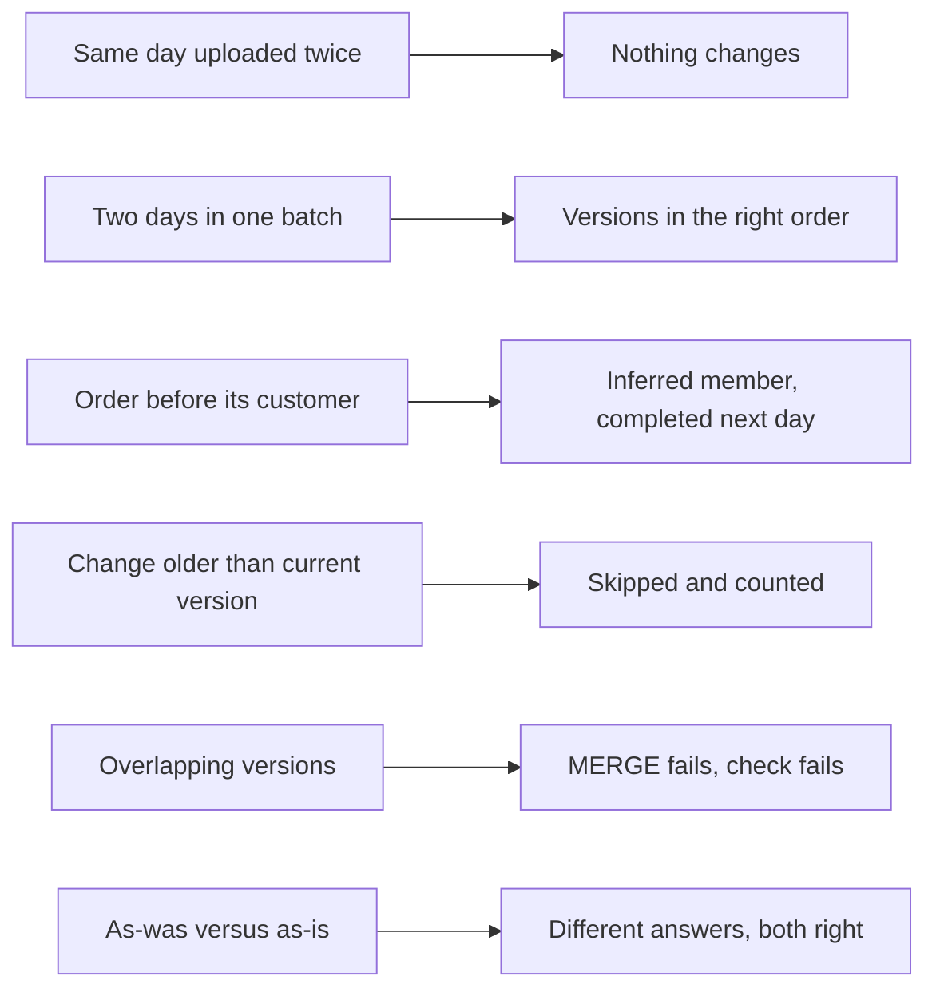

# P06 Failure Drills

Each drill targets one dimensional modeling rule. Predict, run, observe, restore. `tests/data_quality_checks.sql` must pass after each.



## D1 Same Day Uploaded Twice

`./upload_day.sh 2025-03-05` again, then `EXECUTE TASK P06_FOOD.PIPE.LOAD_RAW AWAIT;`.

- **Observe:** `PUT` skips the files (same content, no `OVERWRITE`); `COPY` loads 0 files; `BUILD_CORE` logs 0 orders merged.
- **Lesson:** two independent guards against double loading: the stage and the load metadata.

## D2 Two Days in One Batch

Upload two new days, run the graph once.

- **Observe:** customers changed on both days get two new versions in this run, with `VALID_TO` of the first equal to `VALID_FROM` of the second; orders of the first day resolve to the first version.
- **Lesson:** the SCD2 logic orders versions inside a batch, so the load cadence does not change the history.

## D3 Order Before Its Customer

Every tenth new sign-up arrives a day late. After loading day N, before day N+1:

```sql
SELECT CUSTOMER_SK, CUSTOMER_ID, CITY, IS_INFERRED, VALID_FROM FROM CORE.DIM_CUSTOMER WHERE IS_INFERRED;
SELECT ORDER_ID, CUSTOMER_SK FROM CORE.FACT_ORDER WHERE CUSTOMER_SK IN (SELECT CUSTOMER_SK FROM CORE.DIM_CUSTOMER WHERE IS_INFERRED);
```

Load day N+1 and repeat.

- **Observe:** the same surrogate keys now carry real cities and tiers; the facts did not change.
- **Lesson:** an inferred member is completed in place. Creating a new version instead would leave the early orders pointing at "Unknown" forever.

## D4 A Change Older Than the Current Version

```sql
INSERT INTO RAW.CUSTOMERS (CUSTOMER_ID, FULL_NAME, EMAIL, CITY, LOYALTY_TIER, SIGNUP_DATE, IS_DELETED, UPDATED_AT, SRC_FILE, LOADED_AT)
SELECT CUSTOMER_ID, FULL_NAME, EMAIL, IFF(CITY = 'Odesa', 'Lviv', 'Odesa'), LOYALTY_TIER, SIGNUP_DATE, IS_DELETED, '2025-03-03 00:00:01', 'manual', CURRENT_TIMESTAMP()
FROM CORE.DIM_CUSTOMER WHERE IS_CURRENT AND CUSTOMER_SK > 0 AND VALID_FROM > '2025-03-04' LIMIT 1;
EXECUTE TASK PIPE.LOAD_RAW AWAIT;
```

- **Observe:** the run log reports 1 late customer change skipped; the dimension is unchanged.
- **Discuss:** the alternative is to rebuild the full history of that customer from RAW. When is that worth it?

## D5 Overlapping Versions

```sql
UPDATE CORE.DIM_CUSTOMER SET VALID_TO = DATEADD(day, 2, VALID_TO)
WHERE NOT IS_CURRENT AND CUSTOMER_SK = (SELECT MIN(CUSTOMER_SK) FROM CORE.DIM_CUSTOMER WHERE NOT IS_CURRENT);
```

Upload and load the next day.

- **Observe:** `customer_version_gap_or_overlap` fails; if a new order falls into the overlap, the fact `MERGE` fails as nondeterministic and the whole batch rolls back.
- **Restore:** set `VALID_TO` back to the next version's `VALID_FROM`, rerun the graph.
- **Lesson:** SCD2 integrity is what makes point-in-time joins safe. Check it after every run.

## D6 As-Was Versus As-Is

```sql
SELECT * FROM MART.V_REVENUE_BY_TIER WHERE TIER_AT_ORDER <> TIER_TODAY;
```

- **Observe:** revenue of customers who moved up a tier appears under the old tier "as was" and under the new tier "as is".
- **Lesson:** both are correct answers to different questions. Write down which one finance, marketing, and the loyalty team each need.

## Drill Log Template

| Drill | Prediction | Observed | Lesson in one sentence |
| --- | --- | --- | --- |
| D1 | | | |
| D2 | | | |
| D3 | | | |
| D4 | | | |
| D5 | | | |
| D6 | | | |
