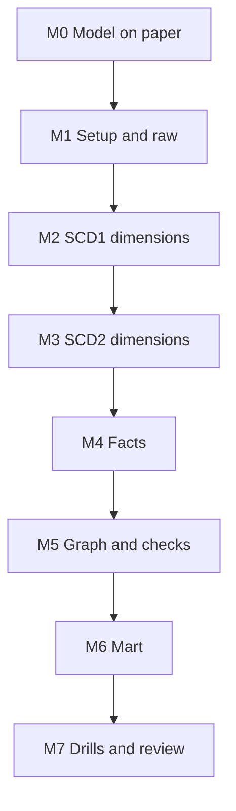

# 7. Build It Yourself

## Brief

A food delivery platform sends one delta extract per day. Design the star schema, decide which attributes keep history, and load it so that last month's numbers never change because a customer moved, every order is counted even when its customer arrives late, and each order shows its full lifecycle. Prove after each load that the model is consistent.

## Rules

| You may use | Only when stuck | Only after the milestone passes |
| --- | --- | --- |
| [01](01_problem.md) to [04](04_alternative_stacks.md), `_shared/`, Snowflake documentation, Kimball techniques | [05](05_snowflake_step_by_step.md) | [06_solution/](06_solution/README.md) |

Use the generator as the source. Design the model yourself before reading [02](02_architecture_decisions.md) in detail.

## Milestones

### M0 Model on Paper
- [ ] Bus matrix: processes (orders, order lines) against dimensions
- [ ] Grain of each fact in one sentence
- [ ] For each dimension attribute: SCD1, SCD2, or not stored, with a reason

### M1 Setup and Raw
- [ ] Raw tables that keep every extracted row with file and load time
- [ ] Loading the same day twice adds nothing

### M2 SCD1 Dimensions
- [ ] Menu items and couriers overwritten in place, only by newer rows

### M3 SCD2 Dimensions
- [ ] One current version per key; no gaps or overlaps
- [ ] Loading two days at once gives the same versions as loading them separately
- [ ] SCD1 attributes of an SCD2 dimension corrected on all versions

**Hint:** `LAG` over the batch, compared with the current version for the first row of each key.

### M4 Facts
- [ ] Order fact resolves dimension versions at order time, once
- [ ] Unfinished orders complete in a later run without a second row
- [ ] Late customers: facts load immediately and show real attributes after the customer arrives
- [ ] Order line fact with the price paid

### M5 Graph and Checks
- [ ] Load and build as a task graph; build in one transaction
- [ ] Integrity checks after every run, also after failed runs

### M6 Mart
- [ ] Daily KPIs per city and cuisine
- [ ] Revenue by loyalty tier as-was and as-is, with a sentence on who needs which

### M7 Drills and Review
- [ ] Drills: duplicate upload, two-day batch, late customer, back-dated change, overlap, as-was versus as-is
- [ ] One page: model diagram, SCD choices per attribute, rejected alternatives
- [ ] Pause or teardown

## Stretch Goals

- **Back-dated changes:** instead of skipping, rebuild the full history of affected keys from RAW and re-point facts.
- **Mini-dimension:** move loyalty tier into a separate mini-dimension referenced directly by the fact.
- **Order status events:** a transaction fact with one row per status change next to the accumulating snapshot; compare queries.
- **dbt version:** snapshots plus incremental models; compare with your SQL.
- **Streamlit:** an operations app on `DT_DAILY_KPI` using the role pattern from P03.

## Portfolio and Interview

**Resume bullet example:** Designed and loaded a star schema for a food delivery platform in Snowflake from daily OLTP extracts, with hash-based SCD2 dimensions, point-in-time fact joins, inferred members for late-arriving customers, an accumulating snapshot order fact, and integrity checks after every load.

**Questions you should be able to answer:**
1. Why do facts store a surrogate key and not the customer id?
2. What happens to an order whose customer arrives a day later, and why is the inferred row updated in place?
3. Why are half-open validity ranges used, and what check proves they are correct?
4. When is an accumulating snapshot better than a transaction fact?
5. A marketing manager asks why revenue by tier differs between two reports. What do you answer?
