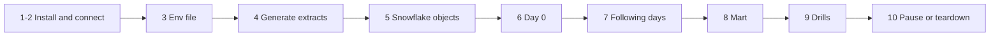

# P06 Quickstart

Numbered commands from an empty laptop to a loaded star schema with SCD2 history and passing integrity checks. Only a Snowflake account is needed. Details: [05_snowflake_step_by_step.md](05_snowflake_step_by_step.md).



### 1. Install

Python 3.12, Snowflake CLI ([setup guide](../../../../shared/environments/setup-guide/01_workstation_macos.md), [Snowflake CLI](../../../../shared/environments/setup-guide/02_cli_tools_and_auth.md#snowflake-cli)).

**Done when:** `snow --version` and `python3.12 --version` work.

### 2. Snowflake trial and connection

[Snowflake account guide](../../../../shared/environments/setup-guide/accounts/snowflake.md); add `[connections.p06]` to `~/.snowflake/config.toml`.

**Done when:** `snow sql -c p06 -q "SELECT CURRENT_USER()"` succeeds.

### 3. Env file

```bash
cd 16-cloud-databases/01-snowflake/end-to-end-projects/P06_food_delivery_dimensional_model/06_solution
cp p06.env.example p06.env      # P06_DATA_DIR: an absolute folder outside the repository
set -a; source p06.env; set +a
mkdir -p "$P06_DATA_DIR"
```

**Done when:** `echo $P06_DATA_DIR` prints an existing folder.

### 4. Generate extracts

```bash
( cd generator && python3.12 -m venv .venv && source .venv/bin/activate && pip install pytest \
  && python -m pytest -q test_food_oltp.py && python food_oltp.py --out "$P06_DATA_DIR" --days 14 )
```

**Done when:** 8 tests pass and 14 `day=` folders exist.

### 5. Snowflake objects

```bash
./run_sql.sh core/00_account_setup.sql core/01_raw.sql core/10_model.sql core/20_build_procedure.sql core/30_task_graph.sql
```

**Done when:** `SHOW TASKS IN SCHEMA P06_FOOD.PIPE` shows three tasks `started`.

### 6. Day 0

```bash
./upload_day.sh 2025-03-03
snow sql -c p06 -q "USE ROLE P06_OWNER; EXECUTE TASK P06_FOOD.PIPE.LOAD_RAW AWAIT"
./run_sql.sh tests/data_quality_checks.sql
```

**Done when:** all checks `PASS`.

### 7. Following days

```bash
for d in 04 05 06 07 08 09 10; do
  ./upload_day.sh 2025-03-$d
  snow sql -c p06 -q "USE ROLE P06_OWNER; EXECUTE TASK P06_FOOD.PIPE.LOAD_RAW AWAIT"
done
./run_sql.sh tests/data_quality_checks.sql
```

**Done when:** checks still `PASS` and customers with more than one version exist.

### 8. Mart

```bash
./run_sql.sh core/40_mart.sql
```

**Done when:** the dashboard tile queries at the end of the script return data.

### 9. Drills

[tests/failure_drills.md](06_solution/tests/failure_drills.md); the remaining days (11 to 16) are for drills D1 and D2.

**Done when:** drill log filled.

### 10. Pause or teardown

```bash
./run_sql.sh core/90_pause.sql
./run_sql.sh teardown.sql        # end of project
```

**Done when:** `SHOW WAREHOUSES LIKE 'P06_%'` returns nothing after teardown.
