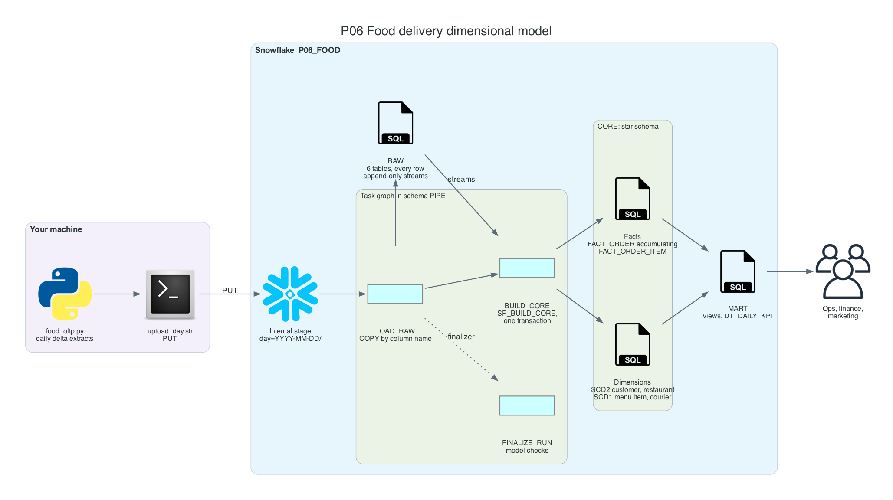
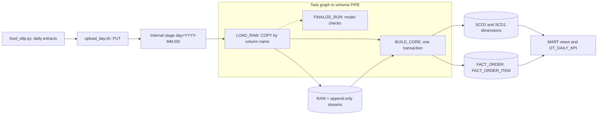

# P06 Food Delivery Dimensional Model

Design and load a star schema for a food delivery platform from daily delta extracts of its operational database. Customers move between cities and loyalty tiers, restaurants change cuisine and price tier, some customers reach the warehouse a day after their first order, and orders stay in progress across extract boundaries. The project builds the dimensional model that answers questions correctly despite all of that: SCD2 dimensions with point-in-time joins, inferred members, an accumulating snapshot fact, and integrity checks after every load.

No cloud account besides Snowflake is needed: a local generator writes the extracts, `PUT` uploads them to an internal stage.

## Target Architecture

Own diagram, generated from [assets/architecture.py](assets/architecture.py). Icons: vendor architecture icon sets bundled with the <a href="https://diagrams.mingrammer.com">diagrams</a> library.

Text version (Mermaid)

### Reference From the Source Article

ProjectPro lists this idea as "Build a Real-Time Data Processing Pipeline for Food Aggregators in Snowflake": OLTP data on orders, restaurants, and deliveries loaded through bronze, silver, and gold layers with delta loads, facts and dimensions, streams and tasks, and a dashboard. P06 keeps that scope and goes deep on the modeling decisions that such a pipeline depends on: which attributes keep history, how facts find the right dimension version, what happens when a fact arrives before its dimension, and how to prove the model is consistent.

Source: ProjectPro, <a href="https://www.projectpro.io/article/snowflake-projects/1168">13 End-to-End Snowflake Projects That Build Job-Ready Skills</a>.

## Skills

| Skill | Milestone |
| --- | --- |
| Reading an OLTP model and choosing grains, facts, and dimensions | M1 |
| `COPY` with `MATCH_BY_COLUMN_NAME` and `INCLUDE_METADATA`; append-only streams | M2 |
| SCD1 and SCD2 in SQL: change detection by hash, versions inside a batch | M3 |
| Point-in-time joins from facts to SCD2 dimensions | M4 |
| Late-arriving dimensions: inferred members completed in place | M4 |
| Accumulating snapshot facts across extracts | M4 |
| Model integrity checks in a finalizer | M5 |
| As-was versus as-is reporting | M6 |

## Prerequisites

- P05 recommended: streams, transactions, and task graphs are used without explanation here
- Snowflake trial and Snowflake CLI: [setup guide](../../../../shared/environments/setup-guide/README.md)
- Python 3.10+ (generator uses the standard library only)
- [Cost guardrails](../_shared/cost_guardrails.md)

## Navigation

| Part | File |
| --- | --- |
| Quickstart: numbered commands from install to teardown | [QUICKSTART.md](QUICKSTART.md) |
| 1. Problem | [01_problem.md](01_problem.md) |
| 2. Architecture and decisions | [02_architecture_decisions.md](02_architecture_decisions.md) |
| 3. Snowflake approach | [03_snowflake_approach.md](03_snowflake_approach.md) |
| 4. Alternative stacks and roadmap | [04_alternative_stacks.md](04_alternative_stacks.md) |
| 5. Step by step on Snowflake | [05_snowflake_step_by_step.md](05_snowflake_step_by_step.md) |
| 6. Solved reference | [06_solution/README.md](06_solution/README.md) |
| 7. Build it yourself | [07_build_it_yourself.md](07_build_it_yourself.md) |

Recommended route: 1, 2, 3, 4, then **7** (build). Use 5 when stuck. Compare with 6 at the end.
