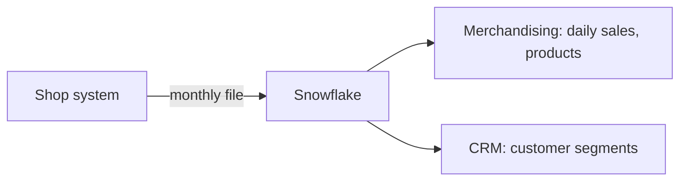

# 1. Problem

## Business Context

A UK online gift retailer sells mostly to wholesalers in 43 countries. Its shop system exports transactions once a month. Merchandising wants daily sales and returns per country and the best and worst products per month. The CRM team wants customer segments from recency, frequency, and monetary value (RFM). The data team writes Python and wants code they can test and review, not a pile of SQL scripts.

## Source Data

[UCI Online Retail II](https://archive.ics.uci.edu/dataset/502/online+retail+ii): one Excel workbook, two sheets, December 2009 to December 2011.

| Column | Meaning | Surprises |
| --- | --- | --- |
| `Invoice` | Invoice number | Starts with `C` for a return, `A` for an accounting adjustment |
| `StockCode` | Product code | `POST`, `DOT`, `M`, `BANK CHARGES`, `AMAZONFEE` and others are not products |
| `Description` | Product name | Free text; stock adjustments use notes like "damaged" |
| `Quantity` | Units | Negative on returns and on stock adjustments |
| `InvoiceDate` | Timestamp | |
| `Price` | Unit price in GBP | Zero on adjustments, negative on accounting adjustments |
| `Customer ID` | Customer number | Missing on about 22% of lines (guest checkouts) |
| `Country` | Customer country | |

Measured on the full dataset while writing this project:

| Fact | Value |
| --- | --- |
| Lines delivered | 1,067,371 |
| Exact duplicate lines | 34,335, of which 23,023 in December 2010, where the two sheets overlap on 1 to 9 December |
| Lines with zero or negative price | 6,014 |
| Return lines | 19,103 |
| Fee and postage lines | 5,669 |
| Accepted lines without customer | 229,200 (about 22%) |
| Customers, countries | 5,942 customers in 43 countries |

## Functional Requirements

1. Monthly files load as delivered; the month is known from the delivery, not guessed.
2. Every distinct line is either accepted or rejected with a reason; nothing disappears.
3. Returns reduce revenue but are not invoices; fees are reported separately from product revenue.
4. Daily sales per country, product results per month, RFM segments for known customers.
5. Reprocessing a month gives the same result; only new or changed months are processed.
6. The transformation logic has unit tests that run without Snowflake.

## Non-Functional Requirements

| Requirement | Target |
| --- | --- |
| Reconciliation | Accepted plus rejected equals distinct raw lines, per month |
| Testability | Transformations covered by local tests in under a few seconds |
| Deployability | One script builds and uploads the code; one SQL file deploys it |
| Compute location | All data processing in Snowflake, from laptop runs too |

## Out of Scope

- Forecasting and ML (P13)
- Product hierarchy enrichment
- Currency conversion (all prices are GBP)
