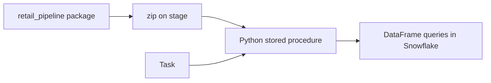
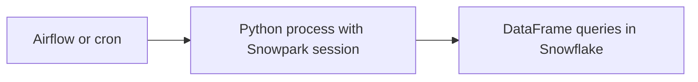
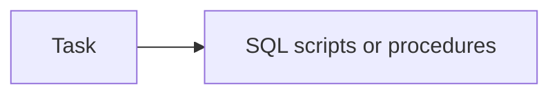
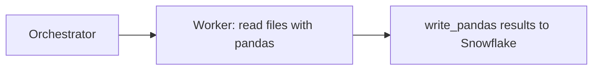

# 2. Architecture and Decisions

## Requirements That Drive the Design

| Driver | Consequence |
| --- | --- |
| Team writes Python and wants tests | Snowpark DataFrames in pure functions; Snowpark local testing |
| Data is large for a laptop, small for Snowflake | Push every transformation down; never collect raw data |
| Monthly deliveries, reprocessing happens | Delete and insert per month, in one transaction, tracked in a status table |
| Dirty data is the norm | Classify every line; reject with a reason instead of filtering silently |
| Must run unattended | Package as a stored procedure, schedule with a task |

## Options

### Option 1: Snowpark package deployed as a stored procedure (chosen)

### Option 2: Snowpark client run from an orchestrator

### Option 3: SQL only

### Option 4: pandas on a worker

## Trade-Offs

| Criterion | 1 Stored procedure | 2 Client | 3 SQL only | 4 pandas |
| --- | --- | --- | --- | --- |
| Where data is processed | Snowflake | Snowflake | Snowflake | Worker memory |
| Where orchestration runs | Snowflake task | External | Snowflake task | External |
| Credentials outside Snowflake | None at run time | Needed by the client | None | Needed by the worker |
| Unit tests without Snowflake | Yes, local testing | Yes, local testing | Hard | Yes |
| Reuse of Python libraries | Anaconda channel packages | Any, but only client-side | No | Any |
| Deployment | Zip plus `CREATE PROCEDURE` | Ship the client | SQL files | Ship the worker |
| Best when | Python team, Snowflake-centric platform | Pipeline spans several systems | SQL team, simple logic | Small data or heavy Python-only libraries |

## Why / Why Not

**Why pure functions that take and return DataFrames?**
They contain no session handling, no table names, and no writes. That makes them testable with a local session and reusable from the client, the procedure, or a notebook.

**Why local testing and not a test Snowflake account?**
Tests run in under a second, need no credentials, cost nothing, and run in CI. The trade-off is coverage: local testing does not implement every function, and some types behave differently (two quirks are documented in [03](03_snowflake_approach.md)). Integration runs against Snowflake still happen, as the first procedure call and the data quality checks.

**Why classify and reject instead of filtering?**
A filter hides data. A reject table with a reason shows what was removed and how much revenue it represents, and lets reconciliation prove that nothing was lost.

**Why deduplicate exact rows per month?**
The two workbook sheets overlap by nine days. Exact duplicates also exist within sheets. Removing identical rows is safe; a line that differs in any field is kept.

**Why delete and insert per month, not `MERGE`?**
The month is the unit of delivery. Replacing it as a whole is simpler than matching lines that have no stable key, and makes reruns exact.

**Why a status table?**
It answers "which months need work?" by comparing load time and processing time, so the scheduled run is cheap when nothing new arrived.

**Why RFM in full each time?**
Scores are relative to all customers and to the reference date. A partial update would rank customers against a stale population.

**Why a warehouse task, not serverless?**
The procedure runs many queries with a predictable shape; an XS warehouse is easy to size and its cost is visible. Serverless is an option to compare.

## Architecture Decision Records

### ADR-001: Transformations as pure Snowpark functions

- **Decision:** `retail_pipeline/transforms.py` has no I/O; `pipeline.py` reads, writes, and controls transactions.
- **Consequences:** fast unit tests; any runner can use the same logic.

### ADR-002: One package, two runners

- **Decision:** the stored procedure handler and `run_local.py` call the same `process_new_months`.
- **Consequences:** the laptop run is a faithful rehearsal of the scheduled run.

### ADR-003: Explicit table definitions

- **Decision:** tables are created in SQL; the pipeline only appends with `column_order="name"`.
- **Consequences:** a renamed DataFrame column fails loudly instead of creating a new table shape.

### ADR-004: Reject with reason

- **Decision:** invalid lines go to `STG.REJECTED_LINE` with one reason each; checks reconcile accepted plus rejected against distinct raw lines.
- **Consequences:** data quality is measurable per month and per reason.

## Failure Modes

| Failure | Detection | Recovery |
| --- | --- | --- |
| Code changed, not redeployed | Behaviour differs from tests | `package.sh`, then `30_procedure.sql` |
| Corrected file with the same name | `PUT` skips it | Upload under a new name; decide the replacement rule |
| Procedure fails mid-month | Error in task history; month status unchanged | Rerun; the month is replaced as a whole |
| Function unsupported in local testing | `NotImplementedError` in pytest | Patch in `conftest.py` or an integration test |
| Client pulls data | Slow `to_pandas`, memory errors | Aggregate in DataFrames first |

## Cost Model

| Component | Driver |
| --- | --- |
| First full run | Several minutes of XS for 25 months |
| Monthly run | Seconds to a minute for one month plus RFM |
| Task with nothing pending | One short warehouse resume (consider a `WHEN` condition as a stretch goal) |
| Storage | About 100 MB compressed |
