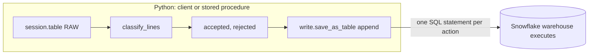

# 3. Snowflake Approach

## Snowpark in One Picture



- A DataFrame is a query plan. Nothing runs until an action: `collect`, `count`, `save_as_table`, `to_pandas`.
- Each action becomes SQL executed on the warehouse. Python only builds the plan, whether it runs on a laptop or inside a procedure.
- `to_pandas` and `collect` move data to Python memory. Use them for results, not for raw data.

## Package Layout

```text
retail_pipeline/
  transforms.py    pure functions: DataFrame in, DataFrame out
  pipeline.py      reads RAW, writes STG and MART, transactions, status, RFM
tests/
  conftest.py      patches for functions local testing does not implement
  test_transforms.py
run_local.py       client runner: File API upload, process from laptop
package.sh         zip and upload for the stored procedure
```

## Classification Rules

| Order | Rule | Result |
| --- | --- | --- |
| 1 | Invoice starts with `A` | Reject `accounting_adjustment` |
| 2 | Price zero or negative | Reject `non_positive_price` |
| 3 | Negative quantity, not a return | Reject `stock_adjustment` |
| 4 | Positive quantity on a return invoice | Reject `positive_quantity_on_return` |
| 5 | Missing date | Reject `missing_date` |
| - | Invoice starts with `C` | Accepted, `IS_RETURN` |
| - | Stock code in the fee list | Accepted, `LINE_TYPE = fee` |
| - | Missing customer | Accepted; excluded from RFM |

The first matching rule wins, so each rejected line has exactly one reason.

## Deployment as a Stored Procedure

```sql
CREATE OR REPLACE PROCEDURE OPS.SP_PROCESS_NEW_MONTHS()
  RETURNS STRING
  LANGUAGE PYTHON
  RUNTIME_VERSION = '3.11'
  PACKAGES = ('snowflake-snowpark-python')
  IMPORTS = ('@OPS.CODE_STAGE/retail_pipeline.zip')
  HANDLER = 'retail_pipeline.pipeline.process_new_months'
  EXECUTE AS OWNER;
```

- `IMPORTS` adds the zip to the Python path; `HANDLER` is module path plus function.
- The handler receives a Snowpark session for the procedure owner; no credentials in code.
- Packages come from the Snowflake Anaconda channel; anything else must be in the zip and pure Python.

## Local Testing: What to Know

```python
Session.builder.config("local_testing", True).create()
```

| Observation in this project | Handling |
| --- | --- |
| `trim` is not implemented | Patched in `tests/conftest.py` with `snowflake.snowpark.mock.patch` |
| A multi-branch `CASE` whose first row is NULL returns JSON-quoted strings | Explicit `.cast("string")` on the whole expression |
| A `CASE` without `otherwise` inside `max` on dates fails to serialize | Explicit `.cast("date")` |
| `session.sql` is not supported | All SQL lives in `pipeline.py`, which is not unit-tested; checks cover it |

The casts are harmless in Snowflake and make types explicit, which is good practice anyway.

## Object Inventory

| Object | Type | Purpose |
| --- | --- | --- |
| `RAW.RETAIL_STAGE`, `RAW.ONLINE_RETAIL` | Stage, table | Monthly files and their rows, with month and file lineage |
| `OPS.CODE_STAGE` | Stage | `retail_pipeline.zip` |
| `OPS.SP_PROCESS_NEW_MONTHS` | Python stored procedure | Pending months, then RFM |
| `OPS.MONTHLY_RUN` | Task on `P07_WH` | `COPY`, then `CALL` |
| `OPS.MONTH_STATUS`, `OPS.RUN_LOG` | Tables | Processing state and history |
| `STG.SALES_LINE`, `STG.REJECTED_LINE` | Tables | Classified lines |
| `MART.DAILY_SALES`, `MART.PRODUCT_MONTHLY`, `MART.CUSTOMER_RFM` | Tables | Outputs |

## What This Project Teaches About Snowflake

- Snowpark is a SQL generator with a Python API; pushdown is the default and must be protected.
- Python stored procedures run packaged code next to the data with the owner's rights.
- Local testing makes transformation code testable like any other Python.
- `COPY` can derive columns from the file path with `METADATA$FILENAME`.
- Transactions work from Python through `session.sql("BEGIN")` and `COMMIT`.
