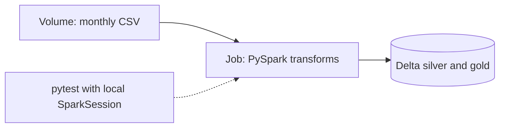
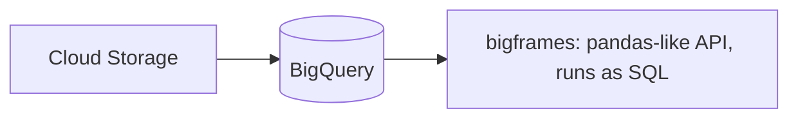
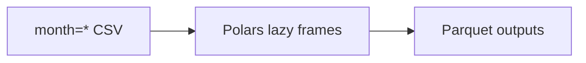
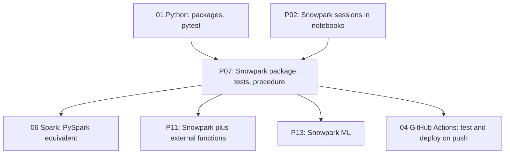

# 4. Alternative Stacks and Roadmap

The problem: a Python team needs tested, deployable transformations over data that is too large to handle comfortably on a laptop.

## Component Mapping

| Concern | Snowflake (this project) | Databricks | BigQuery | Open source |
| --- | --- | --- | --- | --- |
| DataFrame API | Snowpark (lazy SQL) | PySpark (distributed engine) | BigQuery DataFrames (lazy SQL) | Polars, DuckDB Python |
| Run next to the data | Python stored procedure | Job on a cluster or serverless | Remote functions, notebooks | Same machine |
| Local unit tests | Snowpark local testing | Local Spark session | Limited | Native |
| Scheduling | Task | Workflows | Scheduled notebooks, Composer | Airflow, Dagster |
| Packaging | Zip on stage plus Anaconda packages | Wheel on a volume | Python package | Container or wheel |

## Databricks

- PySpark code looks almost identical; local tests use a real local Spark engine instead of an emulator.
- Wins for heavy custom Python (UDFs, ML feature engineering) at scale.

## BigQuery DataFrames

- Same idea as Snowpark: a pandas-like API that compiles to SQL.

## Local Open Source: Polars or DuckDB

- One million lines fits easily on a laptop with Polars or DuckDB. The comparison shows what Snowflake adds: shared governed tables, scheduling, and scale beyond one machine.

## When Each Alternative Wins

| Situation | Better choice |
| --- | --- |
| Python team, data already in Snowflake | Snowpark stored procedures (this project) |
| Pipeline also calls APIs, files, other systems | Snowpark client under an orchestrator |
| Heavy Python UDFs or ML at scale | Databricks |
| Small data, single analyst | Polars or DuckDB |
| Logic is mostly joins and aggregates, team is SQL-first | SQL or dbt |

## Learning Roadmap

| Step | Module | Focus |
| --- | --- | --- |
| Python | [01-python](../../../../01-python/README.md) | Packaging, pytest fixtures |
| Spark | [06-spark-pyspark](../../../../06-spark-pyspark/README.md) | The same transforms in PySpark |
| GitHub Actions | [04-github-actions](../../../../04-github-actions/README.md) | Run tests and `package.sh` in CI |
| Docker | [03-docker](../../../../03-docker/README.md) | Reproducible client runner |

### Suggested Exercise

Port `transforms.py` to PySpark with the same function signatures and run the same test cases against a local SparkSession. Compare: lines changed, test speed, and which behaviours differ (null handling in `CASE`, decimal types).
