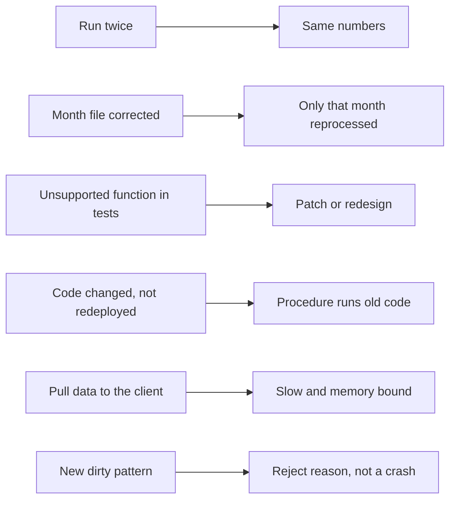

# P07 Failure Drills

Each drill tests one promise of the pipeline: idempotent months, testable code, safe deployment, and visible data quality.



## D1 Run Twice

```sql
CALL OPS.SP_PROCESS_NEW_MONTHS();
```

- **Observe:** "0 months processed"; `MART` unchanged. Then `DELETE FROM OPS.MONTH_STATUS WHERE MONTH = '2011-03';` and call again: only March 2011 is reprocessed and every number is the same as before.
- **Lesson:** delete-and-insert per month makes reruns safe; the status table makes them cheap.

## D2 A Month File Is Corrected

Edit one line of `month=2011-05/online_retail_y2010_2011.csv` locally, then:

```bash
python run_local.py upload    # overwrite=False: the changed file is NOT uploaded
```

- **Observe:** the upload reports the file as skipped.
- **Then:** upload it under a new name, for example `online_retail_y2010_2011_fix1.csv`, run `core/20_load_raw.sql` and the procedure.
- **Observe:** May 2011 is reprocessed; both files are in RAW, so the corrected line and the original are both there. Decide: dedupe by key, or delete the original file's rows first. Write down which you chose and why.

## D3 A Function Local Testing Does Not Support

Add `F.regexp_replace(F.col("DESCRIPTION"), "[^A-Z ]", "")` to `classify_lines` and run `pytest`.

- **Observe:** either a `NotImplementedError` from local testing, or a pass, depending on the Snowpark version.
- **Fix options:** a patch in `tests/conftest.py` (see the `trim` patch), or test that part against a real session in a separate, marked test.
- **Lesson:** local testing is a fast unit test layer, not a full emulator; know which functions your code depends on.

## D4 Code Changed but Not Redeployed

Change the `SEGMENT` labels in `transforms.py`, run `pytest` (passes), then call the procedure without `./package.sh` and `core/30_procedure.sql`.

- **Observe:** RFM segments still have the old labels.
- **Lesson:** a procedure imports a zip from a stage. Deployment is build, upload, recreate. Put it in one script or CI job.

## D5 Pulling Data to the Client

In a Python shell with a session:

```python
import time
t = time.time(); session.table("STG.SALES_LINE").to_pandas(); print("to_pandas", time.time() - t)
t = time.time(); session.table("STG.SALES_LINE").group_by("COUNTRY").count().to_pandas(); print("pushdown", time.time() - t)
```

- **Observe:** about a million rows travel to the laptop in the first case; a few dozen in the second.
- **Lesson:** Snowpark DataFrames are lazy SQL. Keep work in DataFrame operations; collect only results.

## D6 A New Kind of Dirt

Add a line with `QUANTITY = 0` to a month file under a new name and reprocess.

- **Observe:** it is accepted with zero revenue. Is that right? Add a reject reason, a test in `tests/test_transforms.py`, redeploy, rerun the month.
- **Lesson:** cleaning rules are code: tested, versioned, deployed, and visible as reject reasons.

## Drill Log Template

| Drill | Prediction | Observed | Lesson in one sentence |
| --- | --- | --- | --- |
| D1 | | | |
| D2 | | | |
| D3 | | | |
| D4 | | | |
| D5 | | | |
| D6 | | | |
