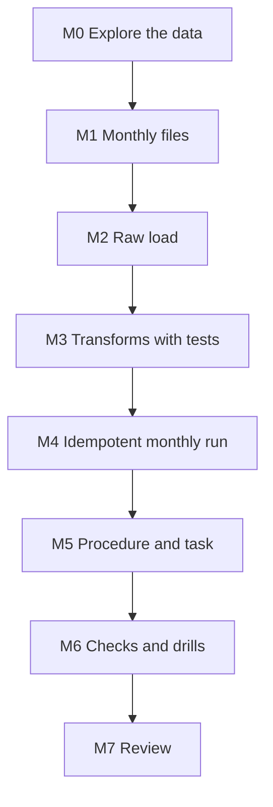

# 7. Build It Yourself

## Brief

A retailer's monthly transaction files are full of returns, adjustments, fees, duplicates, and guest customers. Build a Python pipeline with Snowpark that turns them into daily sales, monthly product results, and customer segments. The transformation code must have unit tests that run without Snowflake, the pipeline must run unattended inside Snowflake, and every delivered line must be accounted for.

## Rules

| You may use | Only when stuck | Only after the milestone passes |
| --- | --- | --- |
| [01](01_problem.md) to [04](04_alternative_stacks.md), `_shared/`, Snowpark documentation, the UCI dataset page | [05](05_snowflake_step_by_step.md) | [06_solution/](06_solution/README.md) |

You may reuse `prepare_months.py`. Write the transformations, tests, pipeline, and deployment yourself.

## Milestones

### M0 Explore the Data
- [ ] A list of every dirty pattern you find, with counts, before writing any rule

### M1 Monthly Files
- [ ] Months split by invoice date; the sheet overlap kept, not hidden

### M2 Raw Load
- [ ] Upload with the Snowpark File API; `COPY` that records file and month

### M3 Transforms With Tests
- [ ] Pure functions: classify, daily sales, product monthly, RFM
- [ ] Local tests for each rule and each aggregate, including returns and fees
- [ ] Every rejected line has exactly one reason

**Hint:** if a local test returns `'"value"'` instead of `'value'`, look at the type of your `CASE` expression.

### M4 Idempotent Monthly Run
- [ ] Rerunning a month gives identical results; only pending months are processed
- [ ] A failure in the middle of a month leaves the previous state

### M5 Procedure and Task
- [ ] The same code runs from the laptop and as a stored procedure
- [ ] A task loads and processes on a schedule

### M6 Checks and Drills
- [ ] Accepted plus rejected equals distinct raw lines per month
- [ ] Drills: rerun, corrected file, unsupported function, stale deployment, client pull, new dirt

### M7 Review
- [ ] One page: package design, test strategy, deployment flow, data quality findings with numbers
- [ ] Pause or teardown

## Stretch Goals

- **CI:** a GitHub Actions workflow that runs the tests and builds the zip on every push.
- **Skip when idle:** a `WHEN` condition or an early return so the scheduled run costs nothing when no month is pending.
- **Snowpark-optimized warehouse or serverless task:** compare runtime and credits for the full run.
- **Market basket:** product pairs bought together, written as a DataFrame self-join.
- **Python worksheet or notebook:** explore the RFM segments interactively with the same package.

## Portfolio and Interview

**Resume bullet example:** Built a Snowpark Python pipeline for 1.07 million real retail transactions with unit-tested DataFrame transformations (Snowpark local testing), idempotent monthly processing, explicit reject reasons with reconciliation, and deployment as a scheduled Python stored procedure.

**Questions you should be able to answer:**
1. Where does the computation happen when you run Snowpark from a laptop?
2. What does Snowpark local testing give you, and what does it not?
3. How does the stored procedure get your code, and what must happen after you change it?
4. Why classify and reject instead of filtering?
5. Why does RFM need a full recompute while daily sales can be replaced per month?
