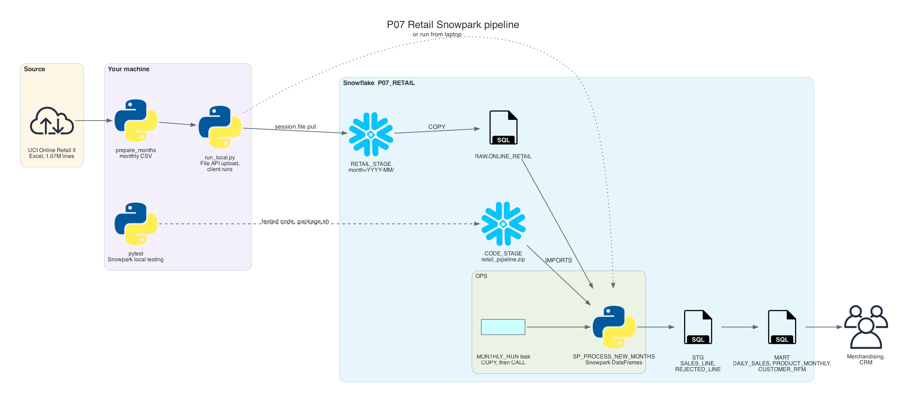
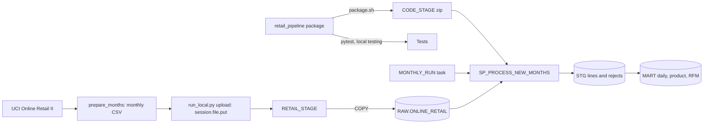

# P07 Retail Snowpark Pipeline

Build a Python data pipeline that runs inside Snowflake. Two years of real online retail transactions (UCI Online Retail II, about 1.07 million lines) arrive as monthly files with everything real data has: duplicates, returns, stock adjustments, postage lines, zero prices, and guest customers. The transformations are written once as Snowpark DataFrame functions, unit-tested on a laptop without a Snowflake account, packaged, deployed as a stored procedure, and scheduled with a task. The same code also runs from the laptop as a client, so you can compare where orchestration lives and where compute happens.

No cloud account besides Snowflake is needed: files go to an internal stage with the Snowpark File API.

## Target Architecture

Own diagram, generated from [assets/architecture.py](assets/architecture.py). Icons: vendor architecture icon sets bundled with the <a href="https://diagrams.mingrammer.com">diagrams</a> library.

Text version (Mermaid)

### Reference From the Source Article

ProjectPro lists this idea as "Build an End-to-End E-Com Sales Data Pipeline Using Snowflake Snowpark": sales order files loaded through internal stages with the Snowpark File API, `COPY` into tables, and DataFrame transformations through several layers. P07 keeps that flow on a real public dataset and adds what makes Python pipelines maintainable: pure transformation functions, local unit tests, packaging and deployment as a stored procedure, idempotent monthly processing, and explicit reject reasons.

Source: ProjectPro, <a href="https://www.projectpro.io/article/snowflake-projects/1168">13 End-to-End Snowflake Projects That Build Job-Ready Skills</a>.

## Skills

| Skill | Milestone |
| --- | --- |
| Converting a real Excel source into monthly deliveries | M1 |
| Snowpark File API upload; `COPY` with values from the file path | M2 |
| Snowpark DataFrames: lazy evaluation, pushdown, conditional aggregates, windows | M3 |
| Unit tests with Snowpark local testing, and patching what it does not support | M3 |
| Idempotent processing per month, transactions from Python | M4 |
| Packaging code, `CREATE PROCEDURE ... IMPORTS`, scheduling with a task | M5 |
| Data quality as reject reasons and reconciliation | M6 |

## Prerequisites

- [01-python](../../../../01-python/README.md): functions, packages, pytest
- Snowflake trial and Snowflake CLI: [setup guide](../../../../shared/environments/setup-guide/README.md)
- Python 3.10 to 3.12 with `snowflake-snowpark-python`, `openpyxl`, `pytest`
- [Cost guardrails](../_shared/cost_guardrails.md): the first full run takes several minutes on XS

## Navigation

| Part | File |
| --- | --- |
| Quickstart: numbered commands from install to teardown | [QUICKSTART.md](QUICKSTART.md) |
| 1. Problem | [01_problem.md](01_problem.md) |
| 2. Architecture and decisions | [02_architecture_decisions.md](02_architecture_decisions.md) |
| 3. Snowflake approach | [03_snowflake_approach.md](03_snowflake_approach.md) |
| 4. Alternative stacks and roadmap | [04_alternative_stacks.md](04_alternative_stacks.md) |
| 5. Step by step on Snowflake | [05_snowflake_step_by_step.md](05_snowflake_step_by_step.md) |
| 6. Solved reference | [06_solution/README.md](06_solution/README.md) |
| 7. Build it yourself | [07_build_it_yourself.md](07_build_it_yourself.md) |

Recommended route: 1, 2, 3, 4, then **7** (build). Use 5 when stuck. Compare with 6 at the end.
