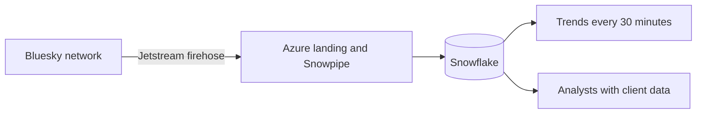

# 1. Problem

## Business Context

A media monitoring company tracks what spreads on social networks for its clients: which posts take off in the last hour, which languages are active, how engagement develops. Bluesky publishes its whole public activity as an open firehose. The company wants it in Snowflake next to client data, with a dashboard that refreshes every 30 minutes and a cost it can explain per gigabyte.



## Source Data

[Jetstream](https://github.com/bluesky-social/jetstream) is a public WebSocket service that turns the Bluesky network's commit stream into JSON. No account or key is needed. A cursor (microseconds since epoch) lets a client resume from a past point.

Measured over 10 seconds while writing this project, filtered to four collections:

| Collection | Creates per second | Deletes per second |
| --- | --- | --- |
| `app.bsky.feed.like` | About 335 | About 5 |
| `app.bsky.feed.repost` | About 58 | About 3 |
| `app.bsky.graph.follow` | About 53 | About 5 |
| `app.bsky.feed.post` | About 50 | About 2 |
| Total | About 510 events per second, about 290 KB per second of JSON | |

That is roughly 44 million events and 25 GB of uncompressed JSON per day; gzip reduces files to about a fifth.

One like (trimmed):

```json
{
  "did": "did:plc:jzfh4uesbwjaeexpl5uglej7",
  "time_us": 1794335859594534,
  "kind": "commit",
  "commit": {
    "rev": "3mzy3js2obq2f", "operation": "create", "collection": "app.bsky.feed.like", "rkey": "3mzy3js2keq2f",
    "record": { "createdAt": "2026-11-10T18:37:39.067Z",
                "subject": { "uri": "at://did:plc:iunzt5sloahxgsq5ci6cvugl/app.bsky.feed.post/3mzxouvj7s227" } }
  }
}
```

A delete carries only the key: `{"operation": "delete", "collection": "app.bsky.feed.like", "rkey": "..."}`. Which post lost a like is only known from the original create.

A restart test while writing this project produced 2,578 duplicates out of 27,904 events (about 9%) from a 5-second cursor rewind.

## Functional Requirements

1. Capture posts, likes, reposts, and follows continuously for bounded sessions.
2. Land compressed files in Azure, partitioned by collection, date, and hour.
3. Load each collection automatically into its own raw table.
4. One typed, deduplicated event table.
5. Per post: likes, reposts, replies, net of deletions; refresh every 30 minutes.
6. Views for top posts of the last hour, activity per minute, language share.
7. Evidence per hour: files, average size, latency per hop, Snowpipe and task credits.

## Non-Functional Requirements

| Requirement | Target |
| --- | --- |
| Completeness | No gap after a producer restart (rewind, then deduplicate) |
| Correctness | No duplicate event keys in `STG.EVENT` |
| Freshness | p95 event to `STG` under 10 minutes; dashboard lag at most 30 minutes |
| Retention | Lake files 30 days (cool after 7); raw tables 3 days; `STG` as long as needed |
| Cost | Snowpipe credits per GB measured and recorded for three batch sizes |

## Out of Scope

- Identity and account events, profile data, images
- Full-text search and sentiment (Cortex functions are a stretch goal)
- Exactly-once delivery from the producer (deduplication in Snowflake is the design)
