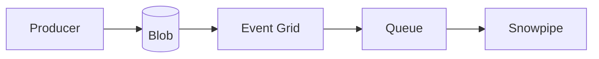
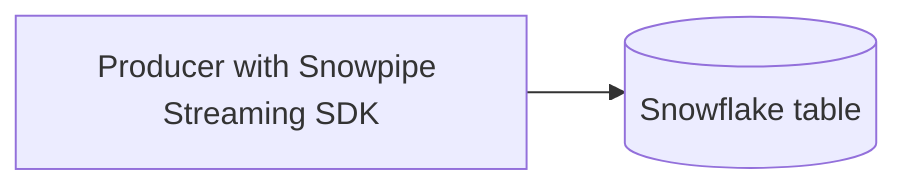
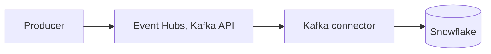
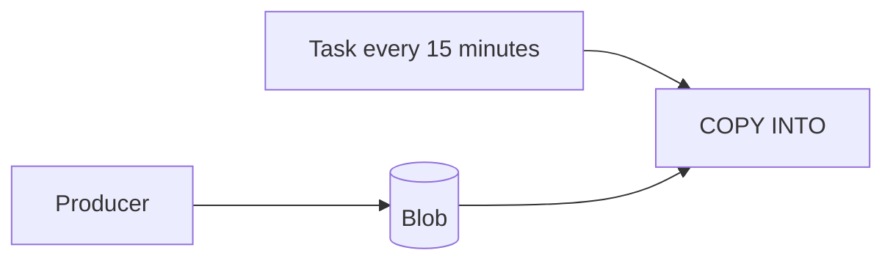

# 2. Architecture and Decisions

## Requirements That Drive the Design

| Driver | Consequence |
| --- | --- |
| 500 events per second, 4 collections with different rates | Batch per collection; one pipe and raw table per collection |
| Per-file overhead in Snowpipe | Batch by count, bytes, and age; measure the trade-off |
| Restarts must not lose events | Cursor checkpoint at the oldest unflushed event, rewind on start |
| Rewind creates duplicates | Deduplicate in Snowflake, within a bounded time window |
| 25 GB per day uncompressed | Transient raw buffer, lake lifecycle, purge |
| Deletes carry only a key | Resolve through the create event |
| Dashboard every 30 minutes | Dynamic table target lag of 30 minutes, not seconds |

## Options

### Option 1: Files on Blob, Event Grid, Snowpipe (chosen)

### Option 2: Snowpipe Streaming from the producer

### Option 3: Event Hubs plus Kafka connector

### Option 4: Scheduled bulk COPY

## Trade-Offs

| Criterion | 1 Blob and Snowpipe | 2 Snowpipe Streaming | 3 Event Hubs and connector | 4 Scheduled COPY |
| --- | --- | --- | --- | --- |
| Latency | Batch seconds plus about a minute | Seconds | Seconds | Schedule |
| Durable copy outside Snowflake | Yes, the lake | No | Event Hubs retention only | Yes |
| Replay after a bug | Reload files | Re-read source, if possible | Within retention | Reload files |
| Moving parts | Storage, Event Grid, queue, pipes | SDK in the producer | Event Hubs, Connect cluster | Storage, task |
| Cost driver | Data volume and file count | Data volume | Event Hubs throughput units plus Connect | Warehouse time |
| Other consumers of the same data | Anything that reads the lake | None | Kafka consumers | Anything that reads the lake |
| Best when | Lake-first, minute latency is fine | Seconds matter, no lake needed | Kafka ecosystem in place | Latency of tens of minutes is fine |

## Why / Why Not

**Why one pipe per collection, not one pipe for everything?**
Likes are two thirds of the volume. Separate pipes give separate raw tables, separate monitoring, and separate pipe pauses; a problem in one collection does not block the others. The cost is four pipe objects instead of one.

**Why one Event Grid subscription and one queue for four pipes?**
Notifications go to every pipe on the integration, and each pipe loads only files under its own path. One subscription and queue means one thing to secure and monitor. Separate queues only help when pipes need isolation at the notification level.

**Why batch by count, bytes, and age together?**
Age bounds latency when traffic is low; bytes and count bound file size when traffic is high. Only age would make huge files at peaks; only count would leave events waiting at quiet times.

**Why checkpoint the oldest unflushed event and rewind on start?**
Events in memory are lost on a crash. Restarting from the oldest event not yet in a file is safe; the rewind adds margin for clock and ordering effects. The price is duplicates, which Snowflake removes.

**Why deduplicate only within two hours?**
Duplicates only come from rewinds of seconds. Checking the whole event table would scan billions of rows at this volume; a time-bounded `NOT EXISTS` reads only recent micro-partitions.

**Why transient raw tables with a purge?**
Raw rows exist in the lake as files. Permanent tables would add fail-safe storage for a copy nobody restores from. `STG.EVENT` stays permanent.

**Why dynamic tables for the mart and a task for staging?**
Staging has custom rules (window dedup, four streams in one statement) that need a task. The mart is pure SQL over staging, where a dynamic table with a 30-minute lag is the least code and refreshes only when needed.

**Why are "last hour" views not dynamic tables?**
Dynamic tables cannot use `CURRENT_TIMESTAMP`; a moving window is a view over the dynamic tables.

## Architecture Decision Records

### ADR-001: Files per collection with three flush triggers

- **Decision:** 60 seconds, 100,000 events, or 64 MB uncompressed, whichever comes first.
- **Consequences:** files of hundreds of KB to a few MB at current rates; latency bounded by about a minute plus Snowpipe.

### ADR-002: Shared notification path, separate pipes

- **Decision:** one Event Grid subscription filtered on `landing/bsky/`, one queue, four pipes.
- **Consequences:** fewer Azure objects; per-collection control in Snowflake.

### ADR-003: Deduplication window of two hours

- **Decision:** event key is `did/collection/rkey/operation/rev`; duplicates are removed within the batch and against the last two hours of `STG.EVENT`.
- **Consequences:** constant cost per run; a duplicate arriving more than two hours late would pass (none are expected from the producer design).

### ADR-004: Retention by layer

- **Decision:** lake 30 days (cool tier after 7), raw 3 days, staging and mart without limit.
- **Consequences:** replay is possible for 30 days by reloading files; storage cost follows value.

## Failure Modes

| Failure | Detection | Recovery |
| --- | --- | --- |
| Producer crash | No new files; cursor file stops changing | Restart; rewind plus dedup |
| Missing notifications | Files in lake, not in `COPY_HISTORY` | `ALTER PIPE ... REFRESH PREFIX = ...` within 7 days |
| Malformed file | `COPY_HISTORY` `Load failed` | Fix or remove the file |
| Staging task fails | Task history; streams keep data | Fix, the next run catches up |
| Jetstream instance down | Producer connection error | `--endpoint` with another public instance, for example `wss://jetstream1.us-west.bsky.network/subscribe`; the cursor works across instances |

## Cost Model

| Component | Driver | How to measure |
| --- | --- | --- |
| Snowpipe | GB loaded and, depending on pricing model, number of files | `PIPE_USAGE_HISTORY` |
| Staging task | Serverless seconds every 5 minutes | `SERVERLESS_TASK_HISTORY` |
| Dynamic tables | `P08_WH` minutes per refresh, twice an hour | `WAREHOUSE_METERING_HISTORY` |
| Storage | Lake GB (Azure), `STG.EVENT` (Snowflake) | Azure cost analysis, `TABLE_STORAGE_METRICS` |

Snowpipe pricing has changed over time; read the current model in the Snowflake documentation before estimating, and record the measured credits per GB from drill D1.
