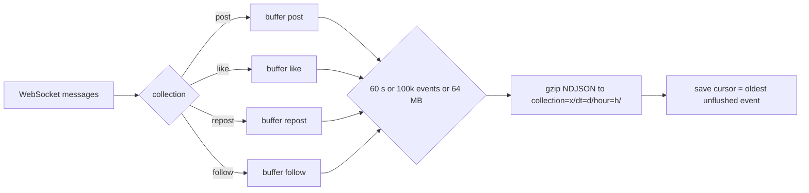
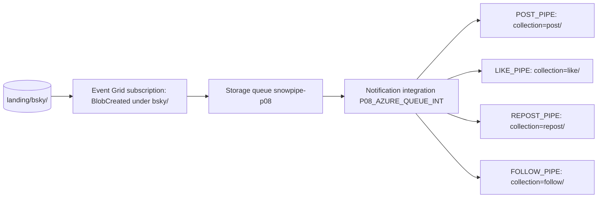
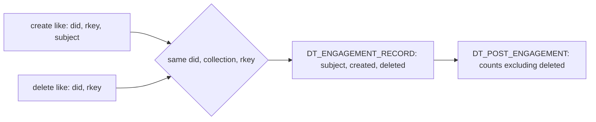

# 3. Snowflake Approach

## From Firehose to Files



The cursor is saved only after files are written. On restart the producer starts from the saved cursor minus 5 seconds, so nothing in memory at the time of a crash is lost, at the cost of a few thousand duplicates.

## One Notification Path, Four Pipes



Each notification is offered to every pipe that uses the integration; a pipe loads the file only if its path matches the pipe's `COPY ... FROM @stage/path/`.

## Staging With a Bounded Deduplication Window

```sql
INSERT INTO STG.EVENT
WITH batch AS (... UNION ALL of the four streams ...),
typed AS (... QUALIFY ROW_NUMBER() OVER (PARTITION BY EVENT_KEY ORDER BY LOADED_AT) = 1)
SELECT t.*, CURRENT_TIMESTAMP()
FROM typed t
WHERE NOT EXISTS (
  SELECT 1 FROM STG.EVENT e
  WHERE e.EVENT_KEY = t.EVENT_KEY
    AND e.EVENT_TIME >= DATEADD(hour, -2, (SELECT MIN(EVENT_TIME) FROM typed))
);
```

- One statement consumes all four streams; offsets advance together.
- The time predicate lets Snowflake prune micro-partitions of `STG.EVENT`, which is loaded roughly in event-time order. Without it the check grows with the table.
- `EVENT_KEY` is `did/collection/rkey/operation/rev`: one commit operation.

## Resolving Deletes



A delete whose create happened before capture started cannot be attributed. The checks count these unresolved deletes; they are expected and should shrink as a share of deletes the longer capture runs.

## Object Inventory

| Object | Type | Purpose |
| --- | --- | --- |
| `P08_AZURE_STORAGE_INT`, `P08_AZURE_QUEUE_INT` | Integrations | Access to the container and the queue, no secrets in Snowflake |
| `RAW.BSKY_STAGE` | External stage | `landing/bsky/` |
| `RAW.<COLLECTION>_PIPE` | Auto-ingest pipes | One per collection |
| `RAW.<COLLECTION>_RAW`, `RAW.<COLLECTION>_STREAM` | Transient tables, append-only streams | Raw buffer, 3 days |
| `PIPE.LOAD_EVENTS`, `PIPE.PURGE_RAW` | Serverless tasks | Staging every 5 minutes, purge daily |
| `STG.EVENT` | Table | Typed, deduplicated events |
| `MART.DT_ENGAGEMENT_RECORD`, `MART.DT_POST`, `MART.DT_POST_ENGAGEMENT` | Dynamic tables | Deletes resolved, engagement, 30-minute lag |
| `MART.V_TOP_POSTS_LAST_HOUR`, `V_ACTIVITY_PER_MINUTE`, `V_LANGUAGE_SHARE` | Views | Dashboard |
| `OPS.V_FILE_PROFILE`, `V_LATENCY_LAST_HOUR`, `V_DEDUP_LAST_DAY` | Views | Evidence |

## Latency Budget

| Hop | Typical | Controlled by |
| --- | --- | --- |
| Event to file | Up to the batch age, 60 s | `--batch-seconds` |
| File to raw | About a minute | Snowpipe, not tunable |
| Raw to `STG` | Up to 5 minutes | Task schedule |
| `STG` to dashboard | Up to 30 minutes | Target lag |

## What This Project Teaches About Snowflake

- Auto-ingest pipes share a notification integration and filter by path.
- File size and count are the cost and latency lever of Snowpipe.
- Transient tables and retention settings are design decisions at volume.
- Deduplication must be bounded to stay cheap as tables grow.
- Dynamic tables fit pure SQL layers with a business-driven freshness target.
