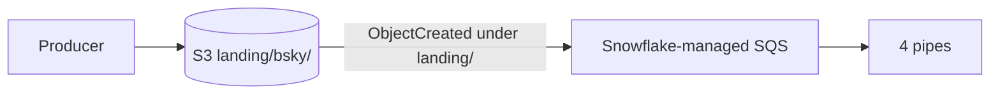
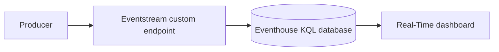
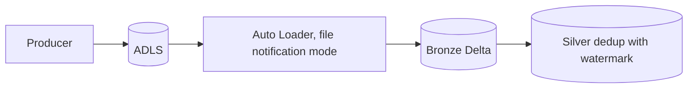
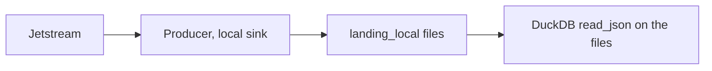
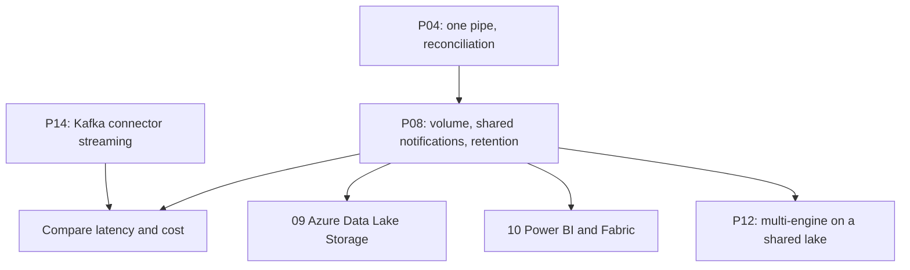

# 4. Alternative Stacks and Roadmap

The problem: continuously land a high-volume public event stream in a governed warehouse with minute-level freshness and a cost you can explain.

## Component Mapping

| Concern | Snowflake on Azure (this project) | Snowflake on AWS | Databricks | Microsoft Fabric |
| --- | --- | --- | --- | --- |
| Landing | Blob Storage (ADLS Gen2) | S3 | ADLS or S3 volume | OneLake |
| Change notification | Event Grid to Storage Queue | S3 events to Snowflake SQS | File notification mode of Auto Loader | Eventstream or shortcuts |
| Continuous load | Snowpipe auto-ingest | Snowpipe auto-ingest | Auto Loader, streaming tables | Eventstream to KQL or Lakehouse |
| Dedup and modelling | Task plus dynamic tables | Same | Lakeflow pipelines | KQL update policies, notebooks |
| Dashboard | Snowsight, Power BI | Same | AI/BI dashboards | Real-Time dashboards, Power BI |

## AWS Variant

- No notification integration: Snowflake owns the SQS queue; the bucket notification points to it. Scripts reuse P04 (see `06_solution/aws/`).

## Microsoft Fabric Real-Time Intelligence

- Seconds of latency and a built-in time-series engine; strong when the team lives in Fabric and Power BI.

## Databricks

- Structured Streaming watermarks implement the same bounded deduplication idea.

## Local Open Source

- `--sink local` and DuckDB give a free way to explore the data and design the dedup and delete logic before any cloud spend.

## When Each Alternative Wins

| Situation | Better choice |
| --- | --- |
| Lake-first, Snowflake as the warehouse, minute latency | Blob or S3 plus Snowpipe (this project) |
| Seconds matter, no need for files | Snowpipe Streaming (see P14) |
| Team on Fabric and Power BI, operational dashboards | Fabric Real-Time Intelligence |
| Heavy stream processing in Python or Scala | Databricks streaming |

## Learning Roadmap

| Step | Module | Focus |
| --- | --- | --- |
| Azure Data Lake Storage | [09-azure-data-lake-storage](../../../../09-azure-data-lake-storage/README.md) | Lifecycle, access tiers, Event Grid |
| Power BI and Fabric | [10-powerbi-fabric](../../../../10-powerbi-fabric/README.md) | Dashboard on the mart; Fabric real-time as an alternative |
| Kafka | [05-confluent-kafka](../../../../05-confluent-kafka/README.md) | The same stream through Kafka |

### Suggested Exercise

Run the producer with `--sink local` for 30 minutes, load the files into DuckDB, and implement the delete resolution and engagement counts there. Then compare row counts with Snowflake for the same window.
