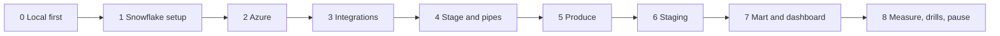

# 5. Step by Step on Snowflake

Every step: **what**, **why**, **verify**, **common errors**. Scripts are in [06_solution](06_solution/README.md).



---

## Phase 0: Local First

```bash
cd producer && python -m pytest -q test_jetstream_producer.py
python jetstream_producer.py --duration-minutes 1 --sink local --local-dir landing_local
```

- **Why:** see the files, sizes, and the cursor file before paying for anything.
- **Verify:** files under `landing_local/bsky/collection=*/dt=*/hour=*/`; `state/cursor.json` exists.

---

## Phase 1: Snowflake Setup

- **What:** `./run_sql.sh core/00_account_setup.sql core/01_schemas_and_raw.sql`.
- **Verify:** four raw tables are `TRANSIENT` in `SHOW TABLES IN SCHEMA P08_SOCIAL.RAW`; four streams with mode `APPEND_ONLY`.

---

## Phase 2: Azure

```bash
set -a; source p08.env; set +a
./azure/01_provision.sh
```

- **Why:** storage with hierarchical namespace, one queue, one Event Grid subscription filtered on `bsky/`, a lifecycle policy.
- **Verify:** `az eventgrid event-subscription list --source-resource-id <storage id>` shows the subject filter.
- **Common errors:** `Microsoft.EventGrid` not registered yet: the script registers it; rerun if the subscription step failed.

---

## Phase 3: Integrations

- **What:** `./run_sql.sh azure/10_integrations.sql`, open both consent URLs, then `./azure/02_grant_snowflake_access.sh <storage app> <queue app>`.
- **Verify:** after a few minutes, `LIST @...` in the next phase works.
- **Common errors:** "not authorized" right after granting: role assignments propagate in minutes.

---

## Phase 4: Stage and Pipes

- **What:** `./run_sql.sh azure/11_stage_and_pipes.sql`.
- **Verify:** `SHOW PIPES IN SCHEMA RAW` lists four pipes with the same `notification_channel` integration.

---

## Phase 5: Produce

```bash
cd producer && python jetstream_producer.py --duration-minutes 15 --sink azure
```

- **Verify:** files appear in the container; `SELECT COUNT(*) FROM P08_SOCIAL.RAW.LIKE_RAW` grows within a couple of minutes.
- **Common errors:** `AuthorizationPermissionMismatch` from the producer: your Blob Data Contributor role has not propagated yet.

---

## Phase 6: Staging

- **What:** `./run_sql.sh core/20_staging.sql`.
- **Verify:** `SELECT COLLECTION, COUNT(*) FROM P08_SOCIAL.STG.EVENT GROUP BY 1` after the first run; `OPS.RUN_LOG` has a row every 5 minutes while producing.

---

## Phase 7: Mart and Dashboard

- **What:** `./run_sql.sh core/30_mart.sql core/40_ops.sql`.
- **Why:** dynamic tables resolve deletes and count engagement; views serve the dashboard; ops views collect evidence.
- **Verify:** `refresh_mode` of each dynamic table (incremental preferred; read `refresh_mode_reason` if full); `SELECT * FROM MART.V_TOP_POSTS_LAST_HOUR` returns posts with links.
- **Dashboard tiles:** top posts last hour, activity per minute by collection, language share, p95 latency per collection.

---

## Phase 8: Measure, Drills, Pause

- `./run_sql.sh tests/data_quality_checks.sql`.
- Work through [tests/failure_drills.md](06_solution/tests/failure_drills.md); D1 is the core measurement of this project.
- Pause after every session: stop the producer, `./run_sql.sh core/90_pause.sql`. Resume: `core/91_resume.sql`.
- Teardown: `./run_sql.sh teardown.sql`, then `az group delete --name "$P08_RG" --yes`.
