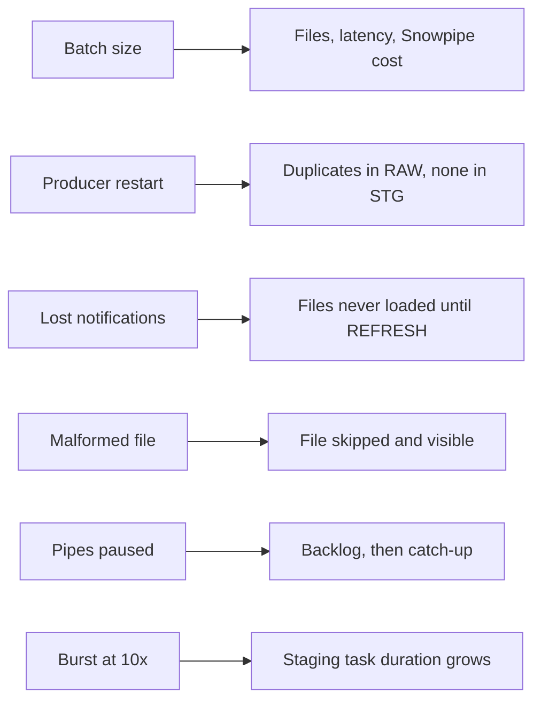

# P08 Failure Drills

Volume changes which mistakes hurt. Each drill measures one of them. Predict, run, read `core/40_ops.sql`, restore.

## D1 Batch Size: Files Versus Latency Versus Cost

Run the producer three times for 10 minutes each, with `--batch-seconds 5`, `60`, and `300`. After each run note from `OPS.V_FILE_PROFILE`, `OPS.V_LATENCY_LAST_HOUR`, and `PIPE_USAGE_HISTORY`:

| Batch seconds | Files per hour | Avg file KB | p95 event to RAW | Snowpipe credits per GB |
| --- | --- | --- | --- | --- |
| 5 | | | | |
| 60 | | | | |
| 300 | | | | |

- **Lesson:** small files buy latency with file count. Snowflake recommends compressed files of roughly 100 to 250 MB for bulk loads; streaming designs trade that away on purpose. Decide where your use case sits, with numbers.

## D2 Producer Restart

Stop the producer with Ctrl+C after 2 minutes, start it again immediately.

- **Observe:** `OPS.V_DEDUP_LAST_DAY` shows more raw rows than staged rows for that hour; `duplicate_event_key_in_stg` stays 0.
- **Try:** set `--rewind-seconds 0` and restart twice. Are events lost? You cannot tell from the data, which is exactly why the default rewinds.

## D3 Lost Notifications

Disable the Event Grid subscription (Azure portal, or delete it), produce for 3 minutes, re-create it with `azure/01_provision.sh` (idempotent parts) or the portal.

- **Observe:** files are in the container but not in `COPY_HISTORY`; `SYSTEM$PIPE_STATUS` shows nothing pending.
- **Recover:** `ALTER PIPE RAW.LIKE_PIPE REFRESH PREFIX = 'collection=like/dt=YYYY-MM-DD/'` for the gap (refresh covers files staged in the last 7 days).
- **Lesson:** auto-ingest is event-driven; missing events mean missing data with no error. Reconcile file listings against `COPY_HISTORY` when anything in the notification path changes.

## D4 Malformed File

Upload a gzip file with one broken JSON line into `landing/bsky/collection=post/dt=.../hour=.../broken.json.gz`.

- **Observe:** `COPY_HISTORY` status `Load failed` with the first error; `files_not_loaded_last_hour` fails; other files keep loading.
- **Lesson:** `ON_ERROR = SKIP_FILE` keeps the pipe healthy and makes the bad file the unit to investigate.

## D5 Pipes Paused While Producing

Run `core/90_pause.sql` while the producer runs, wait 5 minutes, run `core/91_resume.sql`.

- **Observe:** `SYSTEM$PIPE_STATUS` `pendingFileCount` after resume, then latency for the paused window in `OPS.V_LATENCY_LAST_HOUR`.
- **Lesson:** a paused pipe still receives notifications; the refresh in the resume script covers anything missed.

## D6 Burst at Ten Times the Rate

`python jetstream_producer.py --source synthetic --rate 5000 --duration-minutes 5 --sink azure`.

- **Observe:** `TASK_HISTORY` duration of `LOAD_EVENTS`, serverless credits per run, and whether the deduplication window keeps the task duration flat.
- **Try:** remove the time condition from the `NOT EXISTS` in `core/20_staging.sql` and compare durations after a few hours of data.

## Drill Log Template

| Drill | Prediction | Observed | Lesson in one sentence |
| --- | --- | --- | --- |
| D1 | | | |
| D2 | | | |
| D3 | | | |
| D4 | | | |
| D5 | | | |
| D6 | | | |
