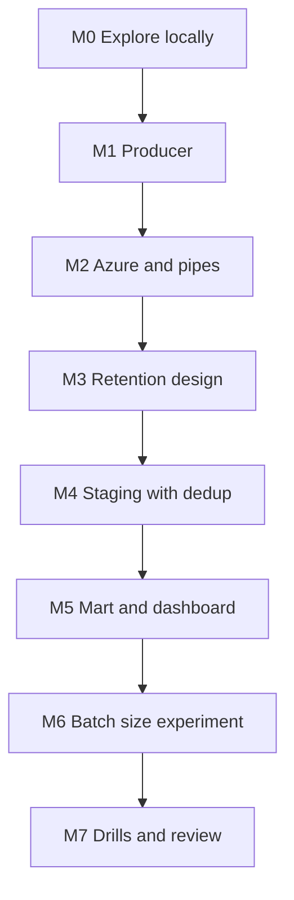

# 7. Build It Yourself

## Brief

A media monitoring company wants the Bluesky firehose in Snowflake on Azure, with a trend dashboard refreshed every 30 minutes, no lost events after restarts, and a cost per gigabyte it can defend. Build the producer, the landing and notification path, the staging logic, and the mart, then prove with measurements which batch size you would run in production.

## Rules

| You may use | Only when stuck | Only after the milestone passes |
| --- | --- | --- |
| [01](01_problem.md) to [04](04_alternative_stacks.md), `_shared/`, P04, Snowflake, Azure, and Jetstream documentation | [05](05_snowflake_step_by_step.md) | [06_solution/](06_solution/README.md) |

You may reuse the P04 sinks. Write the Jetstream client and batching yourself.

## Milestones

### M0 Explore Locally
- [ ] Rates per collection and operation measured over 5 minutes; one example of each event shape saved

### M1 Producer
- [ ] Separate files per collection, partitioned by date and hour
- [ ] Flush by count, bytes, and age; bounded run time
- [ ] Cursor checkpoint that never skips an unflushed event; tests for batching and cursor

**Hint:** which `time_us` is safe to save when four buffers hold events of different ages?

### M2 Azure and Pipes
- [ ] One Event Grid subscription and one queue; four pipes; no secrets in Snowflake

### M3 Retention Design
- [ ] A table: layer, retention, storage type, reason; implemented with lifecycle policy, table type, and purge

### M4 Staging With Dedup
- [ ] One typed event table; zero duplicate keys after a producer restart
- [ ] The dedup cost does not grow with the table

### M5 Mart and Dashboard
- [ ] Engagement per post net of deletes, refreshed every 30 minutes
- [ ] Top posts last hour, activity per minute, language share

### M6 Batch Size Experiment
- [ ] Files per hour, file size, p95 latency, Snowpipe credits per GB for three batch sizes
- [ ] A recommendation with the numbers

### M7 Drills and Review
- [ ] Drills: batch size, restart, lost notifications, malformed file, paused pipes, burst
- [ ] One page: design, rejected alternatives, cost per GB and per day at measured volume
- [ ] Pause after each session; teardown at the end

## Stretch Goals

- **Snowpipe Streaming variant:** write the same events with the Snowpipe Streaming SDK and compare latency and cost with M6.
- **Cortex:** sentiment of English posts with a Cortex function on a sample, and its cost.
- **Search optimization:** look up all engagement for one post URI quickly; measure before and after.
- **Power BI:** the dashboard in Power BI with DirectQuery on the views (prepares P11).
- **Alerts:** a Snowflake alert when p95 latency exceeds 10 minutes.

## Portfolio and Interview

**Resume bullet example:** Built a lake-first ingestion of the Bluesky firehose (about 500 events per second) into Snowflake on Azure with per-collection Snowpipe pipes on a shared Event Grid path, bounded-window deduplication, delete-aware engagement metrics in dynamic tables, layered retention, and a measured batch-size versus latency versus cost trade-off.

**Questions you should be able to answer:**
1. Why do four pipes share one queue, and how does each pipe know which files are its own?
2. How does your producer avoid losing events on a crash, and what does that cost?
3. Why must deduplication be bounded in time at this volume?
4. How do you count likes net of unlikes when an unlike carries no post reference?
5. What happens to data if Event Grid misses notifications, and how would you notice?
