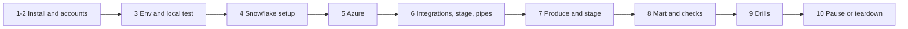

# P08 Quickstart

Numbered commands from an empty laptop to the Bluesky firehose flowing through Azure into a Snowflake trend dashboard. Details: [05_snowflake_step_by_step.md](05_snowflake_step_by_step.md).



### 1. Install

Python 3.12, Snowflake CLI, Azure CLI ([setup guide](../../../../shared/environments/setup-guide/01_workstation_macos.md), [CLI tools](../../../../shared/environments/setup-guide/02_cli_tools_and_auth.md)).

**Done when:** `snow --version`, `az version`, `python3.12 --version` work.

### 2. Accounts

[Snowflake](../../../../shared/environments/setup-guide/accounts/snowflake.md) with `[connections.p08]` in `~/.snowflake/config.toml`, [Azure](../../../../shared/environments/setup-guide/accounts/azure.md) with `az login`. Use the Azure region of your Snowflake account.

**Done when:** `snow sql -c p08 -q "SELECT CURRENT_REGION()"` and `az account show` work.

### 3. Env file and local test

```bash
cd 16-cloud-databases/01-snowflake/end-to-end-projects/P08_social_feed_azure/06_solution
cp p08.env.example p08.env      # set P08_STORAGE_ACCOUNT (globally unique, lowercase)
set -a; source p08.env; set +a
python3.12 -m venv .venv && source .venv/bin/activate && pip install -r producer/requirements.txt
( cd producer && python -m pytest -q test_jetstream_producer.py && python jetstream_producer.py --duration-minutes 1 --sink local )
```

**Done when:** 7 tests pass and `producer/landing_local/bsky/` has files for four collections.

### 4. Snowflake setup

```bash
./run_sql.sh core/00_account_setup.sql core/01_schemas_and_raw.sql
```

**Done when:** `SHOW STREAMS IN SCHEMA P08_SOCIAL.RAW` lists four streams.

### 5. Azure

```bash
./azure/01_provision.sh       # then put AZURE_TENANT_ID into p08.env and source it again
```

**Done when:** the script prints the tenant id and account URL.

### 6. Integrations, stage, pipes

```bash
./run_sql.sh azure/10_integrations.sql        # open both AZURE_CONSENT_URLs, accept
./azure/02_grant_snowflake_access.sh <storage app name> <queue app name>
./run_sql.sh azure/11_stage_and_pipes.sql     # after a few minutes
```

**Done when:** `SHOW PIPES IN SCHEMA P08_SOCIAL.RAW` lists four pipes.

### 7. Produce and stage

```bash
( cd producer && python jetstream_producer.py --duration-minutes 20 --sink azure ) &
./run_sql.sh core/20_staging.sql
```

**Done when:** `SELECT COLLECTION, COUNT(*) FROM P08_SOCIAL.STG.EVENT GROUP BY 1` returns four collections.

### 8. Mart and checks

```bash
./run_sql.sh core/30_mart.sql core/40_ops.sql tests/data_quality_checks.sql
```

**Done when:** checks `PASS` and `MART.V_TOP_POSTS_LAST_HOUR` returns posts.

### 9. Drills

[tests/failure_drills.md](06_solution/tests/failure_drills.md), D1 first.

**Done when:** the batch size table in D1 is filled.

### 10. Pause or teardown

```bash
./run_sql.sh core/90_pause.sql                 # after every session; resume with core/91_resume.sql
./run_sql.sh teardown.sql && az group delete --name "$P08_RG" --yes    # end of project
```

**Done when:** `SHOW INTEGRATIONS LIKE 'P08_%'` is empty and the resource group is gone.
