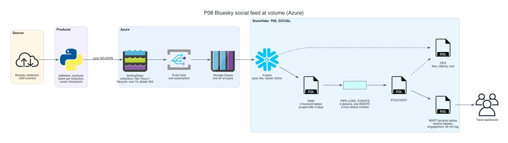
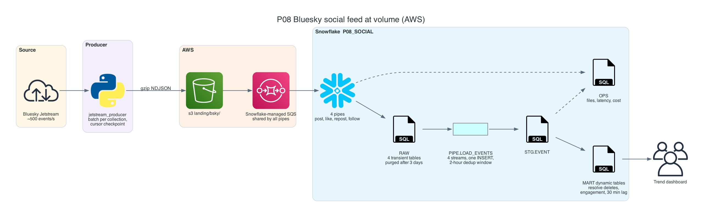
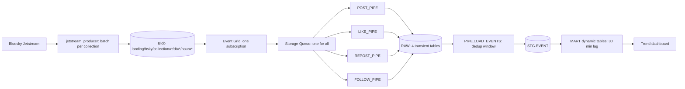

# P08 Social Feed on Azure

Ingest the public Bluesky firehose into Snowflake through Azure Blob Storage and Snowpipe, at a volume where design choices show up on the bill: about 500 events per second, 25 GB of raw JSON per day. A producer writes compressed micro-batches per collection, one Event Grid subscription and one queue feed four pipes, a serverless task deduplicates within a bounded window, and dynamic tables turn likes, reposts, and replies into a trend dashboard refreshed every 30 minutes. Every hop is measured: files, sizes, latency, and credits.

P04 introduced the Azure pattern with one pipe; P08 is about running it at volume.

## Target Architecture

Own diagram, generated from [assets/architecture.py](assets/architecture.py). Icons: vendor architecture icon sets bundled with the <a href="https://diagrams.mingrammer.com">diagrams</a> library.

AWS variant

Own diagram, generated from [assets/architecture.py](assets/architecture.py).

Text version (Mermaid)

### Reference From the Source Article

Source: ProjectPro, <a href="https://www.projectpro.io/article/snowflake-projects/1168">13 End-to-End Snowflake Projects That Build Job-Ready Skills</a>. Linked for personal study, not copied into this repository.

The original collects tweets, likes, retweets, and comments with Python into Azure Blob Storage, loads them with Snowpipe, processes them with streams and tasks, and refreshes a popularity dashboard every 30 minutes. P08 keeps that design on a live open network that can actually be consumed for free, and adds what the volume demands: batching per collection, a shared notification path, bounded deduplication, delete handling, retention, and cost evidence.

## Skills

| Skill | Milestone |
| --- | --- |
| Consuming a WebSocket firehose with a resumable cursor | M1 |
| File sizing: batch by count, bytes, and age; partitioned paths | M1, M6 |
| One Event Grid subscription and one queue for several pipes | M2 |
| Transient raw tables, purge, and lake lifecycle as retention design | M3 |
| Deduplication within a bounded time window | M4 |
| Resolving deletes that carry only a key | M5 |
| Dynamic tables with a business-driven target lag | M5 |
| Measuring files, latency, and Snowpipe credits per GB | M6 |

## Prerequisites

- P04 completed or read: the Azure integration steps are explained there
- Azure subscription ([account guide](../../../../shared/environments/setup-guide/accounts/azure.md)), Azure CLI, Snowflake CLI ([setup guide](../../../../shared/environments/setup-guide/README.md))
- Python 3.10+ with `websockets`, `azure-identity`, `azure-storage-blob`
- [Cost guardrails](../_shared/cost_guardrails.md): the resource monitor does not cover Snowpipe; every producer run is bounded

## Navigation

| Part | File |
| --- | --- |
| Quickstart: numbered commands from install to teardown | [QUICKSTART.md](QUICKSTART.md) |
| 1. Problem | [01_problem.md](01_problem.md) |
| 2. Architecture and decisions | [02_architecture_decisions.md](02_architecture_decisions.md) |
| 3. Snowflake approach | [03_snowflake_approach.md](03_snowflake_approach.md) |
| 4. Alternative stacks and roadmap | [04_alternative_stacks.md](04_alternative_stacks.md) |
| 5. Step by step on Snowflake | [05_snowflake_step_by_step.md](05_snowflake_step_by_step.md) |
| 6. Solved reference | [06_solution/README.md](06_solution/README.md) |
| 7. Build it yourself | [07_build_it_yourself.md](07_build_it_yourself.md) |

Recommended route: 1, 2, 3, 4, then **7** (build). Use 5 when stuck. Compare with 6 at the end.
