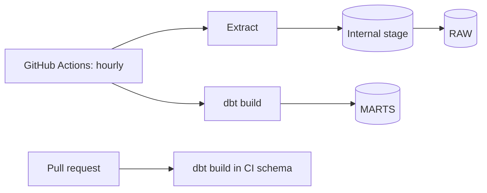
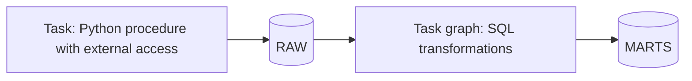
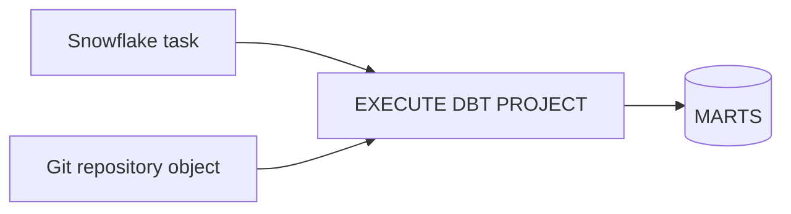
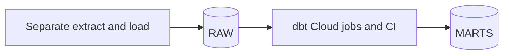

# 2. Architecture and Decisions

## Requirements That Drive the Design

| Driver | Consequence |
| --- | --- |
| Several people change the logic; numbers are quoted publicly | Logic as code in Git, reviewed and tested per pull request (dbt) |
| Re-fetches and overlapping windows | Raw keeps everything; staging picks the latest fetch per candle |
| The exchange may correct a recent candle | Incremental fact re-reads a lookback window on every run |
| Crypto trades 24/7, indexes on business days | Returns per asset over its own observations; correlation only on shared days |
| Missing data is as bad as wrong data | Source freshness, a stale-data alert, and a gap test |
| Automation without passwords | Two service users with key pairs and separate roles |
| Volume is tiny | No streaming, no pipes: an hourly scheduled run is enough |

## Options

### Option 1: dbt Core, GitHub Actions, PUT and COPY (chosen)

### Option 2: Snowflake-only (tasks, procedures, external access)

### Option 3: dbt Projects on Snowflake

### Option 4: dbt Cloud

## Trade-Offs

| Criterion | 1 dbt Core and Actions | 2 Snowflake only | 3 dbt Projects on Snowflake | 4 dbt Cloud |
| --- | --- | --- | --- | --- |
| Tests, docs, lineage | dbt | Hand-written | dbt | dbt plus hosted docs and IDE |
| CI per pull request | Workflow you write | Hard | Workflow you write | Built in, with deferral |
| Where it runs | GitHub runners | Snowflake | Snowflake | dbt Labs |
| Secrets outside Snowflake | Key pair in GitHub | None | Few | Key pair in dbt Cloud |
| Extraction | Same runner | External access integration | Separate | Separate tool |
| Cost | Free runners plus warehouse | Warehouse or serverless | Warehouse | Seat license plus warehouse |
| Portable to another warehouse | Mostly | No | Mostly | Mostly |
| Best when | Small team, open source, full control | One platform, few transformations | Snowflake-centric team that wants dbt | Larger team, governance, IDE for analysts |

## Why / Why Not

**Why dbt instead of the task graphs of P01 and P05?**
The logic is many small SELECTs that depend on each other. dbt builds them in dependency order, tests each model before its children, generates lineage and documentation, and makes environments a schema name. P05 shows what you write by hand when you do not have that.

**Why keep raw responses instead of loading typed rows directly?**
A typed table forgets which request a row came from. With the envelope (`window_start`, `fetched_at`) a wrong number can be traced to one file, and any model can be rebuilt from raw after a logic change.

**Why an incremental fact with a lookback, and why 6 hours?**
A full rebuild of hourly candles is cheap today but grows forever; the incremental merge reads only recent hours. Exchanges occasionally correct the last candles, and the in-progress hour changes until it closes. Six hours covers both with margin. Corrections older than that need a deliberate `--full-refresh`, which is a documented, rare operation.

**Why is the in-progress hour loaded at all?**
The API's `end` is inclusive, so the newest window also returns the candle of the current, unfinished hour. Dropping it would delay the data by an hour; keeping it means its close changes until the hour ends. The lookback makes the next runs overwrite it with the final values, and staging keeps the latest fetch. The large-move alert reads only the last closed hour for the same reason.

**Why returns over observations, not calendar days?**
An S&P 500 return from Friday to Monday is one trading-day return, not three. Filling weekends with zero returns would understate index volatility and distort correlation.

**Why annualize with observations per year from a seed?**
Crypto has 365 observations a year, indexes about 252. The number is reference data and belongs in a reviewed seed, not in a formula.

**Why separate CI and pipeline users and roles?**
CI runs code from any branch. Its role can create and drop its own schemas and read raw data, nothing else. The pipeline user loads files as the owner of RAW and builds production. A malicious or buggy pull request cannot overwrite production.

**Why Snowflake alerts in addition to dbt tests?**
dbt tests run when dbt runs. If the scheduled job stops, no test fails. The stale-data alert runs inside Snowflake on its own schedule, independent of GitHub.

**Why not Snowpipe?**
A few files an hour do not justify a notification path. The scheduled run already knows when files arrive; `COPY` in the same job is simpler and gives the job a clear success or failure.

## Architecture Decision Records

### ADR-001: Layered dbt project with views below marts

- **Decision:** staging and intermediate are views; marts are tables, the hourly fact incremental.
- **Consequences:** no storage for intermediate steps; marts are fast for the dashboard; a view's cost is paid by the mart build that reads it.

### ADR-002: Incremental merge with a 6-hour lookback

- **Decision:** `unique_key = [product_id, candle_start]`, `merge`, re-read `max(candle_start) - 6 hours`, plus one hour to compute the first return.
- **Consequences:** constant cost per run; late corrections inside 6 hours are applied automatically; older ones need a full refresh.

### ADR-003: Environments are schemas

- **Decision:** `generate_schema_name` builds `MARTS` in prod, `DEV_<user>_MARTS` in dev, `CI_PR_<n>_MARTS` in CI; CI schemas are dropped after each run.
- **Consequences:** one database, cheap environments; requires the cleanup macro and the CI role limited to schemas it creates.

### ADR-004: Contract on the hourly fact only

- **Decision:** `contract: enforced` on `fct_crypto_hourly`, the table the alerts and the dashboard read.
- **Consequences:** explicit casts in the model; column changes need a YAML change in the same pull request.

### ADR-005: Failures are stored

- **Decision:** `store_failures` for all data tests in schema `TEST_FAILURES`.
- **Consequences:** after a failure the offending rows can be queried; a few small tables per build.

## Failure Modes

| Failure | Detection | Recovery |
| --- | --- | --- |
| Scheduled job stops | Freshness warn after 2 h, error after 6 h; stale alert after 3 h | Fix the job; the next run re-reads 2 days |
| Coinbase API error or rate limit | Extract step fails; retries with backoff first | Next run fills the gap |
| Exchange corrects an old candle | DQ check: staging differs from fact | `dbt build -s fct_crypto_hourly --full-refresh` |
| Bad logic in a pull request | CI build fails, children skipped | Fix before merge |
| Contract change | Build fails before writing | Update `_marts.yml` in the same pull request |
| FRED revises history | Next daily fetch wins in staging | Nothing to do |
| CI schemas left behind | DQ check lists `CI_` schemas | `dbt run-operation drop_ci_schemas` |

## Cost Model

| Component | Driver | How to measure |
| --- | --- | --- |
| Hourly run | XS warehouse: COPY plus dbt build, about a minute, 24 times a day | `WAREHOUSE_METERING_HISTORY`, `QUERY_HISTORY` by `QUERY_TAG` or user |
| CI | One build per pull request push | Same, filtered on `P09_CI_SVC` |
| Alerts | Two condition queries an hour on `P09_WH` | `ALERT_HISTORY`, warehouse metering |
| Storage | Raw JSON and CSV, megabytes | `TABLE_STORAGE_METRICS` |
| GitHub Actions | Free minutes for public repositories; metered for private ones | Repository billing page |

The warehouse bills a minimum of 60 seconds each time it resumes. If the alerts ran on their own interval, 24 runs and 24 alert checks a day could mean 48 resumes. The alerts use `USING CRON 25 * * * * UTC`, 15 minutes after the job starts, so they usually find the warehouse still running or resume it once per hour.
