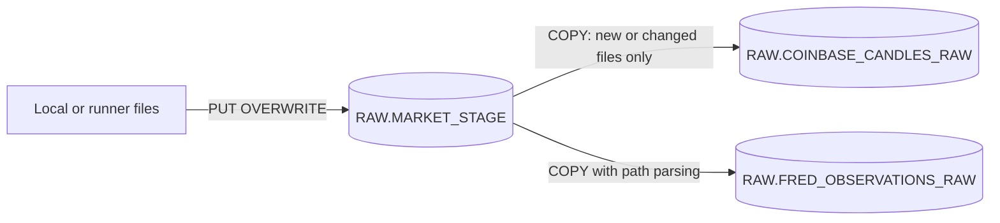
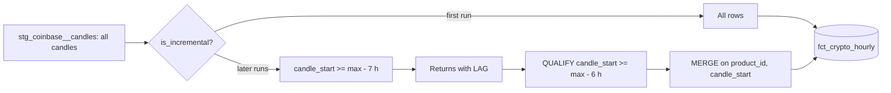
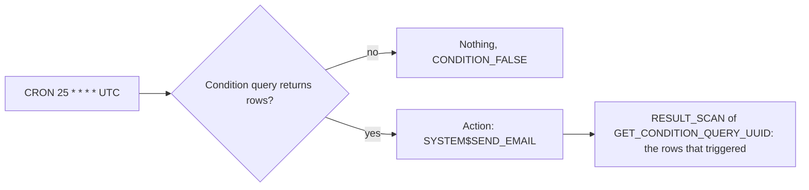

# 3. Snowflake Approach

Snowflake is the database and the compute for every transformation; dbt only generates SQL and decides the order. Seeing which Snowflake features dbt uses underneath is the point of this part.

## Load: Stage, COPY, and Load Metadata

- `COPY INTO` remembers loaded files for 64 days by name and checksum. Re-running it loads nothing new; a re-uploaded file with new content (the current window fetched again an hour later) loads again because its checksum changed.
- `METADATA$FILENAME` and `METADATA$START_SCAN_TIME` become `SRC_FILE` and `LOADED_AT`, so lineage reaches the file.
- The FRED series id is parsed from the path with `REGEXP_SUBSTR(..., 'series=([A-Z0-9]+)', 1, 1, 'e')`; the CSV itself only has the id in its header.
- `ON_ERROR = SKIP_FILE` makes the file the unit of failure, visible in `COPY_HISTORY`.

## What dbt Generates

| dbt construct | Snowflake statement underneath |
| --- | --- |
| View model | `CREATE OR REPLACE VIEW ... AS SELECT` |
| Table model | `CREATE OR REPLACE TABLE ... AS SELECT`, swapped atomically |
| Incremental, `merge` | `CREATE TEMPORARY VIEW` of new rows, then `MERGE INTO ... USING ... ON product_id AND candle_start` |
| Contract enforced | `CREATE TABLE` with explicit column types first, then `INSERT`; type mismatches fail before data changes |
| `+grants` | `GRANT SELECT ON ... TO ROLE P09_READER` after each build |
| Seed | `CREATE TABLE` plus batched `INSERT` |
| Data test | A `SELECT` that returns failing rows; with `store_failures` a table in `TEST_FAILURES` |
| Unit test | A query over fixed input rows (CTEs), compared with expected rows; no real tables read |
| Source freshness | `SELECT MAX(LOADED_AT)` per source table |

Reading the compiled SQL in `target/run/` once is the fastest way to stop thinking of dbt as magic.

## The Incremental Fact

The extra hour is read but not written: it provides the previous close for the first return. Without it, the first row of every incremental batch would have a null return.

## Daily Prices Across Two Calendars

| Asset | Daily price | Observations per year | Return between |
| --- | --- | --- | --- |
| BTC, ETH, SOL | Close of the last hourly candle of the UTC day, complete days only | 365 | Consecutive calendar days |
| SPX, NDQ | FRED official close | about 252 | Consecutive trading days |
| USD_BROAD (broad dollar index) | FRED daily value | about 252 | Consecutive business days |

`int_asset_daily_prices` unions both sources into one shape; `fct_asset_daily` computes simple and log returns per asset with `LAG` over that asset's own rows. The correlation mart joins crypto and SPX returns on date, so only days where both exist count.

## Window Functions: What Snowflake Does Not Support

Snowflake has no named `WINDOW` clause (`WINDOW w AS (...)`). Each window is written inline. A frame like `rows between 29 preceding and current row` is supported for `STDDEV_SAMP`, `CORR`, and `COUNT`. The `QUALIFY observations_in_window = 30` filter removes the warm-up rows where the window is not yet full.

## Alerts

- An alert needs a warehouse (or runs serverless when `WAREHOUSE` is omitted), the `EXECUTE ALERT` privilege, and an email notification integration whose recipients are verified users of the account.
- `SNOWFLAKE.ALERT.GET_CONDITION_QUERY_UUID()` lets the action read exactly the rows that made the condition true, so the email lists the moves instead of saying "something happened".

## Security Model

| Principal | Role | Can | Cannot |
| --- | --- | --- | --- |
| You | P09_OWNER, P09_TRANSFORMER | Everything in P09 | Account administration |
| P09_PIPELINE_SVC | P09_OWNER, P09_TRANSFORMER | PUT, COPY, build production | Create users or integrations |
| P09_CI_SVC | P09_TRANSFORMER | Read RAW, create and drop its own schemas | Write RAW, touch alerts, load files |
| Dashboard | P09_READER | Read MARTS | Read RAW or staging |

Both service users are `TYPE = SERVICE`: no password, no MFA prompts, key-pair authentication only. The private keys exist only as GitHub secrets.

## Object Inventory

| Object | Purpose |
| --- | --- |
| `P09_MARKETS.RAW.MARKET_STAGE`, `FF_JSON`, `FF_CSV` | Landing for extracted files |
| `RAW.COINBASE_CANDLES_RAW`, `RAW.FRED_OBSERVATIONS_RAW` | As delivered, with file and load time |
| `STAGING.*`, `INTERMEDIATE.*` (views) | Typed, deduplicated, rolled up |
| `MARTS.FCT_CRYPTO_HOURLY` (incremental, contract), `FCT_ASSET_DAILY`, `MART_VOLATILITY_30`, `MART_CORRELATION_SPX_60` | Consumer tables |
| `REFERENCE.ASSETS` (seed) | Asset list, sources, observations per year |
| `TEST_FAILURES.*` | Rows of failed tests |
| `OPS.ALERT_STALE_PRICES`, `OPS.ALERT_LARGE_MOVE`, `P09_EMAIL_INT` | Alerts and notification |
| `P09_CI_SVC`, `P09_PIPELINE_SVC` | Service users |

## What This Project Teaches About Snowflake

- Load metadata makes `COPY` idempotent; re-uploading changed files is how a moving window gets refreshed
- `MERGE` is the engine of incremental models; its cost depends on how much of the target it has to scan
- Schemas are cheap enough to be environments, as long as something drops them
- Alerts give monitoring that does not depend on the orchestrator being alive
