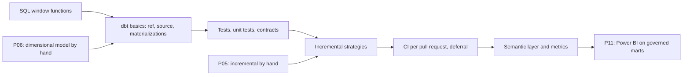

# 4. Alternative Stacks and Roadmap

The same problem without Snowflake, or with Snowflake but without dbt Core and GitHub Actions. The shape stays the same: land raw, model in layers, test, ship per pull request, alert on missing data.

## Component Mapping

| Concern | P09 | Databricks | Microsoft Fabric | BigQuery | Local open source |
| --- | --- | --- | --- | --- | --- |
| Landing | Internal stage, `COPY` | Volume, Auto Loader or `COPY INTO` | OneLake Files, pipeline copy | GCS, load job | Local files |
| Transformation | dbt Core on Snowflake | dbt on Databricks, or Lakeflow Declarative Pipelines | dbt on Fabric Warehouse, or notebooks | dbt on BigQuery, or Dataform | dbt with DuckDB |
| Incremental | `merge` with lookback | `merge` on Delta | `merge` (warehouse) | `merge` or `insert_overwrite` by partition | `delete+insert` or `merge` |
| Environments | Schemas per user and PR | Catalogs or schemas | Workspaces | Datasets | Files per branch |
| Scheduling | GitHub Actions | Lakeflow Jobs | Fabric pipelines | Cloud Scheduler, Workflows | cron |
| Alerts | Snowflake alerts | SQL alerts | Activator | Cloud Monitoring | A test that exits non-zero |

## dbt Projects on Snowflake

Snowflake can run a dbt project natively: the project lives in a Git repository object or a workspace, `EXECUTE DBT PROJECT` runs it, and a task schedules it. Extraction still needs an external access integration or a separate job. It removes the GitHub runner and the profile secrets from the production path; CI per pull request still needs a workflow.

## dbt Cloud

Hosted scheduler, IDE, documentation, and CI with deferral to production (`--defer --state`), so a pull request builds only changed models and reads unchanged parents from production. Worth it when many people develop and the license costs less than the time spent maintaining workflows.

## Databricks

Land files in a Unity Catalog volume, load with Auto Loader into Delta bronze tables, model silver and gold with dbt-databricks or with Lakeflow Declarative Pipelines, where expectations replace dbt tests. Jobs schedule everything; SQL alerts replace Snowflake alerts.

## Local Open Source

dbt with DuckDB runs this whole project on a laptop in seconds: `read_json` over the extracted files as sources, the same models with small dialect changes (`QUALIFY` and `MIN_BY` exist in DuckDB). It is the cheapest way to learn dbt; it lacks roles, concurrency, and a shared production.

## When Each Alternative Wins

| Situation | Choice |
| --- | --- |
| Small team, open source preferred, Snowflake already there | P09 as built |
| Snowflake-only governance, no external runners | dbt Projects on Snowflake plus tasks |
| Many analysts, review and docs as a service | dbt Cloud |
| Lakehouse with Spark workloads next to SQL | Databricks with dbt or declarative pipelines |
| Learning dbt with zero cost | dbt with DuckDB |

## Learning Roadmap

| Step | Where in this repository |
| --- | --- |
| dbt fundamentals | [12-dbt](../../../../12-dbt/README.md) |
| Window functions | [02-sql](../../../../02-sql/README.md) |
| GitHub Actions | [04-github-actions](../../../../04-github-actions/README.md) |
| Orchestration with Airflow (next) | P10, [11-airflow](../../../../11-airflow/README.md) |

### Suggested Exercise

Port the staging and mart models to dbt with DuckDB, reading the same extracted files. List every dialect change you needed. That list is your answer to "how portable is dbt really?".
