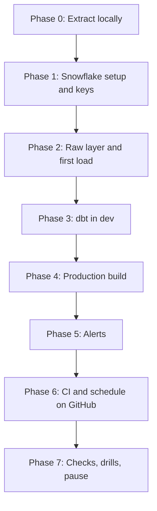

# 5. Step by Step on Snowflake

Use this when stuck in [07](07_build_it_yourself.md). Commands run from `06_solution/` unless stated otherwise. The short version is [QUICKSTART.md](QUICKSTART.md).



## Phase 0: Extract Locally

```bash
python -m pytest -q extract/test_extract_markets.py
python extract/extract_markets.py --out "$P09_DATA_DIR" --days 120
```

- 120 days on the first run: the volatility mart needs 31 complete days per asset, the correlation mart 61 shared trading days with the S&P 500, which is about 90 calendar days.
- Look at one Coinbase file: candles are newest first, and the first candle of a window equals the last of the previous one.

## Phase 1: Snowflake Setup and Keys

Create three key pairs: one for you (dbt dev), one for CI, one for the scheduled pipeline.

```bash
mkdir -p ~/.snowflake/keys && cd ~/.snowflake/keys
for k in p09_dev p09_ci p09_pipeline; do
  openssl genrsa 2048 | openssl pkcs8 -topk8 -inform PEM -out "$k.p8" -nocrypt
  openssl rsa -in "$k.p8" -pubout -out "$k.pub"
done
chmod 600 *.p8
```

```bash
./run_sql.sh core/00_account_setup.sql core/05_service_users.sql
```

Then register your own key: `ALTER USER <you> SET RSA_PUBLIC_KEY = '<body of p09_dev.pub>'`. Verify your email in Snowsight (profile, email) before Phase 5: alert emails go only to verified addresses of account users.

## Phase 2: Raw Layer and First Load

```bash
./run_sql.sh core/01_raw.sql
./upload.sh
./run_sql.sh core/20_load.sql
```

Run `20_load.sql` a second time: both `COPY` statements report 0 files. That is load metadata at work.

## Phase 3: dbt in Dev

```bash
cp dbt/profiles.yml.example ~/.dbt/profiles.yml
cd dbt/p09_markets
dbt debug
dbt deps
dbt build --target dev
```

- Your schemas are `DEV_<USER>_STAGING`, `DEV_<USER>_MARTS`, and so on (`macros/generate_schema_name.sql`).
- Read `target/run/p09_markets/models/marts/fct_crypto_hourly.sql` after a second `dbt build -s fct_crypto_hourly`: it is a `MERGE`.
- `dbt test -s test_type:unit` runs only the unit test; it reads no tables.
- If `dbt deps` fails with an SSL error behind a corporate proxy, point `REQUESTS_CA_BUNDLE` to your proxy's CA bundle; do not disable verification.

## Phase 4: Production Build

```bash
dbt seed --target prod && dbt build --target prod
dbt source freshness --target prod
```

The `on-run-end` hook grants `USAGE` on `MARTS` to `P09_READER`; model grants give `SELECT`.

## Phase 5: Alerts

```bash
cd ../.. && ./run_sql.sh core/30_alerts.sql
```

Test without waiting: `EXECUTE ALERT P09_MARKETS.OPS.ALERT_STALE_PRICES;` then check `INFORMATION_SCHEMA.ALERT_HISTORY`. To force an email, temporarily change the condition to `> DATEADD(hour, -3, SYSDATE())`.

## Phase 6: CI and Schedule on GitHub

1. Copy the project into your own repository (or fork this one) and the two files from `06_solution/ci/` into `.github/workflows/`; adjust `P09_DIR` and the `paths` filter.
2. Add repository secrets `SNOWFLAKE_ACCOUNT`, `SNOWFLAKE_CI_PRIVATE_KEY` (content of `p09_ci.p8`), `SNOWFLAKE_PIPELINE_PRIVATE_KEY` (content of `p09_pipeline.p8`).
3. Open a pull request that changes a model. The workflow builds into `CI_PR_<n>_*` and drops those schemas at the end.
4. Run the scheduled workflow once with "Run workflow" (it also fetches FRED on manual runs), then let the cron take over.

## Phase 7: Checks, Drills, Pause

```bash
./run_sql.sh tests/data_quality_checks.sql
```

Then [tests/failure_drills.md](06_solution/tests/failure_drills.md). After each session: `./run_sql.sh core/90_pause.sql` and disable the scheduled workflow in GitHub.
