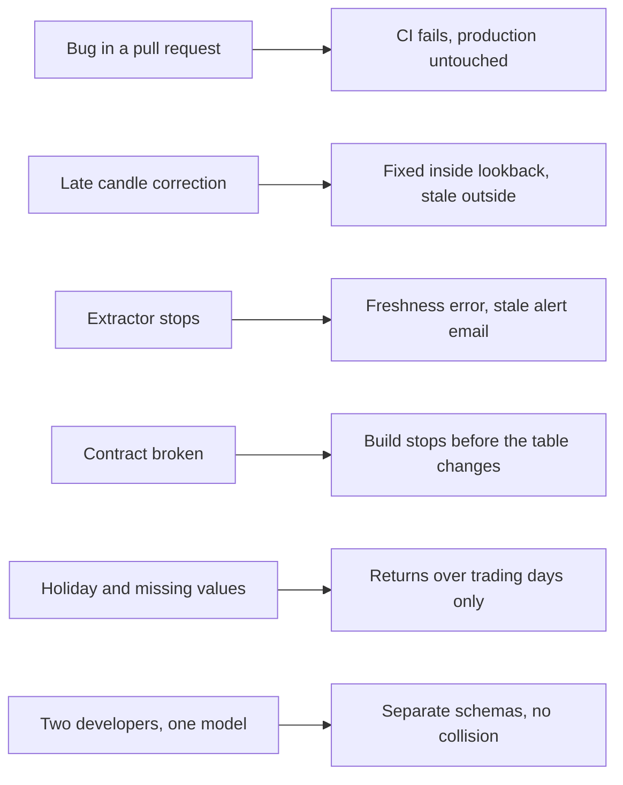

# P09 Failure Drills

In a dbt project most failures are changes, not outages. Each drill breaks one thing on purpose. Predict what stops it, run it, then restore.



## D1 A Bug Reaches a Pull Request

On a branch, change `stg_coinbase__candles.sql` so `low_price` reads `c.value[2]` (the high) instead of `c.value[1]`. Open a pull request.

- **Predict:** which test fails first, and which models are skipped because of it.
- **Observe:** the `expression_is_true` test on staging fails; `dbt build` skips every child of the failed model; `MARTS` in production still has yesterday's correct data.
- **Lesson:** `dbt build` tests a model before its children run. CI in an isolated schema is what makes a red build harmless.

## D2 A Corrected Candle Arrives Late

Simulate an exchange correction: as `P09_OWNER`, insert a raw response fetched now that raises the close and high of one hour by 0.2 percent. Start with the hour 3 hours ago, run `dbt build --target prod -s +fct_crypto_hourly`, then repeat with `-30`.

```sql
INSERT INTO P09_MARKETS.RAW.COINBASE_CANDLES_RAW (PAYLOAD, SRC_FILE, LOADED_AT)
SELECT OBJECT_CONSTRUCT(
         'product', PRODUCT_ID, 'granularity', 3600, 'fetched_at', CURRENT_TIMESTAMP()::STRING,
         'candles', ARRAY_CONSTRUCT(ARRAY_CONSTRUCT(
             DATE_PART(epoch_second, CANDLE_START), LOW_PRICE, HIGH_PRICE * 1.002, OPEN_PRICE, CLOSE_PRICE * 1.002, BASE_VOLUME))),
       'drill/d2.json', CURRENT_TIMESTAMP()
FROM P09_MARKETS.MARTS.FCT_CRYPTO_HOURLY
WHERE PRODUCT_ID = 'BTC-USD'
  AND CANDLE_START = DATEADD(hour, -3, DATE_TRUNC(hour, SYSDATE()));   -- then -30
```

- **Observe:** the 3-hour-old correction reaches `fct_crypto_hourly` (inside `incremental_lookback_hours: 6`); the 30-hour-old one stays only in staging, and DQ check 7 lists it.
- **Recover:** `DELETE FROM P09_MARKETS.RAW.COINBASE_CANDLES_RAW WHERE SRC_FILE = 'drill/d2.json'`, then `dbt build --target prod -s +fct_crypto_hourly --full-refresh`. Do the drill in production only if nobody else uses it; otherwise point the insert at a copy of the database (`CREATE DATABASE P09_DRILL CLONE P09_MARKETS`).
- **Lesson:** the lookback is a contract with the source: "corrections older than N hours are ignored until a full refresh". Choose N from how late the source really corrects, and know what a full refresh costs.

## D3 The Extractor Stops

Disable the scheduled workflow for 4 hours (or skip runs locally).

- **Observe:** `dbt source freshness` warns after 2 hours and errors after 6 on `coinbase_candles_raw`; `OPS.ALERT_STALE_PRICES` sends an email after 3 hours; the `assert_no_long_hourly_gaps` test does not fail until data arrives again, because the gap only exists once a later candle exists.
- **Recover:** enable the workflow. One run with `--days 2` fills the gap, because the extractor always re-reads a window.
- **Lesson:** tests check the data you have; freshness and alerts check the data you do not have. A pipeline needs both.

## D4 The Contract Breaks

In `fct_crypto_hourly.sql` remove the `::number(38, 8)` cast on `close_price` (or rename a column). Run `dbt build --target dev -s fct_crypto_hourly`.

- **Observe:** the build fails with a contract error before any data is written; the existing table keeps its shape.
- **Try:** add a new column instead. With `on_schema_change: append_new_columns` and the contract, dbt asks you to declare it in `_marts.yml` first.
- **Lesson:** a contract turns "a downstream dashboard broke on Monday" into "the pull request failed on Friday".

## D5 Holidays and Missing Values

Pick a US market holiday in the FRED data (for example the most recent Thanksgiving).

- **Observe:** the raw line exists with an empty value; `stg_fred__observations` drops it; `fct_asset_daily` computes the next SPX return against the previous trading day, not against a zero or a null; `mart_correlation_spx_60` uses only days where both crypto and SPX have a return.
- **Try:** replace the inner join in `mart_correlation_spx_60` with a left join and `coalesce(spx_return, 0)`. How far does the correlation move?
- **Lesson:** "missing" and "zero" are different facts. Decide per measure which one the business means.

## D6 Two Developers Change the Same Model

Run `dbt build --target dev -s fct_asset_daily` twice with different `USER` values (for example `USER=alice` and `USER=bob`).

- **Observe:** schemas `DEV_ALICE_MARTS` and `DEV_BOB_MARTS`; production `MARTS` is untouched; `macros/generate_schema_name.sql` decides the names.
- **Lesson:** environments are schema names, not separate accounts. Cleanup is part of the design: dev schemas pile up unless someone drops them.

## Drill Log Template

| Drill | Prediction | Observed | Lesson in one sentence |
| --- | --- | --- | --- |
| D1 | | | |
| D2 | | | |
| D3 | | | |
| D4 | | | |
| D5 | | | |
| D6 | | | |
