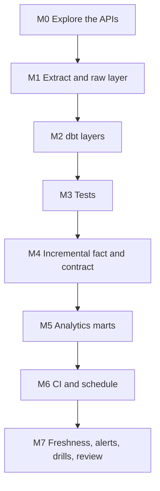

# 7. Build It Yourself

## Brief

A research team needs governed crypto and market metrics in Snowflake: hourly prices no more than two hours old, daily returns next to the stock market, 30-day volatility, and 60-day correlation with the S&P 500, with an email when data stops or a coin moves sharply. Several analysts will change the logic, so every change must be tested in isolation before it reaches production. Build the extraction, the raw layer, the dbt project, CI, the schedule, and the alerts.

## Rules

| You may use | Only when stuck | Only after the milestone passes |
| --- | --- | --- |
| [01](01_problem.md) to [04](04_alternative_stacks.md), `_shared/`, [12-dbt](../../../../12-dbt/README.md), dbt, Snowflake, Coinbase, and FRED documentation | [05](05_snowflake_step_by_step.md) | [06_solution/](06_solution/README.md) |

Write the extractor, the models, and the workflows yourself. Packages like `dbt_utils` are allowed.

## Milestones

### M0 Explore the APIs
- [ ] Fetch one Coinbase window and one FRED series by hand; write down the candle field order, the sort order, whether `end` is inclusive, and how FRED marks holidays

### M1 Extract and Raw Layer
- [ ] Extractor writes responses as delivered, with request window and fetch time; tests without network
- [ ] Raw tables keep file name and load time; a second `COPY` loads nothing

**Hint:** what happens to a window file you upload again an hour later with one more candle?

### M2 dbt Layers
- [ ] Sources with freshness; staging typed and deduplicated; one daily price table for all assets
- [ ] Dev, prod, and CI schemas come from one macro

### M3 Tests
- [ ] Uniqueness, relationships to a seed, value ranges, OHLC consistency
- [ ] One singular test that encodes a business rule; one unit test for the daily rollup
- [ ] Failing rows are stored

### M4 Incremental Fact and Contract
- [ ] Hourly fact as incremental merge; the first return of each batch is not null
- [ ] A lookback you can justify; a documented way to apply older corrections
- [ ] Contract enforced on the fact

### M5 Analytics Marts
- [ ] Daily returns per asset over its own observations
- [ ] 30-observation annualized volatility; 60-day correlation with the S&P 500 on shared days only
- [ ] An exposure for the dashboard

### M6 CI and Schedule
- [ ] Pull requests build in their own schemas and clean up
- [ ] Hourly production run that never overlaps itself; FRED fetched once a day
- [ ] Service users with key pairs and least privilege; no secrets in Git

### M7 Freshness, Alerts, Drills, Review
- [ ] Stale-data alert and large-move alert with the rows in the email
- [ ] Drills: bug in a PR, late correction, extractor stops, contract break, holidays, two developers
- [ ] One page: layer diagram, lookback decision, security model, cost per day
- [ ] Pause after each session; teardown at the end

## Stretch Goals

- **Slim CI:** keep the production `manifest.json` as an artifact and build only `state:modified+` with `--defer`.
- **Snapshots:** a dbt snapshot of the asset seed to track reclassifications (SCD2 the dbt way, compare with P06).
- **dbt Projects on Snowflake:** run the same project with `EXECUTE DBT PROJECT` from a task and compare with the GitHub schedule.
- **Semantic layer:** define metrics for volatility and return with MetricFlow (prepares P11).
- **DuckDB port:** the exercise from [04](04_alternative_stacks.md#suggested-exercise).

## Portfolio and Interview

**Resume bullet example:** Built a dbt project on Snowflake for crypto and stock market analytics with layered models, unit and data tests, an enforced contract on an incremental fact with a lookback for late corrections, CI per pull request in isolated schemas with key-pair service users, an hourly GitHub Actions pipeline, source freshness, and Snowflake alerts with email.

**Questions you should be able to answer:**
1. What SQL does dbt run for an incremental merge model, and what decides its cost?
2. How did you choose the lookback, and what happens to a correction older than it?
3. Why compute returns over observations instead of calendar days?
4. What can a pull request do to production in your setup, and what stops it?
5. Which failure would your dbt tests miss, and what catches it instead?
