# P09 Quickstart

Numbered commands from an empty laptop to tested dbt marts in Snowflake, CI on pull requests, and an hourly scheduled build. Details: [05_snowflake_step_by_step.md](05_snowflake_step_by_step.md).

```mermaid
flowchart LR
    A[1-2 Install and accounts] --> B[3 Env, keys, local test]
    B --> C[4 Snowflake setup]
    C --> D[5 Extract and load]
    D --> E[6 dbt dev]
    E --> F[7 dbt prod and alerts]
    F --> G[8 GitHub CI and schedule]
    G --> H[9 Checks and drills]
    H --> I[10 Pause or teardown]
```



### 1. Install

Python 3.12, Snowflake CLI, OpenSSL ([setup guide](../../../../shared/environments/setup-guide/01_workstation_macos.md), [CLI tools](../../../../shared/environments/setup-guide/02_cli_tools_and_auth.md)).

**Done when:** `snow --version` and `python3.12 --version` work.

### 2. Accounts

[Snowflake](../../../../shared/environments/setup-guide/accounts/snowflake.md) with `[connections.p09]` in `~/.snowflake/config.toml`, and a GitHub account for step 8. Verify your email in Snowsight (profile settings) for the alerts.

**Done when:** `snow sql -c p09 -q "SELECT CURRENT_USER()"` works.

### 3. Env, keys, local test

```bash
cd 16-cloud-databases/01-snowflake/end-to-end-projects/P09_crypto_market_dbt/06_solution
cp p09.env.example p09.env      # set P09_ALERT_EMAIL, SNOWFLAKE_ACCOUNT, SNOWFLAKE_USER
set -a; source p09.env; set +a
python3.12 -m venv .venv && source .venv/bin/activate && pip install requests pytest "dbt-snowflake>=1.10"
python -m pytest -q extract/test_extract_markets.py
mkdir -p ~/.snowflake/keys && for k in p09_dev p09_ci p09_pipeline; do
  openssl genrsa 2048 | openssl pkcs8 -topk8 -inform PEM -out ~/.snowflake/keys/$k.p8 -nocrypt
  openssl rsa -in ~/.snowflake/keys/$k.p8 -pubout -out ~/.snowflake/keys/$k.pub; done
chmod 600 ~/.snowflake/keys/*.p8
```

**Done when:** 4 tests pass and `~/.snowflake/keys/` has three `.p8` and three `.pub` files.

### 4. Snowflake setup

```bash
./run_sql.sh core/00_account_setup.sql core/05_service_users.sql core/01_raw.sql
snow sql -c p09 -q "ALTER USER $SNOWFLAKE_USER SET RSA_PUBLIC_KEY = '$(grep -v -- ----- ~/.snowflake/keys/p09_dev.pub | tr -d '\n')'"
```

**Done when:** `SHOW USERS LIKE 'P09_%'` lists two service users and `DESC USER P09_CI_SVC` shows an `RSA_PUBLIC_KEY_FP`.

### 5. Extract and load

```bash
python extract/extract_markets.py --out "$P09_DATA_DIR" --days 120
./upload.sh && ./run_sql.sh core/20_load.sql
```

**Done when:** `SELECT COUNT(*) FROM P09_MARKETS.RAW.FRED_OBSERVATIONS_RAW` returns about 3,000 and the Coinbase table has 30 rows (10 windows times 3 products).

### 6. dbt dev

```bash
mkdir -p ~/.dbt && cp dbt/profiles.yml.example ~/.dbt/profiles.yml
cd dbt/p09_markets && dbt debug && dbt deps && dbt build --target dev
```

**Done when:** `dbt build` ends with `ERROR=0` and `DEV_<USER>_MARTS.MART_CORRELATION_SPX_60` has rows.

### 7. dbt prod and alerts

```bash
dbt build --target prod && dbt source freshness --target prod
cd ../.. && ./run_sql.sh core/30_alerts.sql
```

**Done when:** `SHOW ALERTS IN SCHEMA P09_MARKETS.OPS` shows two alerts in state `started`.

### 8. GitHub CI and schedule

Copy `ci/*.yml` to `.github/workflows/` of your repository, set `P09_DIR`, add secrets `SNOWFLAKE_ACCOUNT`, `SNOWFLAKE_CI_PRIVATE_KEY`, `SNOWFLAKE_PIPELINE_PRIVATE_KEY`. Open a pull request that touches a model; run the scheduled workflow once by hand.

**Done when:** the pull request check is green, no `CI_PR_` schema remains, and the manual run is green.

### 9. Checks and drills

```bash
./run_sql.sh tests/data_quality_checks.sql
```

Then [tests/failure_drills.md](06_solution/tests/failure_drills.md), D1 first.

**Done when:** check 1 returns no rows and D1 failed in CI as predicted.

### 10. Pause or teardown

```bash
./run_sql.sh core/90_pause.sql     # and disable the scheduled workflow in GitHub
./run_sql.sh teardown.sql          # end of project; then delete the GitHub secrets
```

**Done when:** `SHOW DATABASES LIKE 'P09_%'` and `SHOW USERS LIKE 'P09_%'` are empty.
