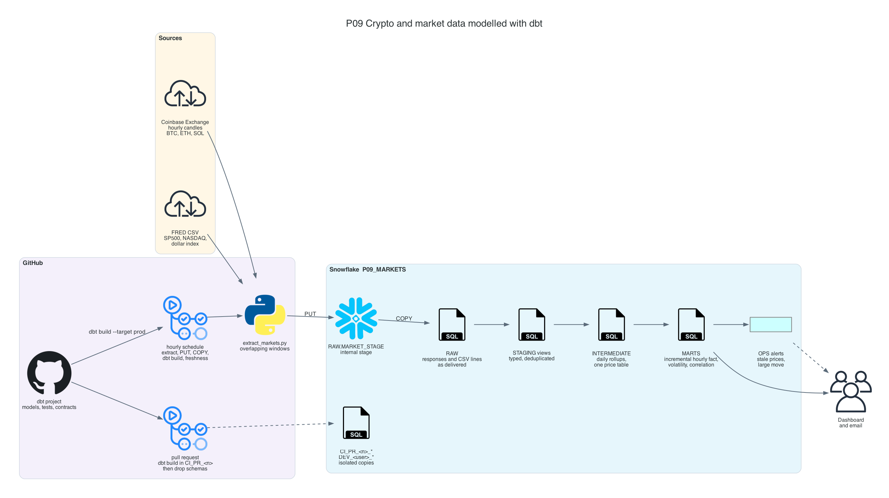
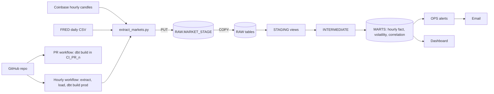

# P09 Crypto Market Data With dbt

Model hourly crypto prices and daily stock index data in Snowflake with dbt, the way an analytics engineering team runs it. The work covers layered models, tests, unit tests, contracts, and an incremental fact with a lookback. Every pull request is built in its own schema by CI, an hourly scheduled run loads and builds production, and Snowflake alerts email when prices go stale or move sharply.

Sources are free and keyless: Coinbase Exchange hourly candles for BTC, ETH, and SOL, and FRED daily series for the S&P 500, the Nasdaq Composite, and the broad dollar index. The marts answer a question people actually ask: how volatile is crypto, and how much does it move with stocks?

## Target Architecture

Own diagram, generated from [assets/architecture.py](assets/architecture.py). Icons: vendor architecture icon sets bundled with the <a href="https://diagrams.mingrammer.com">diagrams</a> library.

Text version (Mermaid)

### Reference From the Source Article

Source: ProjectPro, <a href="https://www.projectpro.io/article/snowflake-projects/1168">13 End-to-End Snowflake Projects That Build Job-Ready Skills</a>. Linked for personal study, not copied into this repository.

The original pulls crypto and stock market data, transforms it with dbt in Snowflake, and visualizes trends. P09 keeps that core and adds the engineering around dbt that teams expect:
- environments separated by schema
- CI on every pull request with automatic cleanup
- a contract on the main fact
- an incremental model that knows how late its source can correct data
- freshness checks and alerts for the data that did not arrive

## Skills

| Skill | Milestone |
| --- | --- |
| Raw layer that keeps API responses as delivered | M1 |
| dbt project layout: sources, staging, intermediate, marts | M2 |
| Generic, singular, and unit tests; `store_failures` | M3 |
| Incremental merge with a lookback window | M4 |
| Model contracts and exposures | M4 |
| Rolling volatility and correlation across calendars (24/7 versus trading days) | M5 |
| CI per pull request in isolated schemas, service users with key-pair auth | M6 |
| Source freshness and Snowflake alerts with email | M7 |

## Prerequisites

- P05 and P06 completed or read: the same incremental and dimensional ideas, written by hand
- Snowflake CLI and a key pair for your user ([setup guide](../../../../shared/environments/setup-guide/README.md))
- Python 3.10+ with `dbt-snowflake` 1.10 or later; a GitHub repository for the CI part
- [Cost guardrails](../_shared/cost_guardrails.md): an hourly schedule wakes the warehouse 24 times a day

## Navigation

| Part | File |
| --- | --- |
| Quickstart: numbered commands from install to teardown | [QUICKSTART.md](QUICKSTART.md) |
| 1. Problem | [01_problem.md](01_problem.md) |
| 2. Architecture and decisions | [02_architecture_decisions.md](02_architecture_decisions.md) |
| 3. Snowflake approach | [03_snowflake_approach.md](03_snowflake_approach.md) |
| 4. Alternative stacks and roadmap | [04_alternative_stacks.md](04_alternative_stacks.md) |
| 5. Step by step on Snowflake | [05_snowflake_step_by_step.md](05_snowflake_step_by_step.md) |
| 6. Solved reference | [06_solution/README.md](06_solution/README.md) |
| 7. Build it yourself | [07_build_it_yourself.md](07_build_it_yourself.md) |

Recommended route: 1, 2, 3, 4, then **7** (build). Use 5 when stuck. Compare with 6 at the end.
