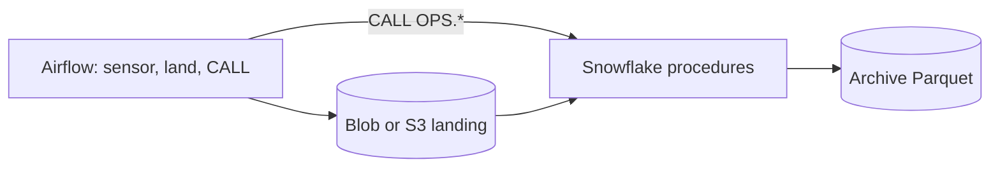
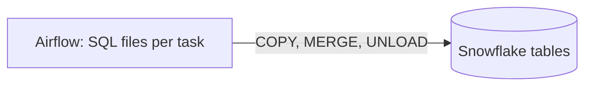
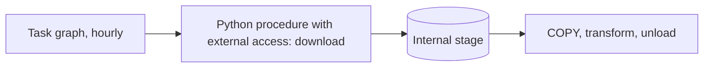
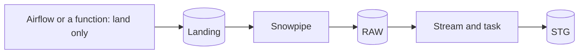

# 2. Architecture and Decisions

## Requirements That Drive the Design

| Driver | Consequence |
| --- | --- |
| The source is a file per hour | The hour is the unit of work everywhere: one DAG run, one landing object, one reload |
| Retries and backfills must not duplicate | Every step replaces what it wrote for its interval: overwrite, delete-and-reload, delete-and-insert |
| The scheduler already exists outside Snowflake | Airflow decides when; Snowflake procedures decide what. Neither knows the other's internals |
| Backfills of a 2.4 GB day | Concurrency bounded per shared resource with pools, not only per DAG |
| Hot data limited, history kept | Unload to Parquet, verify by reading back, external table for cold queries, lifecycle tiers |
| The source changed three times in a year | A drift check per day that warns without stopping retention |
| Least privilege for automation | A service user whose role can call five procedures and read two log tables |

## Options

### Option 1: Airflow outside, procedures inside, cloud landing (chosen)

### Option 2: Airflow runs the SQL itself

### Option 3: Snowflake only (tasks and external access)

### Option 4: Event-driven (Snowpipe on landing)

## Trade-Offs

| Criterion | 1 Airflow + procedures | 2 Airflow runs SQL | 3 Snowflake only | 4 Event-driven |
| --- | --- | --- | --- | --- |
| Where the logic lives | Snowflake, versioned SQL | DAG repository | Snowflake | Snowflake |
| Testable without the orchestrator | Yes: `CALL` by hand | No | Yes | Yes |
| Backfill | `airflow backfill create` | Same | Hand-written loop over hours | Re-land files; Snowpipe skips names it has seen |
| Cross-system steps (download, other systems) | Natural | Natural | External access integration, egress rules | Separate lander |
| Privileges of the automation | Call five procedures | DML and DDL on tables | None outside Snowflake | Lander writes storage only |
| Visibility of runs, retries, SLAs | Airflow UI plus `OPS` logs | Airflow UI | Task history | Pipe and task history |
| Best when | A shared orchestrator coordinates many systems | Small teams, few tables | Snowflake is the only system | Continuous arrival, no ordering needs |

## Why / Why Not

**Why procedures instead of SQL in the DAG?**
The same `CALL OPS.LOAD_HOUR('2026-11-09 15:00:00', 'manual')` works from Airflow, from a worksheet, and from a test. The Airflow role needs no table privileges, and a DAG change cannot alter how data is written. The price: two repositories to keep in step, the DAGs and the SQL.

**Why `COPY ... FORCE = TRUE` after a delete, instead of relying on load metadata?**
Load metadata answers "was this file loaded before", not "is this hour in the table now". After a failed half load, a cleared task, or a purge, the honest answer comes from deleting the hour and loading the file again. `FORCE` makes the reload explicit and the result the same every time.

**Why is RAW loaded without a transaction?**
If `COPY` fails after the delete, the hour is absent from RAW and has no log entry. `BUILD_HOUR` checks that RAW matches the log and refuses otherwise, and the Airflow retry loads the hour again. Readers use STG, which is replaced in one transaction.

**Why Airflow data intervals instead of "now minus one hour"?**
A run for 15:00 to 16:00 processes that hour whenever it runs: on time, after a retry, or during a backfill a year later. Wall-clock logic would process a different hour on every retry. Airflow 3 defaults cron schedules to trigger timetables without intervals, so the DAGs set `CronDataIntervalTimetable` explicitly.

**Why does the daily DAG ask Snowflake whether the day is complete?**
A sensor on the hourly DAG's run states breaks when hours are backfilled, reprocessed, or loaded by hand. `OPS.HOUR_LOG` records what actually landed in STG, whoever loaded it. The price: each poke may resume the warehouse, so the sensor pokes every 20 minutes.

**Why pools?**
`max_active_runs` limits runs of one DAG. A backfill of 8 runs and the live hourly run share GH Archive, your network, and one warehouse. Pools `gharchive_http` and `snowflake_p10` cap each resource across all DAGs.

**Why unload to Parquet instead of keeping everything in Snowflake?**
Snowflake storage is cheap, but a hot table that grows forever makes every full scan, clone, and recovery more expensive. Parquet in cool or cold storage costs a fraction, other engines can read it, and an external table keeps it queryable. The rule "verified before deleted" makes the move safe.

**Why not the archive tier or Glacier Flexible Retrieval?**
Snowflake cannot read Azure archive-tier blobs or S3 Glacier Flexible Retrieval objects without a restore. The lifecycle stops at Azure cold tier and S3 Glacier Instant Retrieval, which stay online.

**Why is the drift check non-blocking?**
A source change is a fact to report, not a reason to stop archiving correct data. The drift task fails visibly and leaves the archive and purge branch alone.

## Architecture Decision Records

### ADR-001: The hour is the unit of work

- **Decision:** one landing object, one RAW partition, one STG partition, and one log row per UTC hour, keyed by the file hour, not by `created_at`.
- **Consequences:** reloads, backfills, and checks all speak the same unit; events never move between hours.

### ADR-002: Orchestrator calls procedures, holds no table rights

- **Decision:** `P10_PIPELINE` has `USAGE` on five procedures, `SELECT` on `OPS.HOUR_LOG`, `OPS.DAY_LOG`, `OPS.SOURCE_DRIFT`, and `READ, WRITE` on the internal landing stage only in internal mode.
- **Consequences:** a leaked Airflow key can rerun the pipeline but not read or change data directly.

### ADR-003: Explicit backfills, catchup off

- **Decision:** `catchup=False`; history is loaded with `airflow backfill create`, whose start date can reach back to `P10_START_DATE`.
- **Consequences:** unpausing a DAG never starts a surprise backfill of months; the history to load is a deliberate, sized decision.

### ADR-004: Verified archive before purge

- **Decision:** `ARCHIVE_DAY` removes the day's prefix, unloads, reads back count and `HASH_AGG` of event ids, writes a manifest, and sets `VERIFIED`. `PURGE_HOT` deletes only verified days older than `P10_HOT_DAYS`.
- **Consequences:** about one extra read of each archived day; a rebuilt day resets `VERIFIED` and must be archived again.

### ADR-005: Interpret source eras explicitly

- **Decision:** `PR_OUTCOME` is derived from either era's representation and is `closed_unknown` where the source no longer says; `PUSH_COMMITS` is NULL, not 0, when the source dropped it.
- **Consequences:** marts show missing knowledge as missing; drift checks compare field ratios per day.

## Failure Modes

| Failure | Detection | Recovery |
| --- | --- | --- |
| Hour not published yet | Sensor returns false on 404 | Waits up to 3 hours, then fails |
| GH Archive blocks or errors | Sensor raises on any status but 200 or 404 | Fix the cause; clear the run |
| Half-loaded RAW hour | `BUILD_HOUR` refuses: RAW differs from log | Retry or clear `load_raw` |
| Day incomplete | Daily sensor waits; `BUILD_DAY` refuses fewer than 24 hours | Backfill the missing hours |
| Day purged, then rebuilt | `BUILD_DAY` refuses: STG differs from log | Reprocess the hours first |
| Archive read-back differs | `ARCHIVE_DAY` raises, `VERIFIED` false | Clear `archive_day`; nothing is purged meanwhile |
| Archive damaged later | DQ check 7 against `OPS.DAY_LOG` | Re-archive while hot; protect with soft delete or versioning |
| Source format change | `check_source_drift` red | Document, adapt STG if needed |
| Backfill overloads | Pools cap concurrency; resource monitor caps credits | Lower `--max-active-runs` or pool slots |

## Cost Model

| Component | Driver | How to measure |
| --- | --- | --- |
| Hourly load and build | XS warehouse resumes about once an hour, about a minute each in the trimmed era | `QUERY_HISTORY` by `QUERY_TAG` `p10/<dag>/<task>/...` |
| Backfill | One full-format day: 24 files of about 100 MB; one file loads in one thread | Credits per day from `WAREHOUSE_METERING_HISTORY` during the backfill |
| Daily sensor | Each poke may resume the warehouse for 60 seconds | Count of `wait_for_24_hours` queries |
| Unload and read-back | One write and one read of the day's STG | `OPS.DAY_LOG.ARCHIVE_BYTES`, query time |
| Storage | Landing 14 days, archive Parquet in cool or cold tier | Cloud cost reports by tag `project=p10` |
| Airflow | Local Docker: your laptop | n/a; a hosted Airflow is the largest fixed cost in [04](04_alternative_stacks.md) |

The warehouse bills at least 60 seconds per resume. Hourly runs that finish in 20 seconds still cost a minute each; a backfill that keeps the warehouse busy is cheaper per hour of data than the live schedule.
