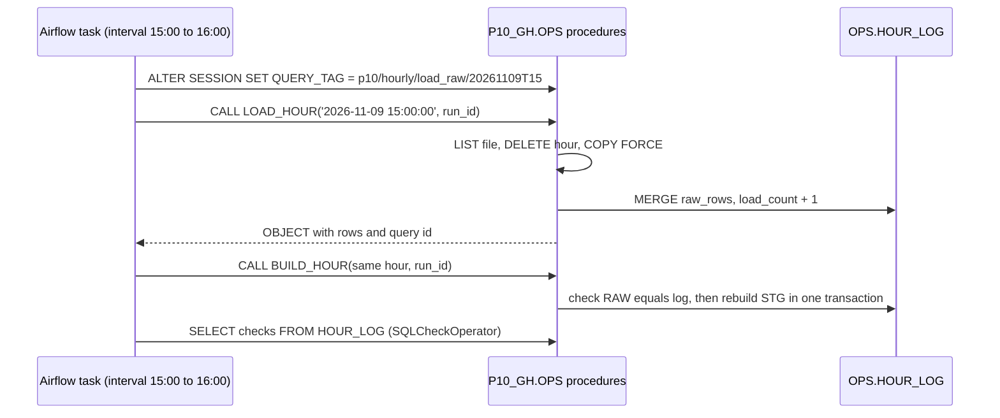
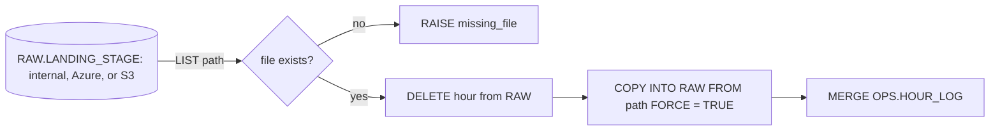
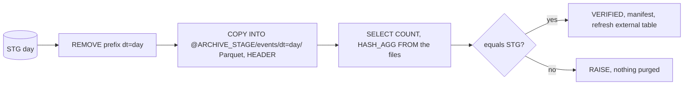

# 3. Snowflake Approach

Airflow decides when; Snowflake does the work. This part is about the Snowflake side: what each procedure does, why it can be called again at any time, and which features make the archive safe.

## The Contract Between Airflow and Snowflake

| Rule | Why |
| --- | --- |
| Every procedure takes the interval as an argument | The same call gives the same result on any day it runs |
| Every procedure replaces its own output for that interval | Retries and backfills need no cleanup |
| Procedures check their input and raise | A red task with a clear message beats a smaller, wrong table |
| `EXECUTE AS OWNER` | The caller's role needs only `USAGE` on the procedure |
| Logs in `OPS`, not in Airflow | Any orchestrator, or a human, can read the state |

## Load: Stages, COPY, and FORCE

- `COPY` of a path that matches no file succeeds with 0 files. That is why `LOAD_HOUR` lists the file first and raises before deleting a good hour.
- `FORCE = TRUE` ignores load metadata. Without it, the reload after the delete would load nothing, because the file was loaded within the last 64 days.
- A `COPY` transformation adds the file hour, `METADATA$FILENAME`, and `METADATA$FILE_ROW_NUMBER` to each row.
- The path is built inside the procedure from the hour, so Airflow never sends a path or SQL text, only a timestamp.
- One gzip file is read by one thread. A bigger warehouse does not load one hour faster; parallel hours in a backfill use its threads.

## STG: Typed, Deduplicated, Honest About Eras

`BUILD_HOUR` rebuilds one hour of `STG.GH_EVENT` in one transaction: delete the hour, insert typed rows with `QUALIFY ROW_NUMBER() OVER (PARTITION BY EVENT_ID ...) = 1`, update the log. The interesting column is `PR_OUTCOME`:

| Era | Payload | `PR_OUTCOME` |
| --- | --- | --- |
| Until early October 2025 | `action = closed`, `pull_request.merged = true or false` | `merged` or `closed_unmerged` |
| October 2025 to early 2026 | `action = closed`, no `merged` field | `closed_unknown` |
| From early 2026 | `action = merged`, or `closed` without the field | `merged`, or `closed_unknown` |

`PUSH_COMMITS` comes from `payload.size` and is NULL when the field is missing. NULL means "not known", 0 would mean "pushed nothing".

## Marts and the Source Profile

`BUILD_DAY` runs only when 24 hours are built and STG still holds exactly the rows the log says. In one transaction it replaces the day in:

| Table | Grain | Purpose |
| --- | --- | --- |
| `MART.EVENT_TYPE_DAILY` | Day, event type | Volume, actors, repositories, bot share |
| `MART.REPO_DAILY` | Day, repository | Stars, forks, pushes, pull requests, issues, releases, human actors |
| `MART.TRENDING_REPOS_7D` (view) | Repository | Top 100 by stars over the last 7 loaded days |
| `OPS.SOURCE_PROFILE_DAILY` | Day, check | Ratios such as push events with a commit count, closed pull requests with a known outcome |

`OPS.SOURCE_DRIFT` compares each day's event type shares and field ratios with the previous 7 calendar days and flags `disappeared`, `appeared`, `share changed`, or `ratio changed`.

## Archive: Unload, Read Back, Manifest

- `OVERWRITE = TRUE` on unload replaces files with the same names but leaves others. A rerun that writes fewer files would leave stale ones, so the procedure removes the prefix first.
- `HASH_AGG(EVENT_ID)` over STG and over `$1:EVENT_ID` from the Parquet files must match. Row count alone would miss a swapped file.
- The manifest `_manifests/events/dt=<day>.json` records rows, files, bytes, hash, and the verification result next to the data, readable without Snowflake.
- With a cloud archive, `ARCHIVE.GH_EVENT_ARCHIVE` is an external table partitioned by `EVENT_DAY` from the path. `AUTO_REFRESH = FALSE`: the procedure refreshes exactly the new partition, so no notification integration is needed.
- `ARCHIVE.GH_EVENT_ALL` unions hot STG and cold archive behind one name. A filter on `EVENT_DAY` prunes both sides.

## Retention

| Layer | Kept | Mechanism |
| --- | --- | --- |
| Landing files | 14 days | Cloud lifecycle rule; GH Archive keeps the originals |
| `RAW.GH_EVENT_RAW` | 2 days after archive | `PURGE_HOT`, transient table without Time Travel |
| `STG.GH_EVENT` | 30 days | `PURGE_HOT`, verified days only |
| Marts | Forever | Small: one row per repository and day |
| Archive Parquet | Forever | Cool after 30 days, cold (Azure) or Glacier Instant Retrieval (AWS) after 90 |

## Security Model

| Principal | Role | Can | Cannot |
| --- | --- | --- | --- |
| You | `P10_OWNER` | Everything in `P10_GH` | Account administration |
| `P10_AIRFLOW_SVC` (`TYPE = SERVICE`, key pair) | `P10_PIPELINE` | Call 5 procedures, read 2 logs and the drift view, PUT in internal mode | Read or write tables, create objects |
| Snowflake storage integration | Azure roles or IAM policy | Read landing, read-write-delete archive | Write landing |
| Airflow cloud identity | Service principal or IAM user | Write landing | Read archive, delete anything |
| Analysts | `P10_READER` | Read marts | Read RAW or STG |

## Object Inventory

| Object | Purpose |
| --- | --- |
| `RAW.LANDING_STAGE`, `ARCHIVE.ARCHIVE_STAGE` | Internal by default, external after `azure/11` or `aws/11` |
| `RAW.FF_GH_JSON`, `ARCHIVE.FF_PARQUET`, `ARCHIVE.FF_MANIFEST` | File formats |
| `RAW.GH_EVENT_RAW`, `STG.GH_EVENT` | Hour-partitioned layers |
| `MART.EVENT_TYPE_DAILY`, `MART.REPO_DAILY`, `MART.TRENDING_REPOS_7D` | Consumer tables and view |
| `OPS.HOUR_LOG`, `OPS.DAY_LOG`, `OPS.SOURCE_PROFILE_DAILY`, `OPS.SOURCE_DRIFT` | Shared state and evidence |
| `OPS.LOAD_HOUR`, `BUILD_HOUR`, `BUILD_DAY`, `ARCHIVE_DAY`, `PURGE_HOT` | The work Airflow calls |
| `ARCHIVE.GH_EVENT_ARCHIVE`, `ARCHIVE.GH_EVENT_ALL` | Cold queries (cloud mode) |
| `P10_AIRFLOW_SVC`, `P10_PIPELINE`, `P10_AZURE_STORAGE_INT` or `P10_AWS_STORAGE_INT` | Identities |

## What This Project Teaches About Snowflake

- Load metadata prevents duplicate loads of a file, not duplicate rows of an interval; delete plus `FORCE` is the explicit reload
- Owner's-rights procedures turn a broad automation role into a narrow, auditable interface
- Unloading is a pipeline step with its own idempotency and verification, not an export button
- External tables and lifecycle tiers keep history queryable at storage prices, as long as the tier stays online
- Query tags connect warehouse cost to orchestrator tasks
