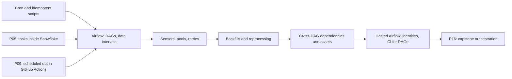

# 4. Alternative Stacks and Roadmap

The same problem with other orchestrators and other platforms. The shape stays: one interval per run, idempotent steps, bounded backfills, verified archive before purge.

## Component Mapping

| Concern | P10 | Hosted Airflow | Dagster | Snowflake only | Databricks | Microsoft Fabric |
| --- | --- | --- | --- | --- | --- | --- |
| Scheduler | Airflow 3 in Docker | Astronomer, Amazon MWAA, Google Cloud Composer, Airflow jobs in Fabric | Dagster schedules and sensors | Task graph | Lakeflow Jobs | Data pipelines or Airflow jobs |
| Unit of work | Data interval | Same | Partition (hourly partitions definition) | Task run, interval computed by hand | Job run with parameters | Pipeline run with parameters |
| Backfill | `airflow backfill create` | Same | Partition backfill in the UI | Loop procedure over hours | Job runs per parameter | Pipeline runs per parameter |
| Landing | Blob or S3 via hooks | Same | Same via resources | External access integration, internal stage | Volume or external location | OneLake Files |
| Load | Procedure: delete + `COPY FORCE` | Same | Same | Same | `COPY INTO` Delta or Auto Loader | Copy activity or notebook |
| Archive | Unload Parquet + external table | Same | Same | Same | Delta table with retention, or Iceberg | Lakehouse tables, OneLake tiers |
| Concurrency limits | Pools | Pools | Concurrency pools and tags | Warehouse concurrency | Job concurrency, cluster size | Capacity units |

## Airflow Variants

**Hosted Airflow.** Astronomer, Amazon MWAA, and Google Cloud Composer run the same DAG files. What changes is identity: a managed identity, an execution role, or workload identity instead of the service principal secret and access keys used locally. The metadata database, upgrades, and scaling stop being your problem; a small environment still costs a fixed amount per hour whether or not anything runs.

**Deferrable sensors.** With a triggerer, `wait_for_hour` could be a deferrable sensor that waits in an async loop instead of rescheduling. Worth it with hundreds of sensors; with one sensor per hour, `mode="reschedule"` is enough.

**Asset-aware scheduling.** Airflow assets let the daily DAG run when an upstream task updates an asset. Here completeness is "24 specific hours", which an asset event per hour does not express without extra logic, so the daily sensor reads `OPS.HOUR_LOG`.

## Dagster

Dagster models the hour as a partition of an asset. The hourly asset materializes one partition, the daily asset depends on 24 of them through a partition mapping, and the UI shows which partitions exist. The same Snowflake procedures can be the body of each asset. Dagster is stronger at "which data exists"; Airflow is more widespread and has more operators.

## Snowflake Only

A task graph can call `LOAD_HOUR` for the previous hour, and a Python procedure with an external access integration can download GH Archive into an internal stage. No container to run and no key outside Snowflake. What you write by hand: the interval of each run, backfill loops, sensor-like waiting, retries with backoff, and a UI for run history. Choose it when Snowflake is the only system involved.

## Databricks

Download with a job task into a Unity Catalog volume, load with `COPY INTO` into a Delta bronze table, rebuild hours with `REPLACE WHERE` on the hour column, which is the Delta equivalent of delete plus insert. Archive by keeping old partitions in Delta with lower-cost storage, or write Iceberg for other engines. Lakeflow Jobs handle parameters per hour and repair runs.

## When Each Alternative Wins

| Situation | Choice |
| --- | --- |
| A shared orchestrator already coordinates several systems | P10 as built, or a hosted Airflow |
| Partitions and data lineage matter more than operators | Dagster |
| Snowflake is the only system and the team is small | Task graph with external access |
| Spark workloads and a lakehouse already exist | Databricks jobs with Delta |
| The organization standardized on Fabric capacity | Fabric pipelines or Airflow jobs |

## Learning Roadmap

| Step | Where in this repository |
| --- | --- |
| Airflow fundamentals | [11-airflow](../../../../11-airflow/README.md) |
| Docker and Compose | [03-docker](../../../../03-docker/README.md) |
| Iceberg as an open archive format | [14-iceberg](../../../../14-iceberg/README.md), P12 |
| Storage tiers on Azure | [09-azure-data-lake-storage](../../../../09-azure-data-lake-storage/README.md) |

### Suggested Exercise

Write the hourly DAG a second time as a Snowflake task graph that loops over missing hours from `OPS.HOUR_LOG`. List what you had to write that Airflow gave you for free: intervals, retries with backoff, backfill, run history, concurrency limits. That list is your answer to "do we need an external orchestrator?".
