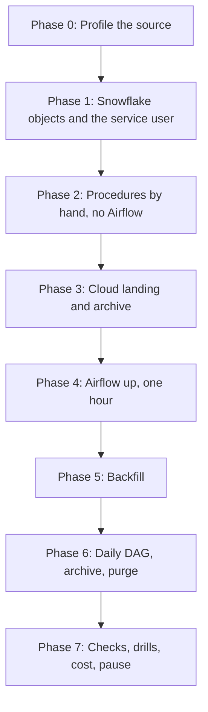

# 5. Step by Step on Snowflake

Use this when stuck in [07](07_build_it_yourself.md). Commands run from `06_solution/` unless stated otherwise. The short version is [QUICKSTART.md](QUICKSTART.md).



## Phase 0: Profile the Source

```bash
python airflow/dags/gharchive_lib.py 2026-11-09T15
python airflow/dags/gharchive_lib.py 2025-10-01T15      # about 100 MB download
```

Compare `types`, `push_events_with_size`, `pr_events_with_merged_flag`, and `pr_actions`. Write down what a "merged pull request" means in each file before you write any SQL.

## Phase 1: Snowflake Objects and the Service User

```bash
./run_sql.sh core/00_account_setup.sql core/01_schemas_and_tables.sql core/10_procedures.sql
```

- `00` creates `P10_AIRFLOW_SVC` as `TYPE = SERVICE` with your public key; `run_sql.sh` refuses to run while a placeholder is unfilled.
- `01` creates internal stages. Everything works on them; the cloud scripts later replace the stages under the same names.
- `10` creates the five procedures and grants `P10_PIPELINE` only `USAGE` on them.

## Phase 2: Procedures by Hand, No Airflow

Prove the Snowflake side before adding a scheduler.

```bash
curl -sS -A "p10-learning" -o /tmp/2026-11-09-15.json.gz https://data.gharchive.org/2026-11-09-15.json.gz
snow sql -c p10 -q "USE ROLE P10_OWNER; PUT 'file:///tmp/2026-11-09-15.json.gz' @P10_GH.RAW.LANDING_STAGE/gharchive/dt=2026-11-09/ AUTO_COMPRESS = FALSE OVERWRITE = TRUE"
```

```sql
USE ROLE P10_OWNER;
CALL P10_GH.OPS.LOAD_HOUR('2026-11-09 15:00:00', 'manual');
CALL P10_GH.OPS.BUILD_HOUR('2026-11-09 15:00:00', 'manual');
CALL P10_GH.OPS.LOAD_HOUR('2026-11-09 15:00:00', 'manual');   -- again: same rows, LOAD_COUNT = 2
SELECT * FROM P10_GH.OPS.HOUR_LOG;
CALL P10_GH.OPS.LOAD_HOUR('2026-11-09 16:00:00', 'manual');   -- no file: raises before deleting anything
```

## Phase 3: Cloud Landing and Archive

Optional; skip to stay on internal stages. Azure order: `azure/01_provision.sh`, values into `p10.env`, `azure/10_integration.sql`, consent URL, `azure/02_grant_snowflake_access.sh`, `azure/11_stages.sql`. AWS order: `aws/01_provision.sh`, `aws/10_integration.sql`, `aws/02_connect_snowflake.sh`, `aws/11_stages.sql`.

- Snowflake gets read on `landing` and read-write-delete on `archive`; Airflow gets write on `landing` only. Check both in the portal or IAM console.
- `11_stages.sql` replaces the internal stages. Files PUT in Phase 2 are gone with them; that is expected.
- `LIST @RAW.LANDING_STAGE/gharchive/` must work before you start Airflow.

## Phase 4: Airflow Up, One Hour

```bash
cd airflow && ./make_env.sh && docker compose up -d --build
docker compose exec airflow-scheduler airflow dags list-import-errors
```

- `make_env.sh` writes connections as `AIRFLOW_CONN_*` JSON into `airflow.env`; nothing is stored in the Airflow database, and both env files are ignored by Git.
- Unpause `p10_gharchive_hourly` in the UI. With `catchup=False` the scheduler creates one run, for the last finished hour.
- Open the task logs: `land_hour` returns the object it wrote or `exists: ...`; `load_raw` and `build_stg` print the object the procedure returned.
- In Snowsight, Query History filtered by `QUERY_TAG` starting with `p10/` shows every statement of that run.

## Phase 5: Backfill

```bash
docker compose exec airflow-scheduler airflow backfill create --dag-id p10_gharchive_hourly \
  --from-date 2026-11-08T00:00:00+00:00 --to-date 2026-11-09T23:00:00+00:00 --max-active-runs 8
```

- Watch Admin, Pools: `gharchive_http` and `snowflake_p10` never exceed 4 running slots, whatever `--max-active-runs` says.
- `--reprocess-behavior completed` runs completed intervals again; `failed` only failed ones; the default `none` only missing ones.
- The backfill can go back to `P10_START_DATE` (default 2025-01-01). Size it first: one day before October 2025 is about 2.4 GB.

## Phase 6: Daily DAG, Archive, Purge

```bash
docker compose exec airflow-scheduler airflow backfill create --dag-id p10_gharchive_daily \
  --from-date 2026-11-08 --to-date 2026-11-09
```

```sql
SELECT * FROM P10_GH.OPS.DAY_LOG ORDER BY EVENT_DAY;
LIST @P10_GH.ARCHIVE.ARCHIVE_STAGE/events/;
LIST @P10_GH.ARCHIVE.ARCHIVE_STAGE/_manifests/;
SELECT EVENT_DAY, STORAGE_TIER, COUNT(*) FROM P10_GH.ARCHIVE.GH_EVENT_ALL GROUP BY 1, 2;   -- cloud mode
```

`purge_hot` deletes nothing yet: both days are inside the 30-day hot window. Drill D6 shows a purge.

## Phase 7: Checks, Drills, Cost, Pause

```bash
./run_sql.sh tests/data_quality_checks.sql
```

Then [tests/failure_drills.md](06_solution/tests/failure_drills.md). Check 11 lists execution minutes per Airflow task; compare the live hourly cost with the backfill cost per hour of data. After each session: `docker compose stop` in `airflow/`, then `./run_sql.sh core/90_pause.sql`.
