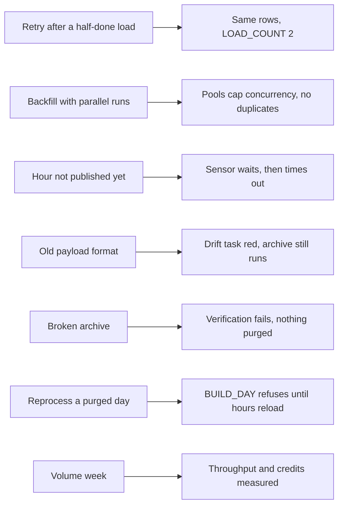

# P10 Failure Drills

With an external orchestrator, most failures sit between two systems: Airflow thinks one thing, Snowflake holds another. Each drill breaks one thing on purpose. Predict what happens, run it, then restore.



Commands run in `06_solution/airflow/` unless stated otherwise. `af` below means `docker compose exec airflow-scheduler airflow`.

## D1 Retry After a Half-Done Load

Pick a loaded hour. As `P10_OWNER`, delete half of its RAW rows to simulate a COPY that stopped midway, then clear `load_raw` for that run in the UI (with downstream).

```sql
DELETE FROM P10_GH.RAW.GH_EVENT_RAW
WHERE EVENT_HOUR = '2026-11-09 15:00:00' AND MOD(SRC_ROW, 2) = 0;
```

- **Predict:** RAW and STG row counts after the cleared tasks finish, and the value of `LOAD_COUNT`.
- **Observe:** `LOAD_HOUR` deletes the hour and loads the whole file again with `FORCE = TRUE`; `BUILD_HOUR` rebuilds STG; `OPS.HOUR_LOG.LOAD_COUNT` is 2 and the counts match the first load.
- **Try:** call `CALL P10_GH.OPS.BUILD_HOUR('2026-11-09 15:00:00', 'manual')` right after the `DELETE`, before any reload. It refuses: RAW differs from the log.
- **Lesson:** an idempotent task replaces its whole unit of work. "Insert what is new" would have needed to know what the failed attempt wrote.

## D2 Backfill With Parallel Runs

```bash
af backfill create --dag-id p10_gharchive_hourly \
  --from-date 2026-11-01T00:00:00+00:00 --to-date 2026-11-02T23:00:00+00:00 --max-active-runs 8
```

- **Predict:** how many `land_hour` and `load_raw` tasks run at the same time, and which limit wins: `--max-active-runs 8`, pool `gharchive_http` (4 slots), or pool `snowflake_p10` (4 slots).
- **Observe:** at most 4 downloads and 4 Snowflake calls at a time; queries queue on the XS warehouse only if more than its concurrency arrive. `SELECT * FROM P10_GH.OPS.HOUR_LOG ORDER BY EVENT_HOUR` shows hours finishing out of order.
- **Try:** run the same backfill again with `--reprocess-behavior completed`. Row counts stay the same, `LOAD_COUNT` grows.
- **Lesson:** a backfill is a load test of every shared resource: the source, the network, the warehouse. Pools are how an orchestrator keeps a backfill from becoming an outage.

## D3 The Hour Is Not Published Yet

Trigger the hourly DAG for the current hour: in the UI, Trigger DAG with a logical date inside the current UTC hour.

- **Predict:** the state of `wait_for_hour` after 5 minutes, and when the run fails if the file never appears.
- **Observe:** `up_for_reschedule` while GH Archive answers 404; the worker slot is free between pokes (`mode="reschedule"`). The file appears about 5 minutes after the hour ends; if not within 3 hours, the sensor fails.
- **Lesson:** "not yet" and "broken" are different answers. The sensor treats 404 as "wait" and anything else (403, 500) as an error, so a blocked User-Agent fails fast instead of waiting 3 hours.

## D4 An Old Payload Format

Backfill one day before GitHub trimmed event payloads, for example 2025-10-01 (about 2.4 GB of gzip for the day), then the daily DAG for it:

```bash
af backfill create --dag-id p10_gharchive_hourly --from-date 2025-10-01T00:00:00+00:00 --to-date 2025-10-01T23:00:00+00:00 --max-active-runs 4
af backfill create --dag-id p10_gharchive_daily  --from-date 2025-10-01 --to-date 2025-10-01
```

- **Predict:** `PUSH_COMMITS` and `PR_OUTCOME` values for that day compared with November 2026, and which drift rows appear once both periods are loaded.
- **Observe:** in October 2025, about 165,000 events per hour, mostly `PushEvent` with a commit count, and pull requests closed with `merged = true` or `false`. In November 2026, a few thousand events per hour, no `PushEvent`, and pull requests with action `merged`. `OPS.SOURCE_PROFILE_DAILY` shows the ratios flip. The daily run for a day after a format change has a red `check_source_drift` while `archive_day` and `purge_hot` still succeed.
- **Lesson:** the source changed, not the pipeline. A drift check turns "the dashboard looks odd" into a dated, explained change; making it a non-blocking leaf keeps a warning from stopping retention.

## D5 A Broken Archive

After the daily DAG archived a day, delete one Parquet file of that day (Azure portal, `aws s3 rm`, or `REMOVE @P10_GH.ARCHIVE.ARCHIVE_STAGE/events/dt=<day>/part_0_0_0.snappy.parquet` as `P10_OWNER`). Then compare what the archive holds with what was verified:

```sql
SELECT COUNT(*) FROM @P10_GH.ARCHIVE.ARCHIVE_STAGE/events/dt=2026-11-09/ (FILE_FORMAT => 'P10_GH.ARCHIVE.FF_PARQUET');
SELECT STG_ROWS, ARCHIVE_ROWS, VERIFIED, PURGED_AT FROM P10_GH.OPS.DAY_LOG WHERE EVENT_DAY = '2026-11-09';
```

- **Predict:** whether anything in the pipeline notices, and what clearing `archive_day` does while the day is still in STG versus after it was purged.
- **Observe:** nothing notices: `VERIFIED` is still true, because verification happened at archive time. While the day is hot, clearing `archive_day` removes the prefix, unloads again, and verifies again. After the purge, `ARCHIVE_DAY` refuses ("day not built"); the only way back is reloading the hours from landing or GH Archive.
- **Try:** make the read-back differ on purpose: between `BUILD_DAY` and `ARCHIVE_DAY`, the procedure compares STG with the numbers `BUILD_DAY` logged, so an extra or missing STG row raises before the unload, and `PURGE_HOT` deletes nothing for an unverified day.
- **Lesson:** verify before you delete the source copy, and then protect the copy itself. Verification is a point in time; blob soft delete, S3 versioning, or an immutability policy is what keeps the archive true afterwards.

## D6 Reprocess a Day That Was Already Purged

Set `P10_HOT_DAYS=0` in `p10.env`, rerun `./make_env.sh && docker compose up -d`, and let the daily DAG purge a day. Then clear `build_marts` for that day.

- **Predict:** whether the marts for that day become empty.
- **Observe:** `BUILD_DAY` raises "STG rows differ from HOUR_LOG": the day is gone from STG. Run an hourly backfill for the day with `--reprocess-behavior completed` first; `LOAD_HOUR` reloads from landing if the files are still there (14 days), otherwise `land_hour` downloads them again. Then the daily run succeeds.
- **Lesson:** a rebuild must refuse partial input instead of producing a smaller, wrong result. Restore `P10_HOT_DAYS=30` afterwards.

## D7 Volume Week (Optional)

Backfill seven days of the old format, for example 2025-09-22 to 2025-09-28: about 17 GB of gzip and 25 million events. Before you start, set the resource monitor quota you accept and note the time.

- **Measure:** download minutes per hour file, `LOAD_HOUR` seconds per hour (`OPS.HOUR_LOG.LOADED_AT` minus the task start, or `QUERY_HISTORY` by tag), credits per day from `WAREHOUSE_METERING_HISTORY`, archive bytes per day from `OPS.DAY_LOG`.
- **Try:** run one day with the warehouse at XS and one at S. A single gzip file is read by one thread, so a bigger warehouse speeds up a backfill only if enough hours load in parallel.
- **Lesson:** sizing comes from measurements on real volume. Record credits per GB and minutes per day in [PROGRESS.md](../../../PROGRESS.md).

## Drill Log Template

| Drill | Prediction | Observed | Lesson in one sentence |
| --- | --- | --- | --- |
| D1 | | | |
| D2 | | | |
| D3 | | | |
| D4 | | | |
| D5 | | | |
| D6 | | | |
| D7 | | | |
