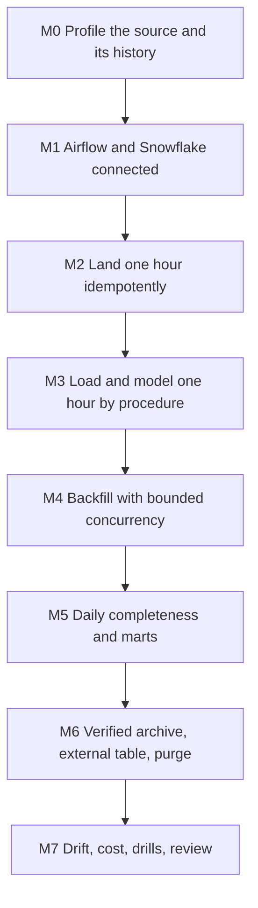

# 7. Build It Yourself

## Brief

A developer-relations team wants every hour of GH Archive in Snowflake: daily facts per repository and event type, any past period reloadable with one command, and history older than a month kept cheaply but still queryable. The platform team runs Airflow and wants the pipeline there, with Snowflake doing the data work. The source has changed its format several times; the pipeline must notice. Build the landing, the loading and modelling procedures, the hourly and daily DAGs, backfills, the verified archive, and the checks.

## Rules

| You may use | Only when stuck | Only after the milestone passes |
| --- | --- | --- |
| [01](01_problem.md) to [04](04_alternative_stacks.md), `_shared/`, [11-airflow](../../../../11-airflow/README.md), Airflow, Snowflake, Azure, AWS, and GH Archive documentation | [05](05_snowflake_step_by_step.md) | [06_solution/](06_solution/README.md) |

Write the DAGs, the procedures, and the landing code yourself. Use the official Airflow image and providers.

## Milestones

### M0 Profile the Source and Its History
- [ ] Download one current hour and one hour from 2025; record events, types, payload fields, publication delay, and what the server answers for a future hour and for the default Python User-Agent

### M1 Airflow and Snowflake Connected
- [ ] Airflow 3 in Docker, UI on localhost only, connections from environment variables, no secrets in Git
- [ ] A Snowflake service user with a key pair and a role that cannot read tables

### M2 Land One Hour Idempotently
- [ ] A sensor that waits on "not yet" and fails on errors, without holding a worker slot
- [ ] Landing that skips an existing object and never leaves a partial one

**Hint:** which storage writes are atomic, and what does that let you conclude from "the object exists"?

### M3 Load and Model One Hour by Procedure
- [ ] Reloading an hour any number of times gives the same rows; a missing file fails before anything is deleted
- [ ] STG typed and deduplicated; pull request outcome correct in every era, unknown where the source does not say
- [ ] A check task per hour that fails on empty or inconsistent hours

### M4 Backfill With Bounded Concurrency
- [ ] Two days backfilled; reprocessing a completed day changes nothing but the load counters
- [ ] Concurrency limited per shared resource, not only per DAG

### M5 Daily Completeness and Marts
- [ ] The daily DAG waits for 24 built hours, read from data
- [ ] Daily facts per repository and event type; a rebuild refuses partial input

### M6 Verified Archive, External Table, Purge
- [ ] Each day unloaded as Parquet, verified by reading back, with a manifest; reruns leave no stale files
- [ ] Cold days queryable through an external table; one name for hot and cold
- [ ] Only verified days are purged; lifecycle rules keep the archive in an online tier

### M7 Drift, Cost, Drills, Review
- [ ] A drift check that flags the October 2025 and 2026 changes without blocking the archive
- [ ] Credits per Airflow task from query tags; live hour versus backfilled hour
- [ ] Drills D1 to D6 (D7 optional)
- [ ] One page: DAG diagram, unit of work, idempotency of each step, security model, retention, cost per day
- [ ] Pause after each session; teardown at the end

## Stretch Goals

- **Snowflake-only twin:** the exercise from [04](04_alternative_stacks.md#suggested-exercise), and an honest comparison.
- **Iceberg archive:** write the archive as a Snowflake-managed Iceberg table on external storage instead of Parquet files plus an external table (prepares P12).
- **Deferrable sensor:** add a triggerer and make `wait_for_hour` deferrable; measure worker slots used during a long wait.
- **DAG CI:** a GitHub Actions workflow that runs the DAG integrity tests on every pull request (`airflow/tests/test_dag_integrity.py`).
- **SLA alert:** a Snowflake alert that emails when the newest built hour is older than 3 hours, independent of Airflow.

## Portfolio and Interview

**Resume bullet example:** Built an hourly GH Archive pipeline orchestrated by Airflow 3 into Snowflake with idempotent per-hour procedures called by a least-privilege service user, bounded-concurrency backfills, cross-DAG completeness from data, a verified Parquet archive on Azure Blob with an external table and lifecycle tiers, and source-drift detection that caught three upstream format changes.

**Questions you should be able to answer:**
1. What exactly does one run of your hourly DAG own, and how does a retry avoid duplicates at each step?
2. Why `COPY ... FORCE = TRUE` after a delete, and what would go wrong with load metadata alone?
3. How does the daily DAG know a day is complete, and why not from the hourly DAG's run states?
4. What has to be true before you delete hot data, and what protects the archive after that?
5. The source dropped a field your mart uses. How did you find out, and what does the mart show now?
