# P10 Quickstart

Numbered commands from an empty laptop to two backfilled days in Snowflake, a verified Parquet archive, and live hourly runs. Details: [05_snowflake_step_by_step.md](05_snowflake_step_by_step.md).

```mermaid
flowchart LR
    A[1-2 Install and accounts] --> B[3 Env, keys, unit tests]
    B --> C[4 Snowflake setup]
    C --> D[5 Optional: Azure or AWS]
    D --> E[6 Airflow up]
    E --> F[7 Backfill two days]
    F --> G[8 Daily DAG and archive]
    G --> H[9 Checks and drills]
    H --> I[10 Pause or teardown]
```



### 1. Install

Docker Desktop (4 GB memory or more), Python 3.12, Snowflake CLI, OpenSSL ([setup guide](../../../../shared/environments/setup-guide/01_workstation_macos.md), [CLI tools](../../../../shared/environments/setup-guide/02_cli_tools_and_auth.md)). Azure CLI or AWS CLI only for step 5.

**Done when:** `docker compose version`, `snow --version`, and `python3.12 --version` work.

### 2. Accounts

[Snowflake](../../../../shared/environments/setup-guide/accounts/snowflake.md) with `[connections.p10]` in `~/.snowflake/config.toml`. Optional: [Azure](../../../../shared/environments/setup-guide/accounts/azure.md) or [AWS](../../../../shared/environments/setup-guide/accounts/aws.md).

**Done when:** `snow sql -c p10 -q "SELECT CURRENT_USER()"` works.

### 3. Env, keys, unit tests

```bash
cd 16-cloud-databases/01-snowflake/end-to-end-projects/P10_gharchive_airflow/06_solution
cp p10.env.example p10.env      # set SNOWFLAKE_ACCOUNT; keep P10_LANDING=internal for now
mkdir -p ~/.snowflake/keys
openssl genrsa 2048 | openssl pkcs8 -topk8 -inform PEM -out ~/.snowflake/keys/p10_airflow.p8 -nocrypt
openssl rsa -in ~/.snowflake/keys/p10_airflow.p8 -pubout -out ~/.snowflake/keys/p10_airflow.pub
chmod 600 ~/.snowflake/keys/p10_airflow.p8
python3.12 -m venv .venv && source .venv/bin/activate && pip install pytest
python -m pytest -q airflow/tests/test_gharchive_lib.py
python airflow/dags/gharchive_lib.py 2026-11-09T15      # profile one live hour
```

**Done when:** 7 tests pass and the profile prints event counts per type.

### 4. Snowflake setup

```bash
./run_sql.sh core/00_account_setup.sql core/01_schemas_and_tables.sql core/10_procedures.sql
```

**Done when:** `DESC USER P10_AIRFLOW_SVC` shows an `RSA_PUBLIC_KEY_FP` and `SHOW PROCEDURES IN SCHEMA P10_GH.OPS` lists five procedures.

### 5. Optional: Azure or AWS landing and archive

Azure:

```bash
set -a; source p10.env; set +a
./azure/01_provision.sh                          # copy the printed values into p10.env
set -a; source p10.env; set +a
./run_sql.sh azure/10_integration.sql            # open AZURE_CONSENT_URL, copy AZURE_MULTI_TENANT_APP_NAME
./azure/02_grant_snowflake_access.sh <AZURE_MULTI_TENANT_APP_NAME>
./run_sql.sh azure/11_stages.sql                 # a few minutes after the grant
```

AWS: `./aws/01_provision.sh`, `./run_sql.sh aws/10_integration.sql`, `./aws/02_connect_snowflake.sh <arn> <external id>`, `./run_sql.sh aws/11_stages.sql`.

**Done when:** `P10_LANDING` is `azure` or `aws` in `p10.env`, and `SHOW EXTERNAL TABLES IN SCHEMA P10_GH.ARCHIVE` lists `GH_EVENT_ARCHIVE`. Skip the whole step to stay on internal stages.

### 6. Airflow up

```bash
cd airflow
./make_env.sh
docker compose up -d --build
alias af='docker compose exec airflow-scheduler airflow'
af dags list-import-errors
af dags unpause p10_gharchive_hourly && af dags unpause p10_gharchive_daily
```

**Done when:** http://localhost:8080 shows both DAGs, `list-import-errors` prints no errors, and the first hourly run turns green (it processes the last finished hour).

### 7. Backfill two days

Use the two full UTC days before today (example dates shown).

```bash
af backfill create --dag-id p10_gharchive_hourly \
  --from-date 2026-11-08T00:00:00+00:00 --to-date 2026-11-09T23:00:00+00:00 --max-active-runs 8
```

**Done when:** 48 runs are green and `SELECT EVENT_DAY, COUNT_IF(BUILT_AT IS NOT NULL) FROM P10_GH.OPS.HOUR_LOG GROUP BY 1` shows 24 for both days.

### 8. Daily DAG and archive

```bash
af backfill create --dag-id p10_gharchive_daily --from-date 2026-11-08 --to-date 2026-11-09
```

**Done when:** `SELECT EVENT_DAY, VERIFIED, ARCHIVE_FILES FROM P10_GH.OPS.DAY_LOG` shows `TRUE` for both days and `MART.TRENDING_REPOS_7D` has rows.

### 9. Checks and drills

```bash
cd .. && ./run_sql.sh tests/data_quality_checks.sql
```

Then [tests/failure_drills.md](06_solution/tests/failure_drills.md), D1 first.

**Done when:** checks 2, 4, and 6 return no rows and D1 behaved as you predicted.

### 10. Pause or teardown

```bash
cd airflow && docker compose stop && cd .. && ./run_sql.sh core/90_pause.sql
# end of project:
cd airflow && docker compose down -v && cd .. && ./run_sql.sh teardown.sql
az group delete --name "$P10_RG"   # or the AWS clean-up listed at the top of aws/01_provision.sh
```

**Done when:** `SHOW WAREHOUSES LIKE 'P10_%'` shows `SUSPENDED` (pause) or nothing (teardown), and `docker compose ps` lists no containers.
