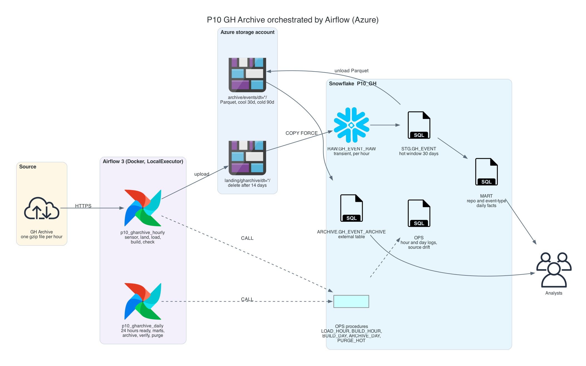
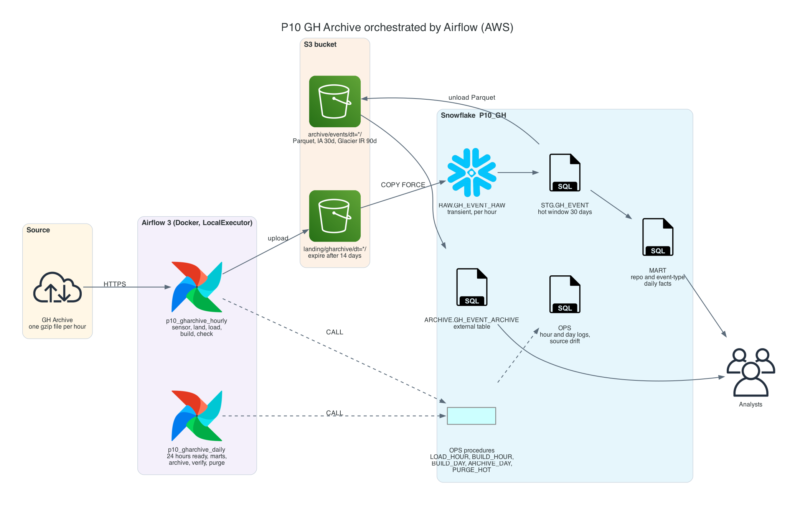
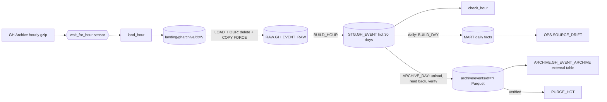

# P10 GH Archive With Airflow

Load the public GitHub event history into Snowflake hour by hour, orchestrated by Apache Airflow from outside Snowflake. Airflow waits for each hourly GH Archive file, lands it in cloud storage, and calls Snowflake procedures that load, model, and check exactly that hour. A daily DAG builds the marts once all 24 hours are in, unloads the day as Parquet to an archive container, reads the archive back to verify it, and only then purges the hot copy. Backfills reuse the same tasks, so loading last month is the same code as loading the last hour.

The data is real and it changed under the pipeline: GitHub trimmed event payloads in October 2025, pull request merges reappeared as a separate action in 2026, and push events vanished from the feed in late 2026. The pipeline has to say so instead of silently reporting zeros.

## Target Architecture

Own diagram, generated from [assets/architecture.py](assets/architecture.py). Icons: vendor architecture icon sets bundled with the <a href="https://diagrams.mingrammer.com">diagrams</a> library.

AWS variant

Own diagram, generated from [assets/architecture.py](assets/architecture.py).

Text version (Mermaid)

### Reference From the Source Article

Source: ProjectPro, <a href="https://www.projectpro.io/article/snowflake-projects/1168">13 End-to-End Snowflake Projects That Build Job-Ready Skills</a>. Linked for personal study, not copied into this repository.

The original streams EC2 logs through Kinesis Firehose into S3 zones, lets Airflow DAGs move the data into Snowflake, transforms it with streams and tasks, and exports curated data back to S3 for archival. P10 keeps the parts that are about orchestration and replaces the streaming front with a public hourly source, because the hard questions of external orchestration are batch questions:
- what one task run is responsible for (one data interval)
- how a retry or a backfill avoids duplicates
- how two DAGs agree that a day is complete
- how to delete hot data only after the archive is proven good

P04, P14, and P15 already cover streaming ingestion.

## Skills

| Skill | Milestone |
| --- | --- |
| Profiling a source and its history before modelling it | M0 |
| Airflow 3 locally: Docker Compose, connections from environment, pools | M1 |
| Data intervals, sensors in reschedule mode, idempotent landing | M2 |
| Snowflake procedures as the unit of work; delete-and-reload per hour; service user with call-only rights | M3 |
| Backfill with bounded concurrency; reprocessing completed runs | M4 |
| Cross-DAG completeness from data, daily marts | M5 |
| Unload to Parquet, read-back verification, manifests, external tables, lifecycle tiers | M6 |
| Source drift detection as a non-blocking check; cost per task through query tags | M7 |

## Prerequisites

- P05 and P09 completed or read: procedures, incremental logic, and scheduled pipelines from inside Snowflake and from GitHub Actions
- Docker Desktop with at least 4 GB of memory, Snowflake CLI, OpenSSL ([setup guide](../../../../shared/environments/setup-guide/README.md))
- For the cloud path: an Azure subscription ([account guide](../../../../shared/environments/setup-guide/accounts/azure.md)) or an AWS account. Without one, the project runs on internal stages end to end
- [Airflow fundamentals](../../../../11-airflow/README.md) help but are not required
- [Cost guardrails](../_shared/cost_guardrails.md): every scheduled hour and every backfilled hour wakes the warehouse

## Navigation

| Part | File |
| --- | --- |
| Quickstart: numbered commands from install to teardown | [QUICKSTART.md](QUICKSTART.md) |
| 1. Problem | [01_problem.md](01_problem.md) |
| 2. Architecture and decisions | [02_architecture_decisions.md](02_architecture_decisions.md) |
| 3. Snowflake approach | [03_snowflake_approach.md](03_snowflake_approach.md) |
| 4. Alternative stacks and roadmap | [04_alternative_stacks.md](04_alternative_stacks.md) |
| 5. Step by step on Snowflake | [05_snowflake_step_by_step.md](05_snowflake_step_by_step.md) |
| 6. Solved reference | [06_solution/README.md](06_solution/README.md) |
| 7. Build it yourself | [07_build_it_yourself.md](07_build_it_yourself.md) |

Recommended route: 1, 2, 3, 4, then **7** (build). Use 5 when stuck. Compare with 6 at the end.
