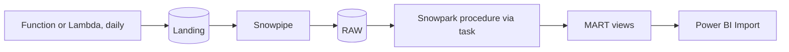
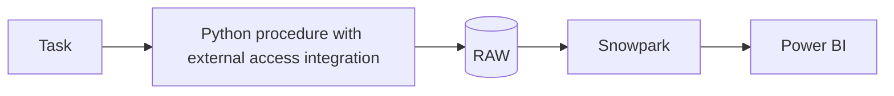
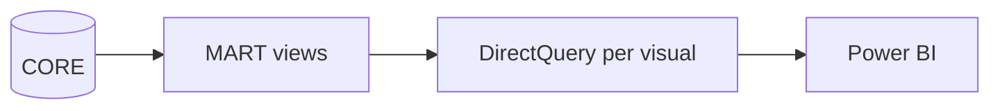

# 2. Architecture and Decisions

## Requirements That Drive the Design

| Driver | Consequence |
| --- | --- |
| Sources publish monthly or yearly | A daily scheduled function, not a stream; a task that runs only when files arrived |
| Each WFP file is a full history | Version in the file name; latest version wins; old versions stay in RAW |
| Reruns and overlapping runs | Create-if-absent writes: Blob `overwrite=False`, S3 `If-None-Match: *` |
| Two exchange-rate sources | Explicit precedence, rate source on every row, reconciliation check |
| Units differ by market | Unit parsing in tested Python; non-comparable units kept but excluded from per-kg facts |
| BI users and SQL users ask the same questions | Metrics defined twice (semantic view, DAX) and tested against each other |
| No secrets | Managed identity or execution role for storage; key pair for Power BI |

## Options

### Option 1: Function, Snowpipe, Snowpark, Import model (chosen)

### Option 2: Streaming front, as in the original

### Option 3: Snowflake only (external access)

### Option 4: Power BI on DirectQuery over the fact

## Trade-Offs

| Criterion | 1 Function + Snowpipe | 2 Streaming front | 3 Snowflake only | 4 DirectQuery |
| --- | --- | --- | --- | --- |
| Fits monthly sources | Yes | No: always-on cost for monthly data | Yes | Yes |
| Moving parts | Function, storage, queue, pipes | Plus a stream and a delivery service | Integration, network rule, secret if needed | Fewer refreshes, more queries |
| Credentials outside Snowflake | None (identities) | Producer credentials | None | Key pair in Power BI |
| Snowflake cost | Pipes per file, one short build | Same plus more files | Warehouse for downloads | Warehouse per interaction |
| Landed files as an audit trail | Yes | Yes | Only if written to a stage | n/a |
| Best when | Periodic public sources, cloud already used | Real event streams | Snowflake-only teams | Data fresher than any refresh schedule |

## Why / Why Not

**Why a function instead of Kinesis or Event Hubs?**
A stream helps when events arrive continuously and must be processed in seconds. WFP publishes once a month per country. A scheduled function asks "is there a new version?" once a day for a few cents a month; a stream would be billed every hour for nothing.

**Why version in the file name?**
Snowpipe loads a name once, COPY skips loaded files, and Blob and S3 can refuse to create an existing key. With the source version in the name, all three mechanisms agree: a rerun lands nothing, loads nothing, and builds nothing. WFP gives a version (`last_modified`); for ECB and World Bank the version is a hash of the content.

**Why check the shape before landing?**
An error page with status 200 is still an error. If it lands as `.csv`, Snowpipe loads garbage, the build runs on it, and the dashboard breaks a day later. A header check at the edge turns that into a failed function today.

**Why ECB first, and WFP's implied rate as the fallback?**
The ECB rate is an official monthly average and the same for every user; it covers INR and TRY here. KES, NGN, ETB, and BDT are not published by the ECB, so WFP's own conversion is the only consistent source. WFP rounds `usdprice` to cents, so the implied rate is computed as a price-weighted ratio for the month, not per row. Measured differences: under 1 percent where both exist.

**Why not convert with WFP's `usdprice` per row?**
For a price of 23 rupees, 0.24 USD is a 2 percent rounding step. Applying one monthly rate to the local price is more accurate and gives one rate per currency and month that can be shown, checked, and overridden.

**Why rebuild CORE fully instead of incrementally?**
A few hundred thousand rows rebuild in about a minute on XS, and a new WFP version can revise any month of history. Incremental logic would need to detect revisions; a full rebuild gets them for free. P05 and P06 show incremental patterns where volume demands them.

**Why build beside and swap?**
`CREATE TABLE ... LIKE`, append, `ALTER TABLE ... SWAP WITH`: readers see the old table or the new one. A failed build leaves yesterday's data intact. Truncate-and-load would show an empty table to a refresh that happens at the wrong moment.

**Why views in MART instead of tables?**
Power BI imports once a day; a view over a small CORE costs a few seconds per refresh. Views keep one copy of the data and run with the owner's rights, so the BI role needs no access to CORE. If DirectQuery becomes necessary, the hot views become dynamic tables.

**Why both a semantic view and DAX measures?**
Power BI cannot use Snowflake's semantic view as its model, and SQL users and Cortex Analyst cannot use DAX. Each consumer gets metrics in its own language, and a check compares them. The alternative, one definition generated into both, is a stretch goal.

**Why a separate BI warehouse and a service user?**
BI load has a different shape from pipeline load and should be visible and sized on its own. The service user signs in with a key pair, so nothing breaks when Snowflake enforces MFA for human users.

## Architecture Decision Records

### ADR-001: Scheduled serverless ingestion with versioned, create-if-absent landing

- **Decision:** one function per cloud, daily at 06:00 UTC; WFP versioned by HDX `last_modified`, ECB and World Bank by content hash; writes fail if the key exists.
- **Consequences:** idempotent end to end; old versions accumulate in landing and RAW (tiny); the function needs only write access to one prefix.

### ADR-002: FX precedence ECB, then WFP implied

- **Decision:** `UNITS_PER_USD = COALESCE(ECB cross rate, WFP price-weighted implied rate)`; `FX_SOURCE` on every row; `ECB_WFP_DIFF_PCT` where both exist.
- **Consequences:** USD and EUR prices for every country; for four currencies the rate comes from WFP and inherits its method.

### ADR-003: Unit normalization in code

- **Decision:** `units.parse_unit` maps `90 KG`, `500 ML`, `200 G` to a base unit; counts and services are not comparable.
- **Consequences:** new unit names need a code change and a test; unknown units are visible in a check, never guessed.

### ADR-004: Full rebuild, build beside and swap

- **Decision:** the procedure rebuilds `CORE.UNIT_MAP`, `FX_MONTHLY`, and `FOOD_PRICE` from the newest snapshots and swaps each table.
- **Consequences:** simple and revision-safe; tables are swapped one after another, so for a few seconds FX and prices can come from different builds of the same input.

### ADR-005: Import mode, metrics in two layers with a parity check

- **Decision:** Power BI imports MART views daily; metrics exist in `SEM.FOOD_PRICES` and in DAX; SQL check 9 compares the semantic view with SQL.
- **Consequences:** BI cost is one refresh a day; a DAX change needs a matching check in Power BI (drill D7).

## Failure Modes

| Failure | Detection | Recovery |
| --- | --- | --- |
| Source error page or outage | `SourceError` in the summary; failed invocation | Next daily run; other sources unaffected |
| Same version fetched twice | Summary `unchanged` | Nothing to do |
| New WFP version revises history | Check 1 shows a new live version | Nothing to do: latest wins |
| Unknown unit | Check 4 | Extend `units.py`, test, package, rebuild |
| FX sources disagree | Check 5 | Investigate; change precedence only with a decision record |
| Build fails | Task history, `OPS.BUILD_LOG` gap | Fix, `CALL CORE.SP_BUILD_MARKETS()`; readers keep the previous build |
| Pipe misses an event | Check 2, `SYSTEM$PIPE_STATUS` | `ALTER PIPE ... REFRESH` |
| DAX and semantic view differ | Manual card comparison (D7) | Align definitions |

## Cost Model

| Component | Driver | How to measure |
| --- | --- | --- |
| Function or Lambda | One run a day, a few minutes when files change | Azure cost analysis by tag, Lambda duration metrics |
| Storage | A few hundred MB of versions per year | Cloud cost reports |
| Snowpipe | Per file loaded: a few files a month | `PIPE_USAGE_HISTORY` |
| Build | Task starts only when streams have data; about a minute on XS | `TASK_HISTORY`, `WAREHOUSE_METERING_HISTORY` for `P11_WH` |
| Power BI refresh | One import a day on `P11_BI_WH` | Query history by `P11_POWERBI_SVC` |
| Power BI interactions | Zero in Import mode; per visual in DirectQuery (D6) | Same |
| Power BI licence | Publishing and scheduled refresh need a Pro or Fabric capacity licence | Microsoft licensing |
