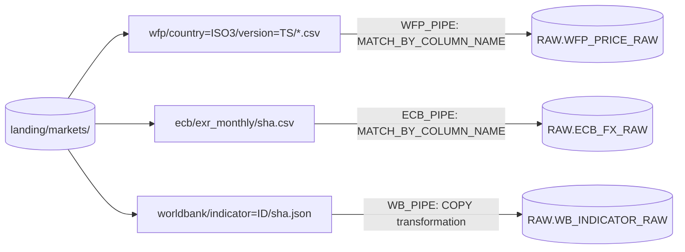
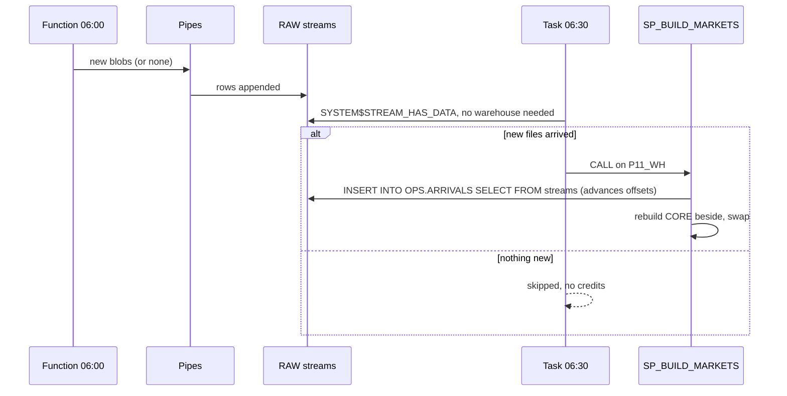
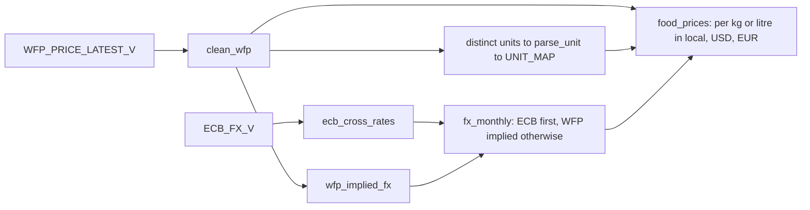
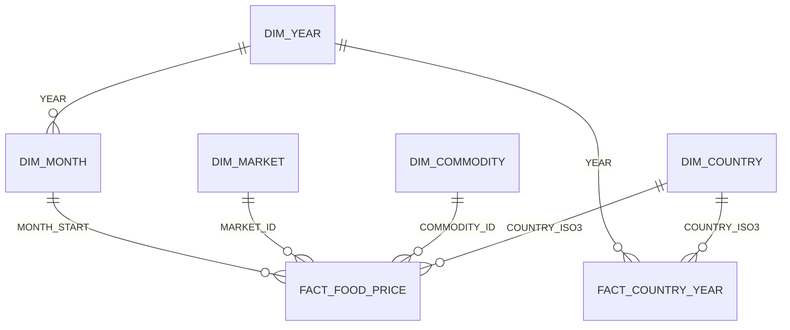

# 3. Snowflake Approach

The cloud function only fetches and lands files. Everything after the landing is Snowflake: pipes, streams, a task, a Snowpark procedure, views, a semantic view, and the access model for Power BI.

## Load: Pipes With Header Matching



- `PARSE_HEADER = TRUE` with `MATCH_BY_COLUMN_NAME = CASE_INSENSITIVE` loads CSV columns by name. A source that reorders or adds columns still loads; a renamed column loads as NULL and shows up in checks. A positional `$1, $2` mapping would shift silently.
- `INCLUDE_METADATA` adds `METADATA$FILENAME`, `METADATA$FILE_ROW_NUMBER`, `METADATA$FILE_LAST_MODIFIED`, and `METADATA$START_SCAN_TIME` without a COPY transformation (the two cannot be combined). It requires `ERROR_ON_COLUMN_COUNT_MISMATCH = FALSE` for CSV.
- World Bank JSON is `[metadata, rows]`. `STRIP_OUTER_ARRAY = TRUE` makes two rows per file; the view keeps the array row and flattens it.
- One Event Grid subscription and one queue (Azure), or one Snowflake-managed SQS queue (AWS), serve all three pipes; each pipe filters by path.
- The same COPY statements run as `core/20_load_internal.sql` in internal-stage mode. Files that landed before the pipes existed are loaded once with `ALTER PIPE ... REFRESH`.

## RAW Views: The Path Carries Meaning

| View | Logic |
| --- | --- |
| `RAW.WFP_PRICE_V` | Country and version parsed from the path with `REGEXP_SUBSTR(..., 'country=([A-Z]{3})', 1, 1, 'e')`; the CSV has neither |
| `RAW.WFP_PRICE_LATEST_V` | `QUALIFY DENSE_RANK() OVER (PARTITION BY COUNTRY_ISO3 ORDER BY SOURCE_VERSION DESC, FILE_LAST_MODIFIED DESC, SRC_FILE DESC) = 1`: one file per country, even if a version was loaded twice |
| `RAW.ECB_FX_V` | Newest ECB file, monthly rows, units per EUR |
| `RAW.WB_INDICATOR_V` | Newest file per indicator, flattened to country, year, value |
| `CORE.COUNTRY_YEAR` | Indicators pivoted to one row per country and year |

Path parsing and version selection are set logic and stay in SQL. Snowpark gets clean inputs and does what is easier in Python.

## Trigger: Streams Plus a Scheduled Task With WHEN



The streams are used only as a signal and an audit of arrivals. The build reads the newest snapshots through the RAW views, because a WFP file replaces history rather than appending to it.

## Snowpark: Pure Transforms, Thin I/O

| Module | Content | Tested |
| --- | --- | --- |
| `markets_pipeline/units.py` | `parse_unit`: `90 KG` to 90 KG, `500 ML` to 0.5 L, counts not comparable | Plain pytest |
| `markets_pipeline/transforms.py` | `clean_wfp`, `wfp_implied_fx`, `ecb_cross_rates`, `fx_monthly`, `food_prices` | Snowpark local testing, no account |
| `markets_pipeline/pipeline.py` | Read views, consume streams, write CORE beside and swap, log | Runs as the procedure `CORE.SP_BUILD_MARKETS` |



FX logic in one table:

| Currency | ECB publishes | Rate used | Example (October 2026) |
| --- | --- | --- | --- |
| USD | Yes | 1 | |
| INR, TRY | Yes | ECB units per EUR divided by USD per EUR | INR 95.53 per USD; WFP implied 94.72 (minus 0.85 percent) |
| KES, NGN, ETB, BDT | No | Sum of local prices over sum of WFP USD prices for the month | KES 129.9 per USD |

EUR prices divide the USD price by the ECB USD per EUR rate of the same month.

Snowpark local testing (version 1.56) behaved differently from Snowflake in three places. Each is handled so the code is correct in Snowflake and testable on a laptop:
- a left join returns NaN, not NULL, for a missing double, so `is_not_null` is wrong there; the source flag is a joined literal with `COALESCE`
- a column computed after a filter can be misaligned, so `clean_wfp` computes all columns first and filters once
- a window followed by a filter failed, so latest-version selection lives in a SQL view

Casting a tag row such as `#value` would fail in Snowflake, so numeric columns use `try_cast`.

## Build Beside and Swap

```sql
CREATE OR REPLACE TABLE CORE.FOOD_PRICE__NEXT LIKE CORE.FOOD_PRICE;
-- Snowpark: save_as_table('CORE.FOOD_PRICE__NEXT', mode='append', column_order='name')
ALTER TABLE CORE.FOOD_PRICE SWAP WITH CORE.FOOD_PRICE__NEXT;
DROP TABLE CORE.FOOD_PRICE__NEXT;
```

`LIKE` keeps the declared column types; `SWAP` is atomic; views over `CORE.FOOD_PRICE` see the new data immediately; a failure before the swap leaves yesterday's data in place.

## Consumer Layer

| Object | Grain | Notes |
| --- | --- | --- |
| `MART.FACT_FOOD_PRICE` | Month, market, commodity, price type, unit | Comparable units, since 2015, three currencies, `FX_SOURCE` |
| `MART.FACT_COUNTRY_YEAR` | Country, year | CPI, inflation, GDP per capita, population, official rate |
| `MART.DIM_COUNTRY`, `DIM_COMMODITY`, `DIM_MARKET`, `DIM_MONTH`, `DIM_YEAR` | One row per key | Latest names win for renamed markets and commodities |
| `MART.FOOD_VS_CPI_YEARLY` | Country, commodity, price type, year | Median local price, year-over-year change, CPI, real gap; only years with 6 or more months |
| `SEM.FOOD_PRICES` | Semantic view | Facts, dimensions with synonyms, metrics: median price in three currencies, observations, markets reporting |



Querying the semantic view by metric name, without joins or `GROUP BY`:

```sql
SELECT * FROM SEMANTIC_VIEW(
  SEM.FOOD_PRICES
  DIMENSIONS countries.country_name, commodities.commodity, prices.price_year
  METRICS prices.median_price_usd, prices.markets_reporting
  WHERE prices.price_type = 'Retail'
);
```

## Security Model

| Principal | Role | Can | Cannot |
| --- | --- | --- | --- |
| You | `P11_OWNER` | Everything in `P11_MARKETS` | Account administration |
| `P11_POWERBI_SVC` (`TYPE = SERVICE`, key pair) | `P11_BI_READER` | Read MART views and the semantic view on `P11_BI_WH` | Read RAW or CORE, use `P11_WH` |
| Function managed identity or Lambda role | Cloud role | Create objects under `landing/markets/` | Overwrite or delete |
| Snowflake storage integration | Cloud role | Read `landing/markets/` | Write anything |

## Object Inventory

| Object | Purpose |
| --- | --- |
| `RAW.LANDING_STAGE`, `RAW.FF_CSV_HEADER`, `RAW.FF_JSON_ARRAY` | Landing and formats |
| `RAW.WFP_PRICE_RAW`, `RAW.ECB_FX_RAW`, `RAW.WB_INDICATOR_RAW` and three streams | Every version as delivered |
| `RAW.WFP_PIPE`, `RAW.ECB_PIPE`, `RAW.WB_PIPE` (cloud mode) | Auto-ingest |
| `RAW.*_V`, `CORE.COUNTRY_YEAR` | Parsing and pivot views |
| `CORE.UNIT_MAP`, `CORE.FX_MONTHLY`, `CORE.FOOD_PRICE` | Snowpark output, swapped on every build |
| `CORE.SP_BUILD_MARKETS`, `OPS.BUILD_MARKETS`, `OPS.CODE_STAGE` | Build and schedule |
| `MART.*` views, `SEM.FOOD_PRICES` | Consumer layer |
| `OPS.ARRIVALS`, `OPS.BUILD_LOG` | Evidence |
| `P11_WH`, `P11_BI_WH`, `P11_RM`, `P11_POWERBI_SVC` | Compute, budget, identity |

## What This Project Teaches About Snowflake

- Header-matched CSV loading with file metadata is the robust default for third-party CSV
- A task with `WHEN SYSTEM$STREAM_HAS_DATA` costs nothing on days without data
- Snowpark code can be designed for local testing: pure transforms, I/O at the edge
- Swapping tables gives atomic replacement without transactions around DDL
- A semantic view is a contract for metric names and meanings, queryable from SQL and AI tools
