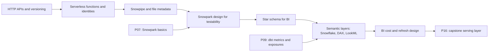

# 4. Alternative Stacks and Roadmap

The same pipeline with other tools. The shape stays: periodic fetch with versioned landing, a load that matches columns by name, typed transformations with explicit FX and unit rules, a star for BI, metrics with one meaning.

## Component Mapping

| Concern | P11 | Microsoft Fabric | Databricks | BigQuery and Looker | Local open source |
| --- | --- | --- | --- | --- | --- |
| Fetch | Azure Function or Lambda | Data pipeline copy activity or notebook | Job task | Cloud Run job | Python script with cron |
| Landing | Blob or S3 | OneLake Files | Volume | GCS | Folder |
| Load | Snowpipe | Pipeline or Dataflow Gen2 | Auto Loader | Load job, external table | DuckDB `read_csv` |
| Transform | Snowpark procedure | Notebook (Spark) or warehouse SQL | PySpark or SQL | SQL, Dataform | Python, DuckDB |
| Star | MART views | Lakehouse or warehouse tables | Gold Delta tables | Views | DuckDB views |
| Semantic layer | Semantic view and Power BI model | Power BI semantic model (Direct Lake) | Metric views and Power BI | LookML | dbt semantic layer |
| BI | Power BI Import | Power BI Direct Lake | Power BI or Databricks dashboards | Looker | Evidence, Superset |

## Microsoft Fabric

The closest alternative for a Power BI team. Land files in OneLake, transform with a notebook into lakehouse Delta tables, and build the semantic model in Direct Lake mode: Power BI reads the Delta files without an import copy and without querying a warehouse per visual. You trade Snowflake's separation of compute and its SQL surface for one capacity bill and no refresh step. With Snowflake in place, Fabric can also read Snowflake data through mirroring or shortcuts to Iceberg tables.

## Databricks

Auto Loader reads the landed CSV with schema hints and rescued columns, PySpark applies the same unit and FX rules, gold Delta tables feed Power BI through the Databricks connector, and Unity Catalog metric views play the role of the semantic view. A good fit if the team already runs Spark jobs next to BI.

## Keep Snowflake, Change the Edges

| Change | Effect |
| --- | --- |
| External access integration instead of a cloud function | No cloud account; the procedure downloads; network rules and egress cost move into Snowflake |
| Dynamic tables instead of the Snowpark build | Declarative refresh; FX precedence and unit parsing move to SQL or a Python UDF |
| Power BI DirectQuery on dynamic tables | Fresher than daily; BI cost per interaction (drill D6) |
| Streamlit in Snowflake instead of Power BI | No licence, no Windows; less self-service for analysts (P03) |

## When Each Alternative Wins

| Situation | Choice |
| --- | --- |
| Snowflake platform, Power BI users, periodic public data | P11 as built |
| Power BI-first organization with Fabric capacity | Fabric lakehouse with Direct Lake |
| Spark-heavy team, many sources | Databricks with metric views |
| Looker shop on Google Cloud | BigQuery with LookML |
| Learning the logic with zero cost | Python and DuckDB on a laptop |

## Learning Roadmap

| Step | Where in this repository |
| --- | --- |
| Power BI and Fabric | [10-powerbi-fabric](../../../../10-powerbi-fabric/README.md) |
| Python | [01-python](../../../../01-python/README.md) |
| Azure storage | [09-azure-data-lake-storage](../../../../09-azure-data-lake-storage/README.md) |
| dbt semantic layer | [12-dbt](../../../../12-dbt/README.md) |

### Suggested Exercise

Rebuild `fx_monthly` and `food_prices` as SQL views or dynamic tables, with units from a seeded table instead of Python. Compare the two versions on four things: lines of code, how you test them, what a new unit costs to add, and how a reviewer reads the FX precedence rule.
