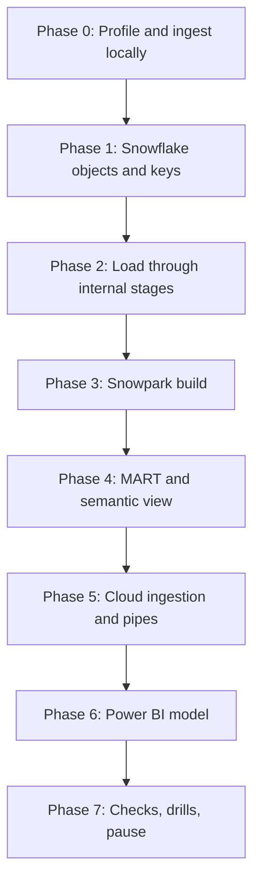

# 5. Step by Step on Snowflake

Use this when stuck in [07](07_build_it_yourself.md). Commands run from `06_solution/` unless stated otherwise. The short version is [QUICKSTART.md](QUICKSTART.md).



## Phase 0: Profile and Ingest Locally

```bash
python -m pytest -q ingest/tests
(cd ingest && python -m markets_ingest.run --target local --out "$P11_DATA_DIR" --countries KEN,TUR,IND)
(cd ingest && python -m markets_ingest.run --target local --out "$P11_DATA_DIR" --countries KEN,TUR,IND)   # again
```

- The first run takes a few minutes (the India file is about 26 MB). The second lists everything as `unchanged` and downloads no CSV.
- Open one WFP file: count units, price types, and how often `usdprice` is below 1. Open the ECB file: which of your currencies are missing?

## Phase 1: Snowflake Objects and Keys

```bash
mkdir -p ~/.snowflake/keys
openssl genrsa 2048 | openssl pkcs8 -topk8 -inform PEM -out ~/.snowflake/keys/p11_powerbi.p8 -nocrypt
openssl rsa -in ~/.snowflake/keys/p11_powerbi.p8 -pubout -out ~/.snowflake/keys/p11_powerbi.pub
./run_sql.sh core/00_account_setup.sql core/01_raw.sql core/10_core_tables.sql
```

`run_sql.sh` puts the public key into `P11_POWERBI_SVC`. The private key is for Power BI only; keep it out of Git.

## Phase 2: Load Through Internal Stages

```bash
./upload.sh
./run_sql.sh core/20_load_internal.sql
```

```sql
SELECT COUNTRY_ISO3, SOURCE_VERSION, COUNT(*) FROM P11_MARKETS.RAW.WFP_PRICE_V GROUP BY 1, 2;
SELECT * FROM P11_MARKETS.RAW.WB_INDICATOR_V LIMIT 10;
```

Run `20_load_internal.sql` again: every COPY reports 0 files.

## Phase 3: Snowpark Build

```bash
python -m pytest -q tests/test_transforms.py   # local testing, no account
./package.sh
./run_sql.sh core/30_procedure_and_task.sql
```

- The script creates the procedure, resumes the task, and calls the build once. The result is a JSON summary with row counts.
- `SELECT * FROM P11_MARKETS.CORE.FX_MONTHLY WHERE CURRENCY = 'INR' ORDER BY MONTH DESC LIMIT 6` shows both rates and the difference.
- Change a transform, run the tests, `./package.sh`, and rerun `30_procedure_and_task.sql`: `IMPORTS` are resolved when the procedure is created.

## Phase 4: MART and Semantic View

```bash
./run_sql.sh core/40_mart.sql core/50_semantic_view.sql
```

`50_semantic_view.sql` ends with a query through `SEMANTIC_VIEW(...)`. `DESC SEMANTIC VIEW P11_MARKETS.SEM.FOOD_PRICES` lists what you declared; `SHOW SEMANTIC METRICS IN P11_MARKETS.SEM.FOOD_PRICES` lists metrics.

## Phase 5: Cloud Ingestion and Pipes

Azure:

```bash
set -a; source p11.env; set +a
./azure/01_provision.sh                      # then AZURE_TENANT_ID into p11.env
./azure/02_deploy_function.sh                # deploys and triggers one run
./run_sql.sh azure/10_integrations.sql       # consent URLs, app names
./azure/03_grant_snowflake_access.sh <storage app name> <queue app name>
./run_sql.sh azure/11_stage_and_pipes.sql    # a few minutes later; replaces the internal stage
```

AWS: `aws/01_provision.sh`, `aws/02_deploy_lambda.sh`, `run_sql.sh aws/10_integration.sql aws/11_stage_and_pipes.sql`, `aws/03_connect_snowflake.sh <arn> <external id> <notification_channel>`, then `ALTER PIPE ... REFRESH` for the three pipes.

- The stage now points to cloud storage; RAW keeps the rows loaded from internal stages. Both are versions of the same files.
- `SELECT SYSTEM$PIPE_STATUS('P11_MARKETS.RAW.WFP_PIPE')` should show `RUNNING` and no errors.

## Phase 6: Power BI Model

Follow [06_solution/powerbi/README.md](06_solution/powerbi/README.md): connect with Key Pair as `P11_POWERBI_SVC`, warehouse `P11_BI_WH`, role `P11_BI_READER`, Import mode, the queries from `queries.pq`, relationships, and the measures from `measures.dax`. Build one page: median USD per kg by country and commodity, a line of median local price by month for one country, and food price change against CPI by year.

## Phase 7: Checks, Drills, Pause

```bash
./run_sql.sh tests/data_quality_checks.sql
```

Then [tests/failure_drills.md](06_solution/tests/failure_drills.md). After each session: stop the schedule (`az functionapp stop` or disable the EventBridge schedule) and `./run_sql.sh core/90_pause.sql`.
