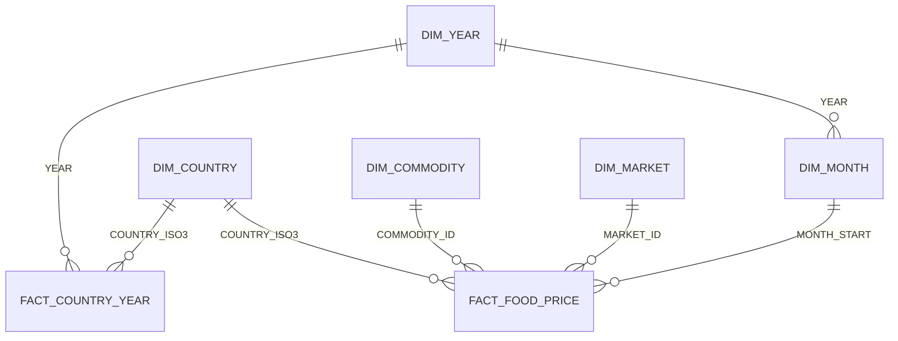

# P11 Power BI Semantic Model

The model the report is built on: tables, relationships, measures, connection, and refresh. It mirrors the Snowflake star in `MART` and the metrics in `SEM.FOOD_PRICES`.

## Files

| File | Content |
| --- | --- |
| [queries.pq](queries.pq) | Power Query (M) per table, with the Snowflake connection |
| [measures.dax](measures.dax) | DAX measures, the first five mirror the semantic view metrics |

## Model

| Setting | Value | Why |
| --- | --- | --- |
| Storage mode | Import for all tables | Monthly data, about a million rows at most; one refresh a day costs one short warehouse run |
| Relationships | Single direction, one to many, from dimensions to facts | Two facts at different grains meet only through shared dimensions |
| `DIM_YEAR` | Shared by both facts | Prices are monthly, indicators yearly: a year slicer filters both |
| Hidden columns | Keys in facts, `FX_SOURCE` except on a data-quality page | Users slice by names, not ids |
| Default summarization | None on price columns | A sum of prices per kg is meaningless; only measures aggregate |

## Connection

1. Create the key pair `p11_powerbi.p8` and `.pub` (QUICKSTART step 3); `core/00_account_setup.sql` registered the public key on `P11_POWERBI_SVC`.
2. In Power BI Desktop: Get data, Snowflake. Server `<account identifier>.snowflakecomputing.com`, warehouse `P11_BI_WH`, advanced option Role `P11_BI_READER`. Data connectivity mode: Import.
3. Authentication: Key Pair, user `P11_POWERBI_SVC`, upload the `.p8` file.
4. Paste the queries from [queries.pq](queries.pq) (Advanced Editor), or pick the views in the navigator and apply the same type changes.

Power BI Desktop runs on Windows only. On a Mac, use a Windows virtual machine, or build the model in the Power BI service (web modeling) from a semantic model published once from Windows. The Snowflake side does not change.

## Refresh

| Step | Time (UTC) | Owner |
| --- | --- | --- |
| Ingestion function or Lambda | 06:00 | Cloud schedule |
| Snowpipe loads new files | within minutes | Snowflake |
| `OPS.BUILD_MARKETS` task rebuilds CORE if anything arrived | 06:30 | Snowflake |
| Scheduled refresh of the semantic model | 07:30 | Power BI service, cloud connection with the same key pair |

Sources change monthly at most; a daily refresh is already generous. If the build fails, the refresh imports yesterday's CORE, which is still consistent because tables are swapped, never half written.

## Measures and the Semantic View

| Power BI measure | Semantic view metric | Check |
| --- | --- | --- |
| Median USD per kg | `prices.median_price_usd` | Data quality check 9 compares the semantic view with SQL; compare one card in Power BI with the same SQL for one country and year |
| Median EUR per kg | `prices.median_price_eur` | Same |
| Median local per kg | `prices.median_price_local` | Same |
| Price observations | `prices.price_observations` | Same |
| Markets reporting | `prices.markets_reporting` | Same |

Measures that need report context (year over year, real gap, affordability) live only in DAX. Rule of thumb: if a number is quoted outside the report, it must exist in the semantic view too.

## DirectQuery: When and What It Costs

DirectQuery sends one or more SQL queries per visual per interaction to `P11_BI_WH`. A report page with eight visuals, opened by ten people, resumes the warehouse many times a day and keeps it running. Import pays once per refresh. Use DirectQuery only if data must be fresher than the refresh schedule, and then point it at small aggregated views, not at the fact. With connector implementation 2.0, Microsoft lists a known issue with `COUNT DISTINCT` results in queries sent to Snowflake; in Import mode `DISTINCTCOUNT` is computed by Power BI itself and is not affected.

## Stretch: Model as Code

Save the report as a Power BI Project (`.pbip`). The semantic model is then stored as TMDL text files that can be reviewed in pull requests, the same way `50_semantic_view.sql` is. Put the folder next to this README and compare a measure change in Git with a change to the semantic view.
