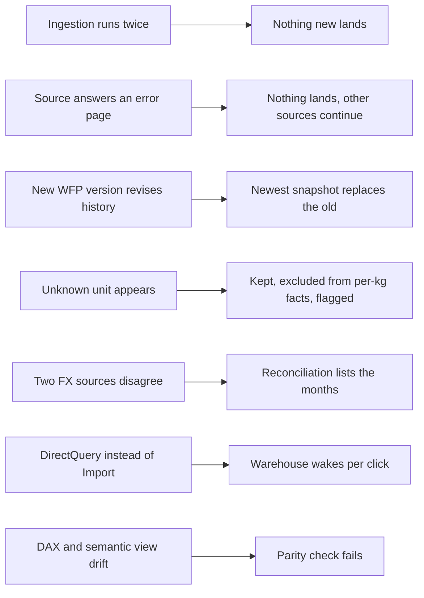

# P11 Failure Drills

In this project most failures are quiet: a source changes shape, two numbers that should agree drift apart, or a cheap design turns expensive when people start clicking. Each drill causes one on purpose. Predict, run, restore.



## D1 The Ingestion Runs Twice

Run the ingestion again right after a successful run: locally `python -m markets_ingest.run --target local --out "$P11_DATA_DIR"`, in Azure with the admin endpoint call from `azure/02_deploy_function.sh`, in AWS with `aws lambda invoke`.

- **Predict:** how many files land, how many WFP CSVs are downloaded, and what Snowpipe does.
- **Observe:** the summary lists everything as `unchanged`; WFP costs one metadata request per country and no download; Snowpipe gets no event because no blob was created; the task's `WHEN` is false and no warehouse starts.
- **Lesson:** version in the name plus create-if-absent makes the whole chain idempotent, from the function to the warehouse bill.

## D2 A Source Answers With an Error Page

Make one source fail: in `sources.py` change `ECB_URL` to a wrong path (or run with the network blocked for `data-api.ecb.europa.eu`).

- **Predict:** what lands, what the function or Lambda reports, and what Power BI shows tomorrow.
- **Observe:** `check_ecb_csv` raises `SourceError`; the summary has one error; WFP and World Bank still land; the invocation fails and shows up as a failure in Application Insights or CloudWatch; the build uses the last good ECB file, so FX stays consistent.
- **Lesson:** validate shape at the edge. An HTML error page saved as `.csv` would load as garbage and break the next build instead of today's ingestion.

## D3 A New WFP Version Revises History

Simulate a revision in internal-stage mode: copy the Kenya file into a newer version folder, then change one 2020 price in an editor.

```bash
src=$(ls -d "$P11_DATA_DIR"/markets/wfp/country=KEN/version=* | tail -1)
dst="$P11_DATA_DIR/markets/wfp/country=KEN/version=29991231T000000"
mkdir -p "$dst" && cp "$src"/*.csv "$dst/"      # then edit one 2020-01-15 price in $dst
./upload.sh && ./run_sql.sh core/20_load_internal.sql && snow sql -c p11 -q "CALL P11_MARKETS.CORE.SP_BUILD_MARKETS()"
```

- **Predict:** how many Kenya rows are in RAW, how many in CORE, and which price for that month the fact shows.
- **Observe:** RAW holds both versions (check 1: two versions, one live); CORE has exactly one version's rows; the fact shows the revised price.
- **Lesson:** for full-snapshot sources, "latest file wins" is the whole merge logic. Keeping old versions in RAW is what lets you answer "what did we report last month, and why did it change?". Remove the drill folder from the stage and RAW afterwards.

## D4 An Unknown Unit Appears

Add a row with unit `Loaf` (or `3 KG bag`) to a local WFP file in a new version folder, upload, load, build.

- **Predict:** whether the build fails, and where the row ends up.
- **Observe:** `parse_unit` marks it not comparable; the row is in `CORE.FOOD_PRICE` with a local price but no per-kg price; it is not in `MART.FACT_FOOD_PRICE`; check 4 lists `Loaf` with `IS_COMPARABLE = FALSE`.
- **Try:** teach `units.py` that `3 KG bag` is 3 KG, add a test, package, rebuild.
- **Lesson:** reference data in code changes through review and tests. An unknown value is surfaced, not guessed.

## D5 Two FX Sources Disagree

Run check 5 with the threshold at 0.5 percent instead of 2.

- **Predict:** which currencies and months appear, and in which direction.
- **Observe:** INR months within about plus or minus 1 percent, TRY within about 0.1 percent in late 2026. WFP's USD prices use WFP's own monthly rate and are rounded to cents; the ECB rate is a monthly average of daily reference rates.
- **Try:** switch the precedence in `fx_monthly` to WFP first, rebuild, and compare the median USD per kg for India in Power BI.
- **Lesson:** when two sources give the same number, document which one wins and why, and measure the difference. "Close enough" is a threshold, not a feeling.

## D6 DirectQuery Instead of Import

Change `FACT_FOOD_PRICE` to DirectQuery in Power BI Desktop, open a page with six visuals, change three slicers.

- **Predict:** queries on `P11_BI_WH` and warehouse resumes for ten minutes of clicking.
- **Observe:** `core/90_pause.sql` lists dozens of queries by `P11_POWERBI_SVC`, tagged by Power BI; the warehouse stays up while people click. In Import mode the same session sends nothing to Snowflake.
- **Lesson:** storage mode is a cost decision. Import pays once per refresh, DirectQuery pays per interaction.

## D7 DAX and the Semantic View Drift Apart

Change the DAX measure `Median USD per kg` to `AVERAGE`, and leave `prices.median_price_usd` as `MEDIAN`.

- **Predict:** which check notices, and how a reader of the weekly note would.
- **Observe:** the SQL parity check still passes (it compares the semantic view with SQL); the Power BI card for one country and year no longer matches the semantic view query for the same filter. Only the manual comparison in [powerbi/README.md](../powerbi/README.md) catches it.
- **Lesson:** two semantic layers mean two definitions. Either generate one from the other, or test them against each other on every change.

## Drill Log Template

| Drill | Prediction | Observed | Lesson in one sentence |
| --- | --- | --- | --- |
| D1 | | | |
| D2 | | | |
| D3 | | | |
| D4 | | | |
| D5 | | | |
| D6 | | | |
| D7 | | | |
