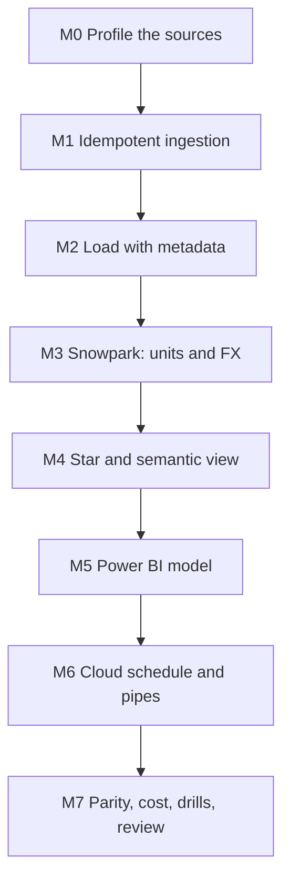

# 7. Build It Yourself

## Brief

A research team needs comparable food prices for six countries in local currency, USD, and EUR, next to inflation and income, in a Power BI report they refresh themselves, with the same numbers available in SQL. Sources are public and change monthly at most. Build serverless ingestion that lands each new version once, the Snowflake load, a Snowpark build with explicit unit and exchange-rate rules, a star for BI, a semantic view, and the Power BI model, with evidence that the numbers agree and cost little.

## Rules

| You may use | Only when stuck | Only after the milestone passes |
| --- | --- | --- |
| [01](01_problem.md) to [04](04_alternative_stacks.md), `_shared/`, [10-powerbi-fabric](../../../../10-powerbi-fabric/README.md), Snowflake, Azure, AWS, Power BI, WFP, ECB, and World Bank documentation | [05](05_snowflake_step_by_step.md) | [06_solution/](06_solution/README.md) |

Write the ingestion, the Snowpark package, the SQL, and the measures yourself.

## Milestones

### M0 Profile the Sources
- [ ] For each source: how it versions, how often it changes, its format and errors. For WFP: units, price types, rounding of `usdprice`. For ECB: which of your currencies exist.

### M1 Idempotent Ingestion
- [ ] A second run lands nothing and downloads no unchanged WFP file
- [ ] An error page from a source is never landed; one failing source does not stop the others
- [ ] Tests without network

**Hint:** what in the file name makes Snowpipe, COPY, and the storage service all agree that a file is new?

### M2 Load With Metadata
- [ ] CSV loaded by header name with file name, row number, file time, and load time
- [ ] World Bank JSON envelope split from its rows
- [ ] Views that parse country and version from the path and pick the newest version

### M3 Snowpark: Units and FX
- [ ] Units normalized to kg or litre in tested Python; unknown units kept but flagged
- [ ] One monthly rate per currency with a written precedence rule and a reconciliation column
- [ ] Prices per kg or litre in local currency, USD, and EUR, with the rate source on every row
- [ ] Transforms tested with Snowpark local testing; readers never see a half-built table

### M4 Star and Semantic View
- [ ] Fact and dimension views with a documented grain; a shared year dimension for the yearly indicators
- [ ] A semantic view with facts, dimensions, synonyms, and at least four metrics
- [ ] Food price change against CPI by year, with the composition caveat written down

### M5 Power BI Model
- [ ] Import model through a key-pair service user, its own role and warehouse
- [ ] Relationships one to many from dimensions; no summing of price columns
- [ ] Measures for median price in three currencies, year over year, real gap, affordability

### M6 Cloud Schedule and Pipes
- [ ] A daily function or Lambda with an identity that can only create files under one prefix
- [ ] Three pipes on one notification channel; files that landed earlier loaded once
- [ ] A build task that costs nothing on days without new files

### M7 Parity, Cost, Drills, Review
- [ ] A check that the semantic view and SQL agree; a documented check for DAX
- [ ] Cost of one day: function, pipes, build, refresh; cost of ten minutes of DirectQuery clicking
- [ ] Drills D1 to D7
- [ ] One page: architecture, versioning rule, FX rule, unit rule, two semantic layers, cost per month
- [ ] Pause after each session; teardown at the end

## Stretch Goals

- **One definition, two layers:** generate the semantic view YAML and the DAX measures from one metric file.
- **Power BI Project:** save the report as `.pbip` and review a measure change as a TMDL diff.
- **Dynamic tables:** replace the Snowpark build with dynamic tables and compare cost and code ([04](04_alternative_stacks.md#suggested-exercise)).
- **Cortex Analyst:** ask questions in natural language against `SEM.FOOD_PRICES` and record which ones it answers wrongly.
- **More countries:** add two countries with ECB currencies (Indonesia IDR, Philippines PHP) and measure how the build time grows.

## Portfolio and Interview

**Resume bullet example:** Built a serverless pipeline from WFP, ECB, and World Bank APIs to Power BI on Snowflake: Azure Functions with managed identity landing versioned files, Snowpipe with header-matched loading, a locally tested Snowpark build with explicit unit and FX rules swapped atomically, a star schema and a Snowflake semantic view, and an Import-mode Power BI model on a key-pair service user with metric parity checks.

**Questions you should be able to answer:**
1. Why is there no stream in front of Snowflake, and what would make you add one?
2. How does a rerun land nothing, load nothing, and build nothing?
3. Which exchange rate does each currency use, why, and how large is the difference to the alternative?
4. What do readers see if the build fails halfway?
5. Where is "median USD per kg" defined, how many times, and how do you know the definitions agree?
