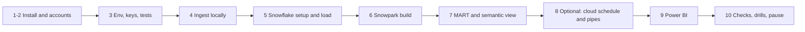

# P11 Quickstart

Numbered commands from an empty laptop to comparable food prices in Snowflake, a semantic view, and a Power BI model. Details: [05_snowflake_step_by_step.md](05_snowflake_step_by_step.md).



### 1. Install

Python 3.11 or 3.12, Snowflake CLI, OpenSSL ([setup guide](../../../../shared/environments/setup-guide/01_workstation_macos.md), [CLI tools](../../../../shared/environments/setup-guide/02_cli_tools_and_auth.md)). Azure CLI or AWS CLI only for step 8. Power BI Desktop on Windows or a Windows virtual machine for step 9.

**Done when:** `snow --version` and `python3 --version` work.

### 2. Accounts

[Snowflake](../../../../shared/environments/setup-guide/accounts/snowflake.md) with `[connections.p11]` in `~/.snowflake/config.toml`. Optional: [Azure](../../../../shared/environments/setup-guide/accounts/azure.md) or [AWS](../../../../shared/environments/setup-guide/accounts/aws.md); [Power BI](../../../../shared/environments/setup-guide/accounts/microsoft_fabric_power_bi.md).

**Done when:** `snow sql -c p11 -q "SELECT CURRENT_USER()"` works.

### 3. Env, keys, tests

```bash
cd 16-cloud-databases/01-snowflake/end-to-end-projects/P11_global_markets_powerbi/06_solution
cp p11.env.example p11.env && set -a && source p11.env && set +a
python3 -m venv .venv && source .venv/bin/activate && pip install pytest snowflake-snowpark-python
mkdir -p ~/.snowflake/keys
openssl genrsa 2048 | openssl pkcs8 -topk8 -inform PEM -out ~/.snowflake/keys/p11_powerbi.p8 -nocrypt
openssl rsa -in ~/.snowflake/keys/p11_powerbi.p8 -pubout -out ~/.snowflake/keys/p11_powerbi.pub
python -m pytest -q ingest/tests tests/test_transforms.py
```

**Done when:** 13 tests pass.

### 4. Ingest locally

```bash
(cd ingest && python -m markets_ingest.run --target local --out "$P11_DATA_DIR")
```

**Done when:** the summary lists 6 WFP files, 1 ECB file, 5 World Bank files, and no errors. A second run lists them as `unchanged`.

### 5. Snowflake setup and load

```bash
./run_sql.sh core/00_account_setup.sql core/01_raw.sql core/10_core_tables.sql
./upload.sh && ./run_sql.sh core/20_load_internal.sql
```

**Done when:** the last query shows 6 WFP files, 1 ECB file, and 5 World Bank files.

### 6. Snowpark build

```bash
./package.sh && ./run_sql.sh core/30_procedure_and_task.sql
```

**Done when:** the `CALL` returns a JSON summary with `food_price` above 300,000 and `SHOW TASKS IN SCHEMA P11_MARKETS.OPS` shows `started`.

### 7. MART and semantic view

```bash
./run_sql.sh core/40_mart.sql core/50_semantic_view.sql
```

**Done when:** the `SEMANTIC_VIEW(...)` query at the end returns median USD prices per country and commodity for 2025.

### 8. Optional: cloud schedule and pipes

Azure: `./azure/01_provision.sh`, `./azure/02_deploy_function.sh`, `./run_sql.sh azure/10_integrations.sql`, open both consent URLs, `./azure/03_grant_snowflake_access.sh <storage app> <queue app>`, `./run_sql.sh azure/11_stage_and_pipes.sql`.
AWS: `./aws/01_provision.sh`, `./aws/02_deploy_lambda.sh`, `./run_sql.sh aws/10_integration.sql aws/11_stage_and_pipes.sql`, `./aws/03_connect_snowflake.sh <arn> <external id> <channel>`, then `ALTER PIPE ... REFRESH` for the three pipes.

**Done when:** `SELECT SYSTEM$PIPE_STATUS('P11_MARKETS.RAW.WFP_PIPE')` shows `"executionState":"RUNNING"` with a recent `lastIngestedTimestamp`, and check 7 of the data quality checks still returns no rows.

### 9. Power BI

Follow [06_solution/powerbi/README.md](06_solution/powerbi/README.md): Key Pair sign-in as `P11_POWERBI_SVC`, Import mode, queries, relationships, measures.

**Done when:** a card with `Median USD per kg` for Kenya, maize, 2025, retail equals the same number from `SEMANTIC_VIEW(...)`.

### 10. Checks, drills, pause

```bash
./run_sql.sh tests/data_quality_checks.sql
./run_sql.sh core/90_pause.sql        # and stop the function app or disable the schedule
./run_sql.sh teardown.sql             # end of project; then delete the cloud resource group or AWS resources
```

Then [tests/failure_drills.md](06_solution/tests/failure_drills.md).

**Done when:** checks 3, 6, 7, and 9 return no unexpected rows, and after teardown `SHOW DATABASES LIKE 'P11_%'` is empty.
