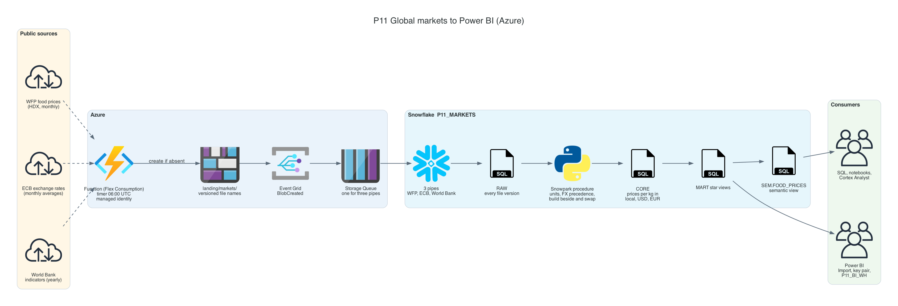
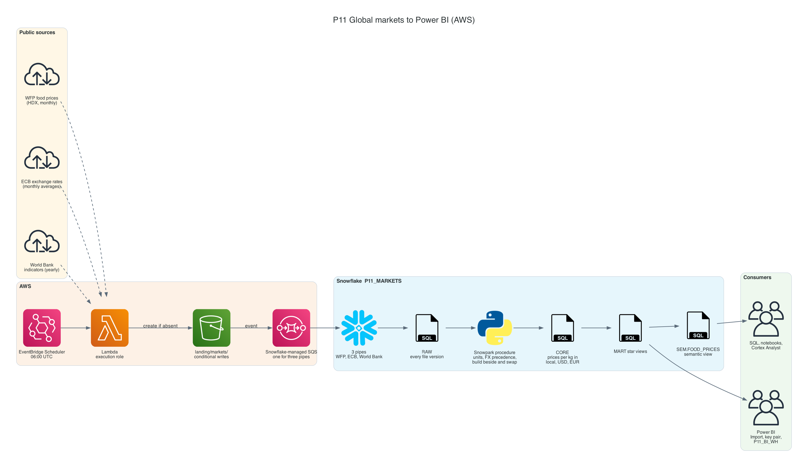
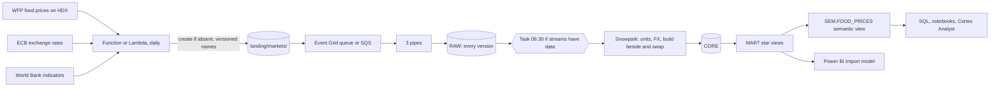

# P11 Global Markets to Power BI

Build a governed food price dataset for six countries and deliver it to Power BI. A serverless function (Azure Functions, or AWS Lambda in the variant) fetches WFP food prices, ECB exchange rates, and World Bank indicators once a day and lands only new versions. Snowpipe loads them, a Snowpark procedure normalizes units and currencies, a star of views and a Snowflake semantic view define the metrics, and a Power BI semantic model in Import mode reads them with a key-pair service user on its own warehouse.

The question the dashboard answers is concrete: what does a kilogram of rice or maize cost in Kenya, Nigeria, Ethiopia, Bangladesh, India, and Türkiye, in local currency, USD, and EUR, and did food get more expensive than everything else?

## Target Architecture

Own diagram, generated from [assets/architecture.py](assets/architecture.py). Icons: vendor architecture icon sets bundled with the <a href="https://diagrams.mingrammer.com">diagrams</a> library.

AWS variant

Own diagram, generated from [assets/architecture.py](assets/architecture.py).

Text version (Mermaid)

### Reference From the Source Article

Source: ProjectPro, <a href="https://www.projectpro.io/article/snowflake-projects/1168">13 End-to-End Snowflake Projects That Build Job-Ready Skills</a>. Linked for personal study, not copied into this repository.

The original ingests market data for 36 countries through Kinesis Data Streams, uses Firehose and Lambda to convert it to CSV in S3, loads it with Snowpipe, cleans it with Snowpark, and visualizes it in Power BI. P11 keeps the serverless function, Snowpipe, Snowpark, and Power BI. It drops the stream: these sources publish monthly and yearly, and a stream would add cost without adding freshness. What it adds:
- versioned landing, so a rerun lands nothing
- an explicit choice between two exchange-rate sources, with a reconciliation check
- unit normalization as reviewed code
- two semantic layers, Snowflake's and Power BI's, kept in agreement by a test

## Skills

| Skill | Milestone |
| --- | --- |
| Profiling three public sources: shape, cadence, versioning, rounding | M0 |
| Serverless ingestion with managed identity or an execution role, create-if-absent landing | M1 |
| Snowpipe with header-matched CSV loading and file metadata | M2 |
| Snowpark: pure transforms tested locally, procedure with imports, build beside and swap | M3 |
| FX precedence and reconciliation; unit normalization | M3 |
| Star schema views for BI; a semantic view with metrics | M4 |
| Power BI: Import model, key-pair service user, separate warehouse, DAX measures | M5 |
| Metric parity, refresh chain, BI cost evidence | M6 |

## Prerequisites

- P07 completed or read: Snowpark DataFrames, local testing, procedures from a zip
- P04 or P08 read: Snowpipe with Event Grid or SQS
- Snowflake CLI, Python 3.11+ with `snowflake-snowpark-python` and `pytest` ([setup guide](../../../../shared/environments/setup-guide/README.md))
- For the cloud path: Azure subscription and Azure CLI, or AWS account and AWS CLI. Without one, the ingestion runs on your laptop and loads through internal stages
- Power BI Desktop (Windows) or a Windows virtual machine; a free Power BI account is enough for Desktop ([account guide](../../../../shared/environments/setup-guide/accounts/microsoft_fabric_power_bi.md))
- [Cost guardrails](../_shared/cost_guardrails.md): two warehouses, one monitor; pipes and the function are billed outside the monitor

## Navigation

| Part | File |
| --- | --- |
| Quickstart: numbered commands from install to teardown | [QUICKSTART.md](QUICKSTART.md) |
| 1. Problem | [01_problem.md](01_problem.md) |
| 2. Architecture and decisions | [02_architecture_decisions.md](02_architecture_decisions.md) |
| 3. Snowflake approach | [03_snowflake_approach.md](03_snowflake_approach.md) |
| 4. Alternative stacks and roadmap | [04_alternative_stacks.md](04_alternative_stacks.md) |
| 5. Step by step on Snowflake | [05_snowflake_step_by_step.md](05_snowflake_step_by_step.md) |
| 6. Solved reference | [06_solution/README.md](06_solution/README.md) |
| 7. Build it yourself | [07_build_it_yourself.md](07_build_it_yourself.md) |

Recommended route: 1, 2, 3, 4, then **7** (build). Use 5 when stuck. Compare with 6 at the end.
