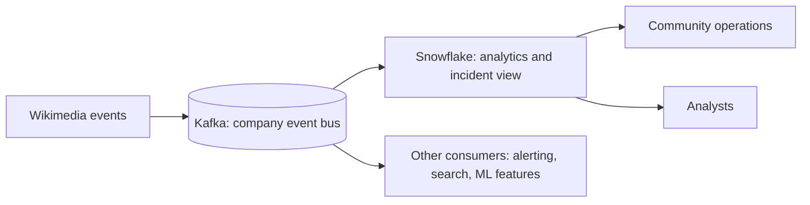

# 1. Problem

## Business Context

After P04 went live, the community-operations team used it daily, and two new needs appeared:

1. **Incident watching.** During an edit storm or a bot malfunction, a five-minute-old view is too slow; the team wants to see the last few minutes **within seconds**.
2. **Event backbone.** The platform team is standardizing on Kafka as the company event bus. Wikimedia events are now published to a Kafka topic, and several systems consume them. Snowflake should become one more consumer, not a separate pipeline with its own collector.

## Source Data

The Kafka topic `wiki.recentchange` carries the same JSON events as P04 (see [P04 problem](../P04_wikimedia_snowpipe_realtime_dwh/01_problem.md#source-data)).

| Property | Value |
| --- | --- |
| Topic | `wiki.recentchange`, 3 partitions, 7 days retention |
| Key | `wiki:title` (keeps per-page ordering) |
| Value | JSON event, unchanged from the source |
| Producer guarantees | `acks=all`, idempotent producer: no broker-retry duplicates |
| Remaining duplicates | Source replays after reconnect: same `meta.id`, new offset |

## Functional Requirements

1. Load every Kafka record into Snowflake without files or manual steps.
2. Keep each record's topic, partition, offset, and Kafka timestamp next to the value.
3. Route records that cannot be parsed to a dead letter queue without stopping the pipeline.
4. Provide the same deduplicated staging and minute mart as P04.
5. Provide a live view of the last five minutes that is seconds fresh.
6. Prove that no offset is loaded twice and no offset is lost.

## Non-Functional Requirements

| Requirement | Target | Measured by |
| --- | --- | --- |
| Raw freshness | p95 Kafka timestamp to connector push at most 30 s | `OPS.V_LATENCY_LAST_HOUR` |
| Live view freshness | Rows visible within 30 s of production | `MART.V_LIVE_LAST_5_MINUTES` while producing |
| Exactly-once per offset | 0 duplicate (partition, offset) pairs | `OPS.V_OFFSET_INTEGRITY` |
| Completeness | Missing offsets equal DLQ count | data quality check |
| Outage tolerance | Connector down for hours recovers without loss | drill D5 |
| Security | Dedicated service user, key-pair only, secrets outside configs and Git | review |
| Cost | Credits per running hour recorded, compared with P04 | cost queries |

## Success Metrics

- Measured p50 and p95 for event to Kafka, Kafka to connector, and event to staging
- Offset integrity table with zero duplicates after all drills
- A cost and latency comparison table: P04 vs P14 (and P15 later)

## Out of Scope

- Running Kafka in production (multi-broker, replication, security): module `05-confluent-kafka`
- Stream processing before Snowflake: P12 and module `13-flink`
- Schema Registry and Avro: stretch goal
