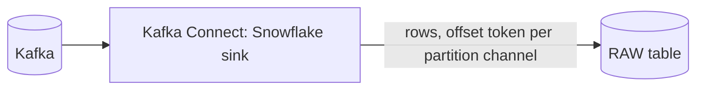
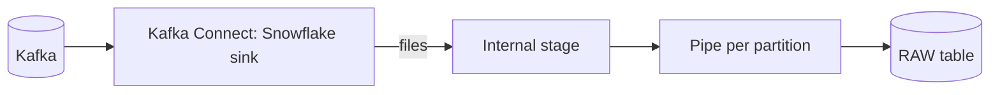
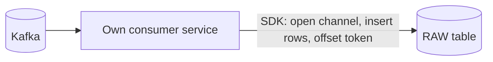
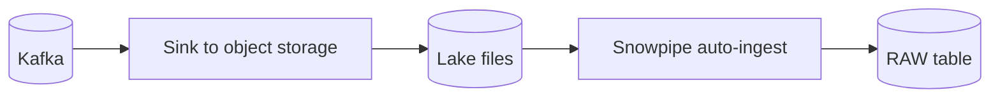
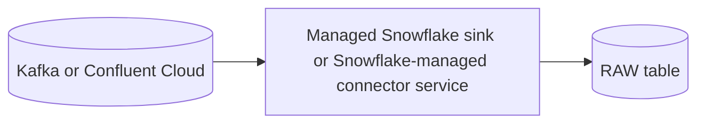
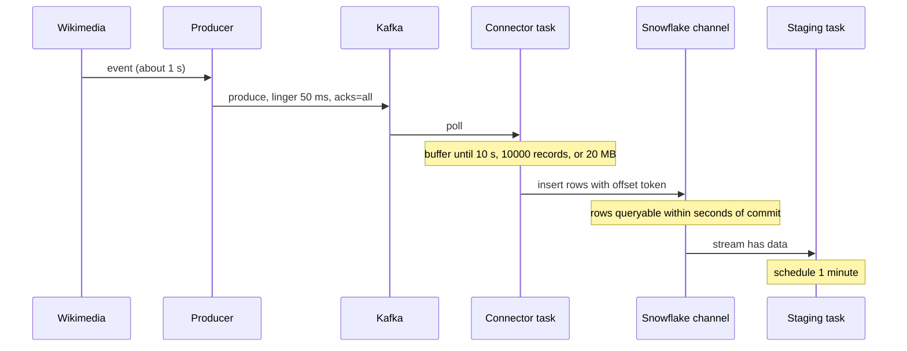
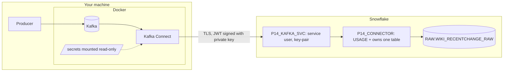

# 2. Architecture and Decisions

## Requirements That Drive the Design

| Driver | Consequence |
| --- | --- |
| Seconds-level freshness for the raw layer | No files in the path; row-based ingestion |
| Kafka is the event bus | Snowflake consumes the topic like any other consumer, with its own offsets |
| Exactly-once per offset | Offsets must be committed atomically with the rows |
| Poison messages must not stop ingestion | Error tolerance with a dead letter queue |
| Hours-long Snowflake outages must be survivable | Kafka retention is the buffer; the connector resumes from committed offsets |
| Fair comparison with P04 | Identical downstream: staging task, minute dynamic table, ops views |

## Options Considered

### Option 1: Kafka connector in Snowpipe Streaming mode (chosen)

### Option 2: Kafka connector in Snowpipe (file) mode

### Option 3: Custom consumer with the Snowpipe Streaming SDK

### Option 4: Kafka to lake, then Snowpipe (P15)

### Option 5: Managed connector service

## Trade-Offs

| Criterion | 1 Connector streaming | 2 Connector file mode | 3 Own consumer + SDK | 4 Lake then Snowpipe | 5 Managed connector |
| --- | --- | --- | --- | --- | --- |
| Raw freshness | Seconds | Minutes (file flush + pipe) | Seconds | Minutes | Seconds to minutes |
| Exactly-once per offset | Yes, offset tokens | Yes, through file names and load metadata | Yes, if you implement tokens correctly | Depends on sink file naming and dedup | Yes (connector semantics) |
| Copy outside Snowflake | No | Internal stage only, temporary | No | Yes, durable lake | No |
| Other engines can reuse data | Only through Kafka | Only through Kafka | Only through Kafka | Yes, from files | Only through Kafka |
| Operational components | Connect cluster | Connect cluster plus stages and pipes it creates | Your service, its deployment and monitoring | Sink, storage, events, pipe | Vendor-run |
| Custom logic before Snowflake | No (SMTs only) | No | Any | Any, in the sink | Limited |
| Cost shape | Streaming ingestion charges while clients run | Per-file Snowpipe charges | Streaming charges plus your compute | Storage, events, per-file Snowpipe | Vendor pricing plus Snowflake |
| Best when | Kafka exists, seconds matter, Snowflake is a consumer | Older setups; batch-sized loads | Non-Kafka sources or special routing | Lake-first platform, replay beyond retention | No team to run Connect |

## Why / Why Not

**Why the connector and not our own consumer?**
The connector already implements partition-to-channel mapping, offset tokens, retries, DLQ routing, and rebalances. Writing that yourself is a project of its own, and its bugs show up as duplicates or gaps. Choose your own consumer only when the source is not Kafka or when routing logic does not fit a sink connector.

**Why Snowpipe Streaming mode and not file mode?**
File mode writes files to an internal stage and loads them with pipes: minutes of latency and per-file costs. Streaming mode inserts rows directly with seconds of latency and no stage housekeeping. File mode remains documented for older setups.

**What does "exactly-once" really mean here?**
For each partition, the connector opens a channel. Rows and the last Kafka offset (the offset token) are committed together. After a crash, the connector asks Snowflake for the token and resumes after it. So each offset is loaded at most once and, as long as Kafka still has it, at least once. It does **not** remove duplicates that already exist in the topic, such as source replays at new offsets; staging still deduplicates on `meta.id`.

**Why schematization off?**
With schematization on, the connector creates and evolves typed columns from the record. That is convenient for stable schemas, but drift then changes table structure automatically. For a noisy public source, two `VARIANT` columns keep ingestion stable and move typing into staging, exactly like P04.

**Why pre-create the table instead of letting the connector create it?**
The stream in staging needs change tracking on the table, and only the owner can enable it. Creating the table as the connector role with `CHANGE_TRACKING = TRUE` solves that, and revoking `CREATE TABLE` afterwards means the connector can write to one table and nothing else.

**Why `errors.tolerance=all` with a DLQ?**
With the default (`none`), one bad record stops the task for its partition until someone intervenes; Kafka lag grows silently. With a DLQ, the bad record is preserved for analysis and costs one offset gap, which the integrity check accounts for.

**Why `wiki:title` as the key?**
Keys decide partitions. `wiki` alone would put most traffic for the busiest wikis on one partition. `wiki:title` keeps ordering per page (the only ordering anyone needs here) and spreads load. `meta.id` would spread perfectly but gives no useful ordering.

**Why still a one-minute task for staging if raw is seconds fresh?**
Fairness and cost. The comparison with P04 must change only one variable. And sub-minute staging means either a warehouse that never sleeps or triggered serverless tasks, which is a stretch goal. The live view over RAW covers the incident-watching need without paying for that.

**Is the live view over RAW a good idea?**
For a five-minute window, yes: it is a small scan and it is honest about not being deduplicated. For anything longer or more critical, use staging. The view's name and comment say which it is.

**What happens if Snowflake is unavailable for hours?**
Records wait in Kafka. The connector retries, tasks may fail, the alert fires. After recovery, the connector resumes from each channel's offset token. Data is lost only if the outage exceeds topic retention, which is why retention is a design parameter, not a default.

**When would P15 be better?**
When data must also exist as files for other engines, when replay beyond Kafka retention is required, or when the Snowflake ingestion path must be decoupled from Kafka availability. P15 trades seconds of latency for a durable lake copy.

## Architecture Decision Records

### ADR-001: Snowflake Kafka connector in Snowpipe Streaming mode

- **Context:** Kafka is the bus, raw freshness in seconds, exactly-once per offset.
- **Decision:** self-managed Kafka Connect with the Snowflake sink connector, `snowflake.ingestion.method=SNOWPIPE_STREAMING`, `tasks.max` equal to the partition count.
- **Consequences:** a Connect cluster to run and monitor; streaming ingestion charges while the connector is active; no stages or pipes to manage.
- **Rejected:** file mode (latency), own consumer (effort and risk), lake first (P15).

### ADR-002: Raw table owned by the connector role, pre-created with change tracking

- **Decision:** two `VARIANT` columns, `CHANGE_TRACKING = TRUE`, owned by `P14_CONNECTOR`; `CREATE TABLE` revoked after creation; owner role inherits read access through the role hierarchy.
- **Consequences:** streams work; the connector cannot create unexpected objects.

### ADR-003: Dedicated service user and secrets through a config provider

- **Decision:** `P14_KAFKA_SVC` with `TYPE = SERVICE`, key-pair only, role `P14_CONNECTOR`; the private key is read by Kafka Connect from a mounted file through `FileConfigProvider`.
- **Consequences:** no password to leak; the connector config can be shown and versioned without secrets; key rotation uses `RSA_PUBLIC_KEY_2`.

### ADR-004: Error tolerance with a dead letter queue

- **Decision:** `errors.tolerance=all`, DLQ topic with context headers, integrity check that subtracts DLQ count from missing offsets.
- **Consequences:** ingestion never blocks on one record; someone must watch the DLQ.

### ADR-005: Downstream identical to P04, plus a live view

- **Decision:** reuse P04's staging task, minute dynamic table, and ops pattern; add `MART.V_LIVE_LAST_5_MINUTES` over RAW.
- **Consequences:** comparable measurements; one explicitly non-deduplicated view.

## Latency Budget

| Hop | Expected | Controlled by |
| --- | --- | --- |
| Event to Kafka | about 1 s | Source, producer linger |
| Kafka to connector push | sub-second plus poll | Connect consumer |
| Connector buffer | up to `buffer.flush.time` (10 s) | Connector config |
| Commit to queryable | seconds | Snowflake |
| **Event to RAW p95 target** | **at most 30 s** | Sum of the above |
| RAW to staging | up to 60 s plus run | Task schedule |

## Failure Modes

| Failure | Detection | Impact | Recovery |
| --- | --- | --- | --- |
| Connect worker crash | Connector status, raw freshness alert | Lag grows | Restart; resume from offset tokens |
| Poison record | DLQ topic, missing offset in integrity view | One record not loaded | Inspect DLQ; fix producer; optionally replay corrected record |
| Snowflake auth failure | Task `FAILED` with auth error, alert | Lag grows | Fix key, restart connector |
| Snowflake outage | Same | Lag grows | Automatic catch-up after recovery |
| Outage longer than retention | Gap between channel token and earliest Kafka offset | Data loss | Raise retention, add lake copy (P15) |
| Source replay duplicates | Raw distinct `meta.id` lower than rows | None in staging | `MERGE` dedup |
| Hot partition | One partition's lag dominates | Latency for that partition | Key design, more partitions |
| Schema drift | Staging `NULL` counts | Typed column `NULL` | Update staging; reprocess from raw |

## Cost Model

| Component | Driver | Notes |
| --- | --- | --- |
| Snowpipe Streaming | Ingestion while the connector's clients are active, plus data volume | The billing model for streaming has changed over time; check the current credit consumption table and `METERING_HISTORY` |
| Staging task | Serverless compute per run | Same as P04 |
| Dynamic table, alert | Warehouse resumes | Same as P04 |
| Kafka and Connect | Local Docker: free; Confluent Cloud: per cluster-hour and connector-hour | Delete cloud clusters after labs |

Pause the connector when not measuring: an idle but running connector can still incur streaming client charges.

## Security and Trust Boundaries

- The private key exists in two places: your key file and the mounted secret. Neither is in Git or the connector config.
- The connector role can write to one table; it cannot read other data or create objects.
