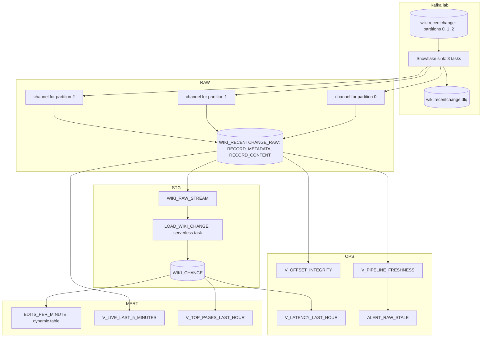
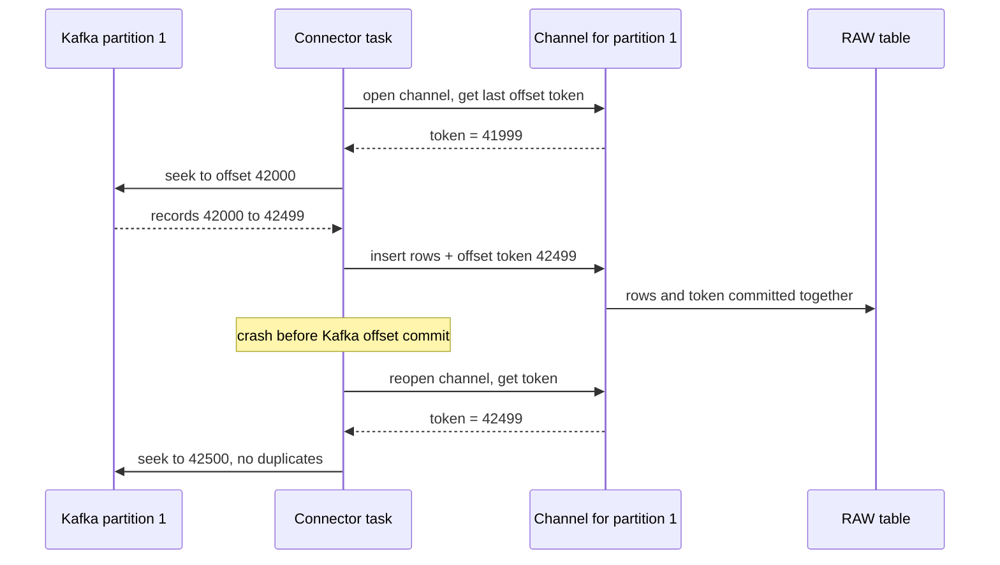
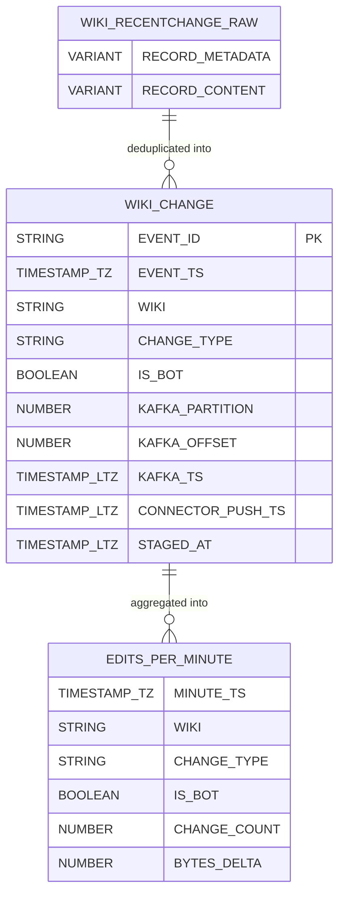

# 3. Snowflake Approach

## Layers and Objects

## Object Inventory

| Object | Type | Purpose |
| --- | --- | --- |
| `P14_OWNER`, `P14_CONNECTOR`, `P14_READER` | Roles | Administer; write raw only; consume |
| `P14_KAFKA_SVC` | Service user | Identity of Kafka Connect, key-pair only |
| `P14_TRANSFORM_WH`, `P14_BI_WH`, `P14_RM` | Warehouses, monitor | Same as P04; streaming ingestion needs no warehouse |
| `RAW.WIKI_RECENTCHANGE_RAW` | Table, owned by `P14_CONNECTOR`, change tracking on | Connector target |
| Channels | Snowpipe Streaming objects (`SHOW CHANNELS`) | One per topic partition, holds the offset token |
| `STG.WIKI_RAW_STREAM`, `STG.LOAD_WIKI_CHANGE`, `STG.WIKI_CHANGE` | Stream, serverless task, table | Deduplicated staging, as in P04 |
| `MART.EDITS_PER_MINUTE` | Dynamic table | Minute aggregates |
| `MART.V_LIVE_LAST_5_MINUTES` | View over RAW | Seconds-fresh, not deduplicated |
| `OPS.V_OFFSET_INTEGRITY` | View | Duplicate and missing offsets per partition |
| `OPS.V_LATENCY_LAST_HOUR`, `OPS.V_PIPELINE_FRESHNESS`, `OPS.ALERT_RAW_STALE` | Views, alert | Evidence and alerting |

## How Channels and Offset Tokens Give Exactly-Once

## Feature Choices

| Need | Chosen | Rejected here | Why |
| --- | --- | --- | --- |
| Row ingestion from Kafka | Kafka connector, Snowpipe Streaming | Snowpipe file mode | Seconds, no stage housekeeping |
| Raw structure | `RECORD_CONTENT`, `RECORD_METADATA` as `VARIANT` | Schematization | Drift stays in staging |
| Connector identity | `TYPE = SERVICE` user, key-pair | Personal user | Least privilege, no password, rotatable |
| Change capture for staging | Append-only stream on raw | Timestamp watermark on `CreateTime` | Exact, transactional consumption |
| Live view | View over RAW with time filter | Dynamic table with 1-minute lag | No warehouse kept awake; honest "not deduplicated" semantics |
| Exactly-once evidence | Offset integrity view | Trust | Measurable proof per partition |

## Data Model

`RECORD_METADATA` contains at least `topic`, `partition`, `offset`, `CreateTime` (Kafka timestamp in milliseconds), and `key`; recent connector versions add `SnowflakeConnectorPushTime`. Inspect a few rows to see what your version writes.

## What This Project Teaches About Snowflake

- Snowpipe Streaming is **row-based**: no files, no pipes, no stages; freshness in seconds.
- **Exactly-once is per offset**, built on channels and offset tokens; business deduplication is still yours.
- **Table ownership matters** for streaming targets and for streams on them.
- **Service users** are the right identity for integrations.
- The **cost profile shifts** from per-file to per-active-client and volume; measure it against P04.
