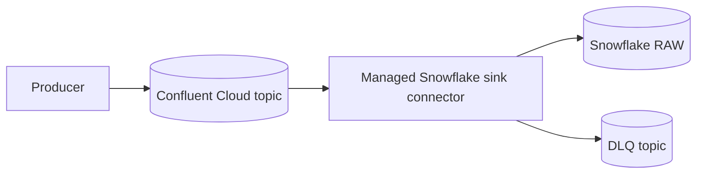
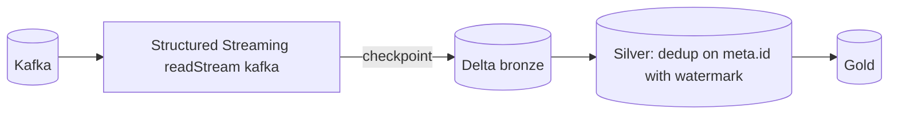
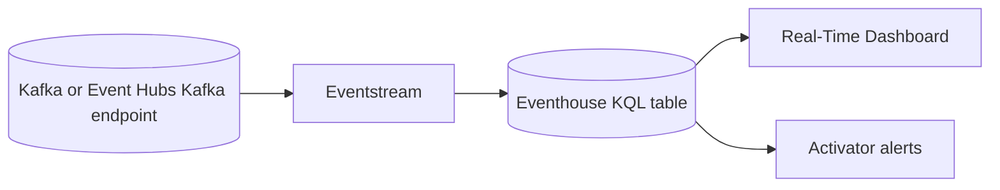
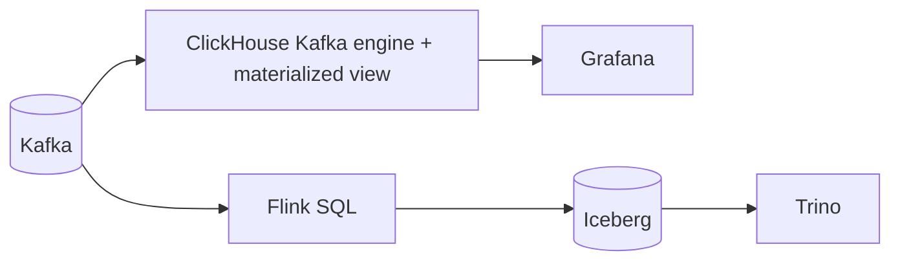
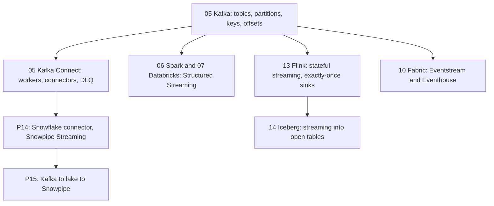

# 4. Alternative Stacks and Roadmap

The problem: a Kafka topic must reach an analytical store within seconds, exactly once per offset, with poison messages isolated and outages survivable.

## Component Mapping

| Concern | Snowflake (this project) | Databricks | Microsoft Fabric | BigQuery | Open source |
| --- | --- | --- | --- | --- | --- |
| Kafka consumer | Kafka Connect Snowflake sink | Structured Streaming Kafka source | Eventstream with Kafka source or Event Hubs Kafka endpoint | Kafka to BigQuery sink connector, or Pub/Sub bridge | Flink Kafka source, or ClickHouse Kafka engine |
| Delivery guarantee | Offset tokens in channels | Checkpoints plus idempotent Delta writes | Eventstream checkpoints | Connector or subscription semantics | Flink checkpoints with two-phase commit sinks |
| Raw storage | `VARIANT` table | Delta bronze | Eventhouse table | Table with `JSON` column | Iceberg table or ClickHouse table |
| Poison messages | DLQ topic | `badRecordsPath` or a quarantine table | Error routing in Eventstream | DLQ in connector | Side outputs to a DLQ topic |
| Live serving | View over raw | Databricks SQL on bronze or a streaming table | Real-Time Dashboard (KQL) | Materialized view | ClickHouse plus Grafana |

## Confluent Cloud Managed Connector

- Same connector logic, no Connect cluster to run.
- Wins when the organization already uses Confluent Cloud.
- Watch: connector-hour pricing, networking between Confluent and Snowflake regions, secrets entered into the managed connector.

## Snowflake-Managed Connectors

Snowflake also offers managed data-movement services that can read from Kafka and other sources. Availability, pricing, and feature coverage vary by region and release; evaluate them against this design (offset semantics, DLQ, ownership, cost) before choosing.

## Databricks Structured Streaming

- Exactly-once comes from the checkpoint plus Delta's transactional writes.
- Wins when transformations or ML must run in-stream before storage.
- Costs: always-on streaming compute, or triggered micro-batches.

## Fabric Real-Time Intelligence

- Seconds-level dashboards and alerts are built in.
- Wins for operations teams in a Microsoft-centric organization.

## Open Source: Kafka to ClickHouse or Flink to Iceberg

- ClickHouse: very low latency for real-time analytics, simple ingestion.
- Flink and Iceberg: full control of state and exactly-once, highest operational effort.

## When Each Alternative Wins

| Situation | Better choice |
| --- | --- |
| Kafka exists, seconds matter, Snowflake is the warehouse | This project |
| You run Confluent Cloud and want no Connect cluster | Managed Snowflake sink |
| Data must also land as files for other engines, or replay beyond retention | P15 |
| Transformations or enrichment must happen before storage | Databricks or Flink |
| Operational real-time dashboards are the main goal | Fabric Real-Time Intelligence or ClickHouse |

## Learning Roadmap

| Step | Module | Focus for this problem |
| --- | --- | --- |
| Kafka basics | [05-confluent-kafka](../../../../05-confluent-kafka/README.md) | Partitions, keys, consumer groups, retention, Connect |
| Structured Streaming | [06-spark-pyspark](../../../../06-spark-pyspark/README.md), [07-databricks](../../../../07-databricks/README.md) | Checkpoints, watermarks, Delta sinks |
| Stream processing | [13-flink](../../../../13-flink/README.md) | Exactly-once sinks, state, DLQ side outputs |
| Open tables | [14-iceberg](../../../../14-iceberg/README.md) | Streaming writes, compaction |
| Microsoft real-time | [10-powerbi-fabric](../../../../10-powerbi-fabric/README.md) | Eventstream, Eventhouse, Activator |

### Suggested Exercise

Design the same pipeline on Databricks Structured Streaming: where does exactly-once come from, what replaces the DLQ, and what does always-on streaming compute cost compared with your measured P14 credits?
