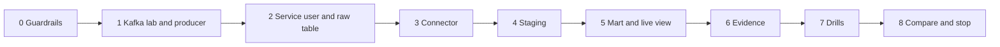

# 5. Step by Step on Snowflake

Every step: **what**, **why**, **verify**, **common errors**. Scripts are in [06_solution](06_solution/README.md); write your own first, compare after.



---

## Phase 0: Guardrails

- **What:** Snowflake trial and Snowflake CLI connection `p14` for your own user ([setup guide](../../../../shared/environments/setup-guide/02_cli_tools_and_auth.md#snowflake-cli)); Docker with at least 6 GB memory.
- **Why:** the connector, Kafka, and Kafka UI together need memory; Snowflake work runs from scripts.
- **Verify:** `snow sql -c p14 -q "SELECT CURRENT_USER()"`, `docker info --format '{{.MemTotal}}'`.

---

## Phase 1: Kafka Lab and Producer

### 1.1 Start the lab

- **What:** follow [Kafka lab: Start](../_shared/kafka_lab/README.md#start): `.env` with the connector version, `docker compose up -d --build`, create `wiki.recentchange` (3 partitions) and `wiki.recentchange.dlq`.
- **Why:** auto topic creation is off, so partition count and DLQ are deliberate decisions.
- **Verify:** `curl -s localhost:8083/connector-plugins | jq -r '.[].class' | grep -i snowflake`.
- **Common errors:** empty `SNOWFLAKE_CONNECTOR_VERSION` makes the image build fail.

### 1.2 Produce synthetic events

- **What:** `python wiki_to_kafka.py --source synthetic --rate 20 --duration-minutes 2`.
- **Why:** proves topic, keys, and producer settings before Snowflake is involved.
- **Verify:** `kcat -b localhost:9092 -t wiki.recentchange -C -c 5 -f 'p%p o%o k=%k\n'` shows all three partitions over time; Kafka UI shows messages.

---

## Phase 2: Service User and Raw Table

### 2.1 Key pair for the service user

```bash
cd ~/.snowflake/keys
openssl genrsa 2048 | openssl pkcs8 -topk8 -inform PEM -out p14_kafka_svc.p8 -nocrypt
openssl rsa -in p14_kafka_svc.p8 -pubout -out p14_kafka_svc.pub
chmod 600 p14_kafka_svc.p8
```

- **Why:** the connector gets its own key, separate from yours; revoking it never locks you out.

### 2.2 Account setup and raw table

- **What:** `./run_sql.sh core/00_account_setup.sql core/01_schemas_and_raw.sql`.
- **Why:**
  - `TYPE = SERVICE` users cannot log in interactively and have no password.
  - The raw table is created **by the connector role**, so the connector owns it, with `CHANGE_TRACKING = TRUE` so staging can stream from it.
  - `CREATE TABLE` is revoked right after: the connector can write into one table only.
- **Verify:**

  ```sql
  DESC USER P14_KAFKA_SVC;                           -- RSA_PUBLIC_KEY_FP set, TYPE SERVICE
  SHOW TABLES IN SCHEMA P14_WIKI_STREAM.RAW;         -- owner P14_CONNECTOR, change_tracking ON
  SHOW GRANTS TO ROLE P14_CONNECTOR;                 -- USAGE on db and schema, OWNERSHIP on one table
  ```

---

## Phase 3: Connector

### 3.1 Read the connector config

Open [connect/p14-snowflake-sink.json](06_solution/connect/p14-snowflake-sink.json) and explain each group to yourself:

| Group | Keys | Meaning |
| --- | --- | --- |
| Routing | `topics`, `snowflake.topic2table.map` | Which topic goes to which table |
| Mode | `snowflake.ingestion.method`, `snowflake.enable.schematization` | Streaming, two `VARIANT` columns |
| Identity | `snowflake.url.name`, `user.name`, `private.key`, `role.name` | Resolved from `${file:...}` at runtime |
| Buffering | `buffer.flush.time`, `buffer.count.records`, `buffer.size.bytes` | Whichever limit is hit first triggers an insert |
| Conversion | `key.converter`, `value.converter` | String keys, schemaless JSON values |
| Errors | `errors.tolerance`, `errors.deadletterqueue.*` | Bad records go to the DLQ with context headers |
| Parallelism | `tasks.max` | One task per partition |

### 3.2 Apply

- **What:** `./connect/connector.sh apply`.
- **Why:** the script writes the secret file into the lab's `secrets/` folder (ignored by Git) and creates or updates the connector through the Connect REST API.
- **Verify:**

  ```bash
  ./connect/connector.sh status                 # connector and 3 tasks RUNNING
  ```

  ```sql
  SHOW CHANNELS IN TABLE P14_WIKI_STREAM.RAW.WIKI_RECENTCHANGE_RAW;
  SELECT COUNT(*) FROM P14_WIKI_STREAM.RAW.WIKI_RECENTCHANGE_RAW;
  ```

- **Common errors:**
  - `JWT token is invalid`: public key on the user does not match the private key file, or the account identifier in `p14.env` is wrong.
  - `Object does not exist or not authorized`: table name casing in `topic2table.map`, or role missing `USAGE`.
  - Task `FAILED` reading `/secrets/...`: file permissions on Linux hosts (see the comment in `connector.sh`).

### 3.3 Prove seconds-level ingestion

- **What:** run the producer for one minute; query the newest rows repeatedly.

  ```sql
  SELECT MAX(TO_TIMESTAMP_LTZ(RECORD_METADATA:CreateTime::NUMBER, 3)) AS NEWEST_KAFKA_TS,
         CURRENT_TIMESTAMP() AS NOW
  FROM P14_WIKI_STREAM.RAW.WIKI_RECENTCHANGE_RAW;
  ```

- **Verify:** the gap between `NEWEST_KAFKA_TS` and `NOW` stays within about `buffer.flush.time` plus a few seconds while producing.

---

## Phase 4: Staging

- **What:** `./run_sql.sh core/20_staging.sql`.
- **Why:** same stream, serverless task, and `MERGE` as P04, reading `RECORD_CONTENT` and keeping partition, offset, and Kafka timestamps for evidence.
- **Verify:** `SELECT COUNT(*), COUNT(DISTINCT EVENT_ID) FROM STG.WIKI_CHANGE;` equal counts.
- **Common errors:** stream creation fails with change tracking errors: the raw table was created by another role or without `CHANGE_TRACKING = TRUE`.

---

## Phase 5: Mart and Live View

- **What:** `./run_sql.sh core/30_mart.sql`; build a dashboard from the tiles in `core/50_dashboard_and_ops_queries.sql` as `P14_READER`.
- **Why:** the minute mart is identical to P04 for comparison; the live view shows what seconds-fresh raw data enables.
- **Verify:** the live tile changes between refreshes while the producer runs.

---

## Phase 6: Evidence

- **What:** `./run_sql.sh core/40_ops.sql`.
- **Verify:**

  ```sql
  SELECT * FROM OPS.V_OFFSET_INTEGRITY;     -- DUPLICATE_OFFSETS = 0
  SELECT * FROM OPS.V_LATENCY_LAST_HOUR;
  SELECT * FROM OPS.V_PIPELINE_FRESHNESS;
  ```

- **Consumer lag** from Kafka's point of view:

  ```bash
  docker compose exec kafka /opt/kafka/bin/kafka-consumer-groups.sh --bootstrap-server kafka:19092 \
    --describe --group connect-p14_wiki_snowflake_sink
  ```

- Stop the producer, wait one task run, then `./run_sql.sh tests/data_quality_checks.sql`: all `PASS`.

---

## Phase 7: Drills

Work through [tests/failure_drills.md](06_solution/tests/failure_drills.md): restart, poison message, drift, duplicate event, broken auth, rebalance, burst.

---

## Phase 8: Compare and Stop

### 8.1 Compare with P04

| Metric | P04 (files + Snowpipe) | P14 (connector streaming) |
| --- | --- | --- |
| p95 event to raw | | |
| p95 event to staging | | |
| Credits per running hour (ingestion) | | |
| Credits per running hour (total) | | |
| Components you operate | | |
| Recovery after a 1-hour outage | | |

### 8.2 Stop

```bash
./connect/connector.sh pause
./run_sql.sh core/90_pause.sql
# in _shared/kafka_lab: docker compose stop
```

End of project: `./connect/connector.sh delete`, `./run_sql.sh teardown.sql`, `docker compose down`, delete `secrets/p14-snowflake.properties`.
